

# الدليل المرجعي الشامل لنظام ECert

## The Ultimate Comprehensive Manual

---

## جدول المحتويات

| # | الفصل | المحتوى |
|---|-------|---------|
| 0 | **الأساس المعماري** | نظرة عامة، نموذج الأدوار والصلاحيات (RBAC)، نطاق الدورات، خريطة المسارات الكاملة |
| 1 | **المصادقة والدخول** | تسجيل الدخول، المصادقة الثنائية (2FA)، تغيير كلمة المرور، تسجيل الخروج |
| 2 | **الموقع العام** | الرئيسية، من نحن، اتصل بنا، الدورات العامة، الأخبار، التسجيل العام، التحقق من الشهادة، التحقق من السند |
| 3 | **لوحة التحكم** | لوحة المؤشرات الموحّدة والإجراءات السريعة |
| 4 | **إدارة التدريب** | التسجيلات، الدورات، الفئات، المدربون، الشهادات، تصاميم الشهادات، استيراد الشهادات القديمة |
| 5 | **الإدارة المالية** | لوحة المؤشرات المالية، الفواتير، الدفعات، الأقساط، عهدة الموظف، المتأخرات، الاستردادات، المصروفات، الصندوق، التقارير، سجل التدقيق المالي، إعدادات النظام المالية |
| 6 | **المحتوى الإعلامي** | المنشورات، الأخبار، إدارة الصفحة الرئيسية |
| 7 | **إدارة النظام** | المستخدمون، الأدوار والصلاحيات، سجل العمليات، الأمان والنسخ الاحتياطي، البيانات الجامعية، مفاتيح الهواتف |
| 8 | **واجهات برمجية (API)** | نقاط النهاية REST وبنيتها |
| 9 | **السيناريوهات التشغيلية** | ثمانية مسارات عمل كاملة خطوة بخطوة |
| 10 | **الملاحق** | جدول الصلاحيات، جدول المسارات الكامل، حالات النظام، رسائل الأخطاء الشائعة |

- **الفصل 11 — دليل اللقطات الفعلية للنظام**
---

## الفصل 0 — الأساس المعماري

### 0.1 نظرة عامة

نظام **ECert** هو منصة متكاملة لإدارة مراكز التدريب، مبنية على:

| الطبقة | التقنية |
|--------|---------|
| إطار العمل | ASP.NET Core MVC (.NET 10) |
| قاعدة البيانات | MySQL / MariaDB عبر Pomelo.EntityFrameworkCore.MySql |
| المصادقة | مصادقة كوكيز (Cookie Authentication) + BCrypt لكلمات المرور |
| الواجهة | Razor Views، Bootstrap 5 RTL، Bootstrap Icons، دعم كامل للعربية (RTL) |
| الحماية | CSP، HSTS، X-Frame-Options، تحديد المعدل (Rate Limiting)، سلسلة توقيعات SHA-256 |
| خلفية | خدمة خلفية للنسخ الاحتياطي المشفّر (BackgroundService) |
| النشر | Docker / Railway (تطبيق)، قاعدة بيانات MySQL مُدارة |

**الفكرة المحورية للنظام:** كل الأموال في النظام مُشتقّة من **دفاتر (Ledgers) قابلة للتتبع** وليس من
أرصدة مخزّنة قابلة للتغيير. لا يوجد "رصيد صندوق" حقل واحد يُعدّل، بل يُحسب في وقت الاستعلام من مجموع
الحركات. هذا التصميم يجعل النظام **قابلاً للتوفيق (Reconcilable)** ومقاوماً للتلاعب.

### 0.2 نموذج الأدوار والصلاحيات (RBAC)

يعتمد النظام على نموذج **صلاحيات دقيقة (Fine-grained Permissions)** لا على أدوار ثابتة. يوجد **دور واحد
مدمج فقط** هو `SuperAdmin`، وكل ما عداه أدوار مخصصة ينشئها مدير النظام.

#### 0.2.1 المكوّنات الأربعة

| المكوّن | الوصف |
|---------|-------|
| **الدور (Role)** | حاوية صلاحيات. إما `SuperAdmin` (محمي، يملك كل شيء) أو دور مخصص (`IsSystem = false`). |
| **الصلاحية (Permission)** | وحدة إذن واحدة (مثل `manage-payments`). تُمنح للدور، وتُحمَّل في كوكيز المستخدم كـ Claim من نوع `Permission`. |
| **قسم (Section)** | وحدة تحكم (Controller) واحدة تُفتح بواسطة صلاحية أو أكثر عبر خريطة `AdminPermissions.SectionAccess`. |
| **النطاق (Course Scope)** | تقييد المستخدم بدورات/فئات محددة، يُحمَّل كـ Claims (`CourseScope`) عند تسجيل الدخول. |

#### 0.2.2 فئات الصلاحيات الثلاث

1. **صلاحيات قابلة للمنح** — يمكن منحها لأي دور مخصص (كل الصلاحيات عدا ما يلي).
2. **صلاحيات حصرية لمدير النظام (SuperAdminOnly)** — لا تُمنح لأي دور مخصص لأنها تتحكم بمن يملك الصلاحيات:
   - `manage-roles` (إدارة الأدوار)
   - `manage-finance-settings` (إعدادات النظام المالية — تشمل إقفال الفترة)
   - `manage-security-settings` (إعدادات الأمان والنسخ الاحتياطي)
3. **أقسام محظورة على غير مدير النظام** — الصندوق الرئيسي (`Cashbox`) غائب عمداً عن خريطة `SectionAccess`
   ولا تفتحه أي صلاحية؛ فهو متاح لمدير النظام حصراً.

> ⚠️ **قاعدة معمارية:** أي Controller بلا مدخل في `SectionAccess` يُعتبر **SuperAdmin-only** تلقائياً، فلا
> تصبح صفحة جديدة عامة بالخطأ.

#### 0.2.3 قوالب الأدوار الجاهزة (Presets)

لتسريع إنشاء الأدوار، يوفّر النظام قوالب جاهزة تُملأ بضغطة واحدة ثم تُعدّل:

| القالب | الاسم | الصلاحيات الممنوحة |
|--------|-------|--------------------|
| `finance` | محاسب | manage-finance، view-invoices، manage-payments، view-reports، view-custody، manage-refunds، view-receivables، view-financial-audit، manage-expenses، manage-installments، view-finance-dashboard |
| `collections` | محصّل رسوم | view-invoices، manage-payments، view-custody |
| `registrations` | مشرف التسجيلات | manage-registrations |
| `trainer` | مشرف تدريب | manage-registrations، manage-courses، manage-instructors، manage-categories |
| `certificates` | مسؤول الشهادات | issue-certificates، manage-certificate-designs |
| `content` | محرر المحتوى | manage-posts، manage-news، manage-homepage |
| `auditor` | مدقق أمني | view-security-audit، view-audit-log، view-reports، view-financial-audit، view-finance-dashboard |

> **الأدوار والصلاحيات — `/Roles`**
>
> 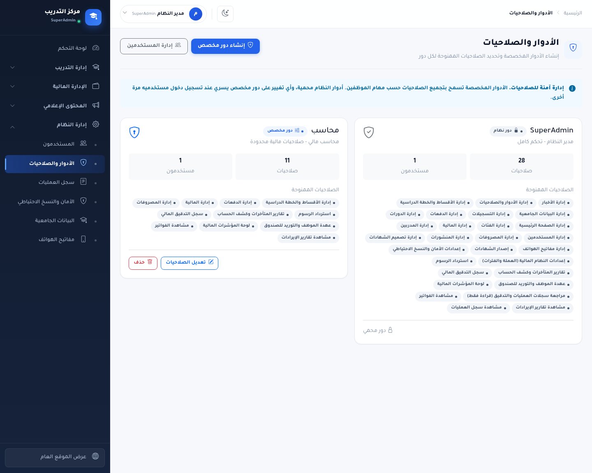

### 0.3 نطاق الدورات (Course Scope)

تقييد المستخدم بدورات محددة هو آلية **العزل بين الفروع/المشرفين**:

- **مستخدم غير مقيّد (Unrestricted):** بلا أي إسناد دورات ⇒ يرى **كل** الدورات. هذا حال مدير النظام، أو
  أي دور غير مرتبط بدورة.
- **مستخدم مقيّد (Restricted):** لديه إسنادات (دورات مباشرة و/أو فئات) ⇒ يرى **فقط** دورات نطاقه، ويُرفض
  وصوله لأي شيء خارجها في القوائم وفي صفحات التفاصيل والإجراءات.

**نقاط دقيقة موثّقة من الكود:**

- إسناد **فئة** يمنح كل دوراتها **الحالية والمستقبلية** (تُحسب عند تسجيل الدخول).
- مستخدم مُنح فئةً فارغة حالياً يحمل Claim علامة التقييد `CourseScopeRestricted` كي لا يُقرأ خطأً كـ
  "غير مقيّد" (منع توسيع الصلاحيات).
- عند إنشاء مستخدم بواسطة **غير مدير النظام**، يرث المُنشئ نطاق المُنشِئ تلقائياً، فلا يمكن لمدير فرعي أن
  يمنح حساباً جديداً صلاحية أوسع من صلاحياته.
- **مدير النظام فقط** يمكنه تعديل النطاق، ولا يمكن تعديله لحساب مدير النظام نفسه.

> **المستخدمون — `/Users`**
>
> 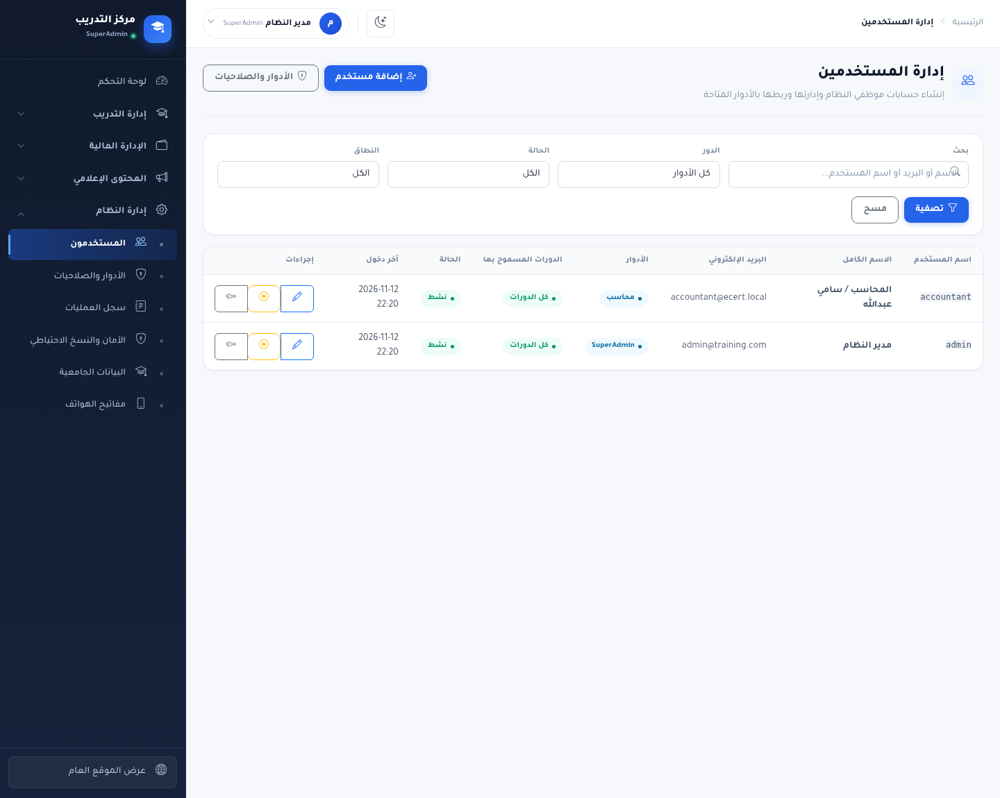

### 0.4 خريطة المسارات الكاملة (Sidebar)

القائمة الجانبية في لوحة الإدارة تُبنى **بيانياً (data-driven)** وتُفلتر تلقائياً حسب صلاحيات المستخدم.
تظهر المجموعة فقط إن كان لدى المستخدم صلاحية واحدة على الأقل من صلاحيات عناصرها.

| المجموعة | العنصر | Controller | الصلاحية الفاتحة |
|----------|--------|------------|------------------|
| **إدارة التدريب** | التسجيلات | Registrations | manage-registrations |
| | الدورات | CoursesManage | manage-courses |
| | الفئات | CategoriesManage | manage-categories |
| | المدربون | Instructors | manage-instructors |
| | الشهادات | Certificates | issue-certificates |
| | تصاميم الشهادات | CertificateDesigns | manage-certificate-designs |
| **الإدارة المالية** | لوحة المؤشرات المالية | Finance | view-finance-dashboard |
| | الفواتير | Invoices | view-invoices أو manage-finance |
| | الدفعات | Payments | manage-payments |
| | الأقساط والخطط | Installments | manage-installments |
| | عهدة الموظف والتوريد | Custody | view-custody |
| | المتأخرات | Receivables | view-receivables |
| | استرداد الرسوم | Refunds | manage-refunds |
| | المصروفات | Expenses | manage-expenses |
| | الصندوق | Cashbox | **SuperAdmin فقط** |
| | تقارير الإيرادات | Reports | view-reports |
| | سجل التدقيق المالي | FinancialAudit | view-financial-audit |
| | إعدادات النظام المالية | FinanceSettings | manage-finance-settings |
| **المحتوى الإعلامي** | المنشورات | PostsManage | manage-posts |
| | الأخبار | NewsManage | manage-news |
| | الصفحة الرئيسية | HomepageManage | manage-homepage |
| **إدارة النظام** | المستخدمون | Users | manage-users |
| | الأدوار والصلاحيات | Roles | manage-roles |
| | سجل العمليات | AuditLog | view-audit-log أو view-security-audit |
| | الأمان والنسخ الاحتياطي | SecuritySettings | manage-security-settings |
| | البيانات الجامعية | AcademicCatalog | manage-academic-catalog |
| | مفاتيح الهواتف | PhoneCountries | manage-phone-countries |

#### المسارات المخفية (ليست في القائمة لكنها موجودة)

| المسار | الوصف | الصلاحية |
|--------|-------|----------|
| `/CertificatesImport/Import` | استيراد شهادات قديمة | issue-certificates |
| `/CoursesManage/Import` | استيراد دورات من Excel | manage-courses |
| `/Registrations/Import` | استيراد متدربين من Excel | manage-registrations |
| `/Expenses/Categories` | بنود المصروفات | manage-expenses |
| `/Installments/Late` | الأقساط المتأخرة | manage-installments |
| `/Reports/CashFlow` | التدفق النقدي | view-reports |
| `/Reports/IncomeStatement` | قائمة الدخل | view-reports |
| `/Reports/Aging` | أعمار المتأخرات | view-receivables |
| `/Reports/Reconciliation` | المطابقة النقدية | view-financial-audit |
| `/Receivables/Statement` | كشف حساب متدرب | view-receivables |
| `/Payments/Receipt` | سند قبض للطباعة | manage-payments |
| `/Refunds/Receipt` | سند استرداد للطباعة | manage-refunds |
| `/Installments/Print` | جدول أقساط للطباعة | manage-installments |
| `/SecuritySettings/VerifyIntegrity` | فحص سلامة سلسلة التدقيق | manage-security-settings |
| `/r/{publicId}` | التحقق العام من سند | عام (مجهول) |
| `/v/{publicId}` | التحقق العام من شهادة | عام (مجهول) |
| `/health` | فحص صحة النظام | عام |

### 0.5 المستخدم الافتراضي (Bootstrap)

عند أول تشغيل تُنشأ قاعدة البيانات مع:
- دور واحد: `SuperAdmin` (يملك كل الصلاحيات).
- مستخدم واحد: `admin` (الاسم الكامل: «مدير النظام»، البريد: `admin@training.com`)، وبكلمة مرور مؤقتة
  **يجب تغييرها عند أول دخول** (`MustChangePassword = true`).

> **صفحة تسجيل الدخول إلى لوحة الإدارة — `/Auth/Login`**
>
> 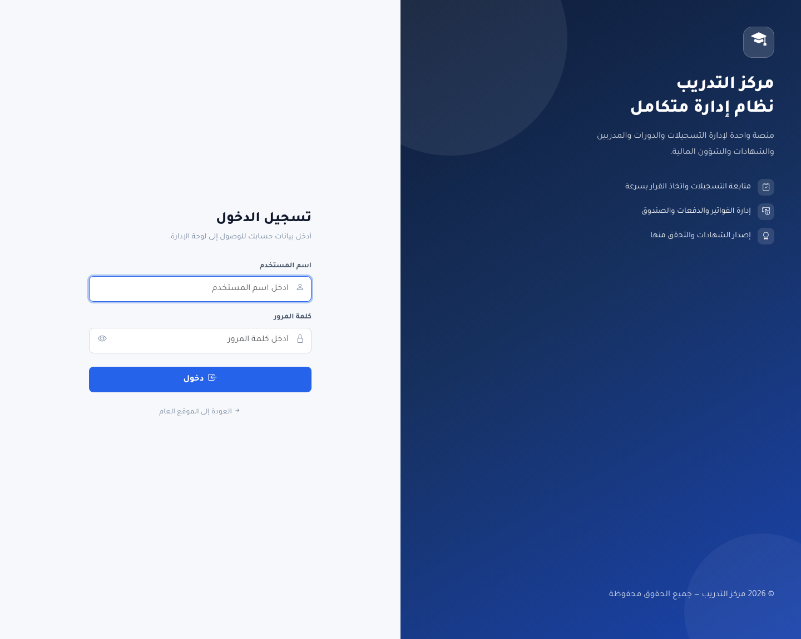

---

## الفصل 1 — المصادقة والدخول

### 1.1 صفحة تسجيل الدخول — `/Auth/Login`

**الغرض:** نقطة الدخول الوحيدة للنظام (لوحة الإدارة والموقع العام يعملان بجلسة واحدة).

**الصلاحيات:** عامة (مجهولة). محمية بتحديد معدل `admin-login` (10 محاولات/دقيقة لكل عنوان).

**التخطيط:** صفحة بعمودين — لوحة علامة تجارية (يسار، بتدرّج أزرق داكن) ونموذج الدخول (يمين). على الشاشات
الصغيرة تختفي لوحة العلامة التجارية.

#### الحقول والأزرار

| العنصر | النوع | الوصف | التحقق |
|--------|------|-------|--------|
| **اسم المستخدم** | input (text) | اسم المستخدم للحساب | مطلوب |
| **كلمة المرور** | input (password) | كلمة مرور الحساب | مطلوب |
| زر إظهار كلمة المرور (أيقونة العين) | button | يبدّل بين إظهار/إخفاء كلمة المرور | — |
| **دخول** | زر إرسال | يرسل النموذج إلى `POST /Auth/Login` | — |
| رابط «العودة إلى الموقع العام» | رابط | يعيد إلى `/Home/Index` | — |

#### منطق الدخول (Step-by-step على الخادم)

1. **فحص الحظر المسبق:** إن كان الحساب أو العنوان محظوراً من محاولات فاشلة سابقة، يُرفض الطلب فوراً قبل
   فحص كلمة المرور، مع رسالة «تم حظر المحاولات مؤقتاً…».
2. **البحث عن المستخدم:** `Username` مطابق و `IsActive = true`.
3. **فحص كلمة المرور:** مقارنة BCrypt.
4. **عند الفشل:** يُسجَّل فشل ضد الحساب والعنوان؛ وعند بلوغ الحد يُرسَل تنبيه تلقائي لقناة تليجرام.
5. **عند النجاح:** إن كان `MustChangePassword = true` يُوجَّه لتغيير كلمة المرور إجبارياً.
6. **فحص 2FA:** إن كانت مفعّلة والحساب مرتبط بتليجرام، يُولَّد رمز OTP ويُرسَل، ويُوجَّه المستخدم لصفحة
   التحقق بخطوتين.
7. **إصدار الكوكيز:** يُنشأ الكوكيز مع كل Claims الأدوار والصلاحيات ونطاق الدورات.
8. **التوجيه النهائي:** لصاحب صلاحيات إدارية ⇒ لوحة التحكم؛ لغيره ⇒ الموقع العام.

> **صفحة تسجيل الدخول إلى لوحة الإدارة — `/Auth/Login`**
>
> 

### 1.2 التحقق بخطوتين — `/Auth/VerifyTwoFactor`

**الغرض:** خطوة ثانية بعد كلمة المرور عند تفعيل المصادقة الثنائية وحين يكون الحساب مرتبطاً بتليجرام.

**الصلاحيات:** تُتاح فقط لمن لديه كوكيز `ecert_2fa` صالح (دائم بعد خطوة كلمة المرور). محمية بتحديد
معدل `admin-login`.

#### الحقول والأزرار

| العنصر | النوع | الوصف |
|--------|------|-------|
| **الرمز** (Code) | input (text) | رمز OTP من 6 أرقام أُرسل إلى تليجرام |
| **تأكيد الدخول** | زر إرسال | يتحقق من الرمز ويُصدر الجلسة |

**تفاصيل أمنية موثّقة:**
- الرمز صالح **5 دقائق** فقط، ويُستهلك عند أول استخدام ناجح.
- يُقبل الرمز خلال **5 محاولات** كحد أقصى، ثم يُبطَل الرمز.
- الحالة مُخزّنة في كوكيز مُشفّر بـ Data Protection (`ecert_2fa`) وليس في الجلسة على الخادم.

> **صفحة التحقق بخطوتين — حقل الرمز — `/Auth/Login`**
>
> 

### 1.3 تغيير كلمة المرور — `/Auth/ChangePassword`

**الغرض:** تغيير كلمة مرور المستخدم الحالي؛ ويُفرض إجبارياً عند أول دخول أو بعد إعادة تعيين إدارية.

**الصلاحيات:** مصادَق (Authorize). إلزامية إن وُجد Claim `MustChangePassword`.

#### الحقول والأزرار

| العنصر | النوع | الوصف | التحقق |
|--------|------|-------|--------|
| **كلمة المرور الحالية** | password | كلمة المرور الحالية | مطلوبة + مطابقة |
| **كلمة المرور الجديدة** | password | الكلمة الجديدة | وفق سياسة كلمة المرور |
| **تأكيد كلمة المرور** | password | تأكيد الكلمة الجديدة | مطابقة |
| **حفظ كلمة المرور** | زر | يحدّث الكلمة ويعيد إصدار الكوكيز | — |

> **ملاحظة تشغيلية:** بعد الحفظ الناجح يُسجَّل المستخدم خروجاً إجبارياً ويعاد إلى صفحة الدخول لتسجيل
> الدخول بالكلمة الجديدة (هذا مقصود لإسقاط Claim التغيير الإجباري).

> **تغيير كلمة المرور — `/Auth/ChangePassword`**
>
> 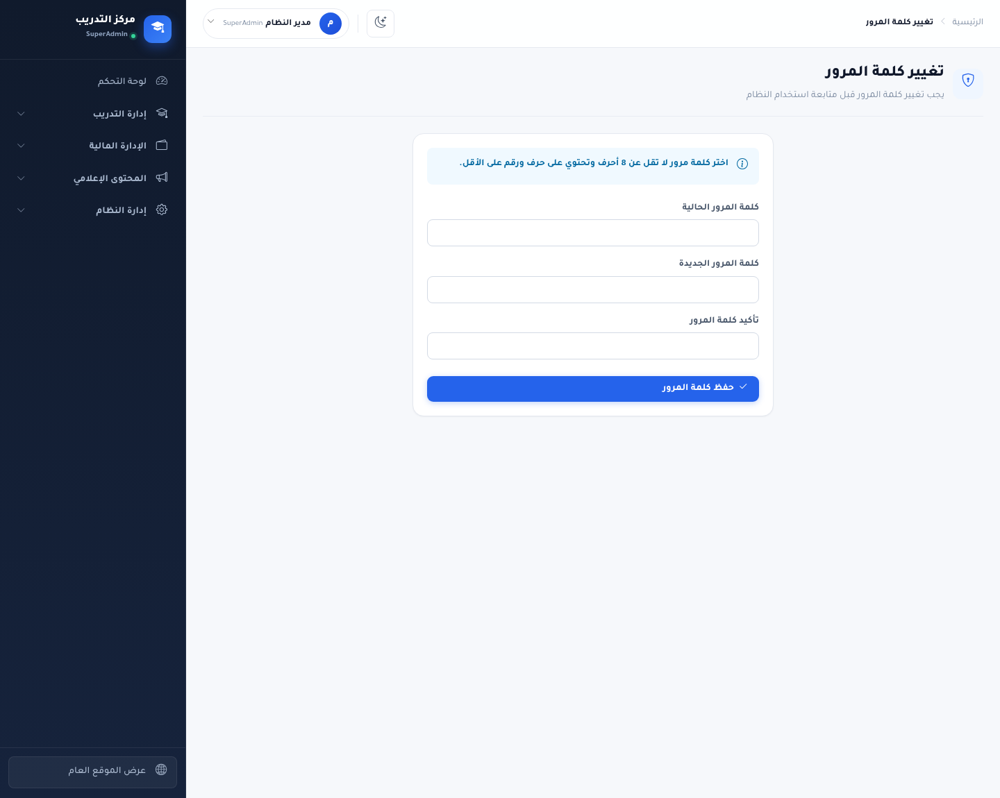

> 

> *الشكل: صفحة تغيير كلمة المرور — لقطة فعلية من النظام عند المسار `/Auth/ChangePassword`.*

### 1.4 تسجيل الخروج — `/Auth/Logout`

**الغرض:** إنهاء الجلسة. لا يطلب تأكيداً. يعيد إلى صفحة الدخول.

> **خروج مدير النظام من الحساب — `/Users`**
>
> 

---

## الفصل 2 — الموقع العام

الموقع العام يستخدم تخطيط `_Layout.cshtml` بشريط تنقل أعلى يحتوي: الرئيسية، الدورات، الأخبار،
التحقق من شهادة، و(إن كان مسجّلاً) لوحة التحكم واسم المستخدم وخروج.

### 2.1 الصفحة الرئيسية — `/Home/Index`

**الغرض:** الصفحة التعريفية العامة. كل محتواها يُدار من `/HomepageManage`.

**الأقسام القابلة للظهور (كلٌّ يُفعّل/يُخفي ويُرتّب من إدارة الصفحة الرئيسية):**
- الشرائح الرئيسية (Slider) بأزرارها.
- النصوص المتحركة.
- الإحصائيات (بطاقات الأرقام، بعضها تلقائي من قاعدة البيانات).
- فئات الدورات.
- أحدث الدورات المتاحة (بطاقة لكل دورة بزر «التفاصيل» و«سجّل الآن»).
- آخر أخبار المركز.
- نخبة المدربين.
- شهادات المتدربين.
- شركاء النجاح.

> **إدارة الصفحة الرئيسية — `/HomepageManage`**
>
> 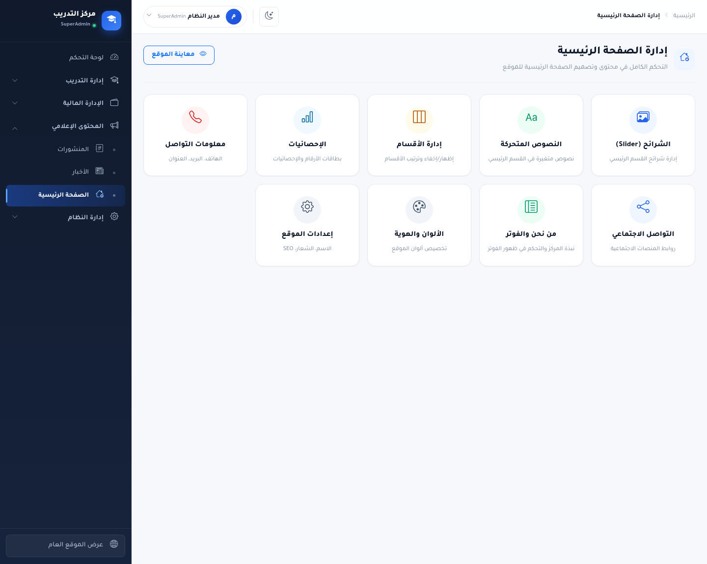

### 2.2 من نحن — `/Home/About`

**الغرض:** صفحة تعريفية بمحتوى قابل للتحرير (العنوان، الملخّص، المحتوى الكامل).

> **صفحة «من نحن» — `/Home/About`**
>
> 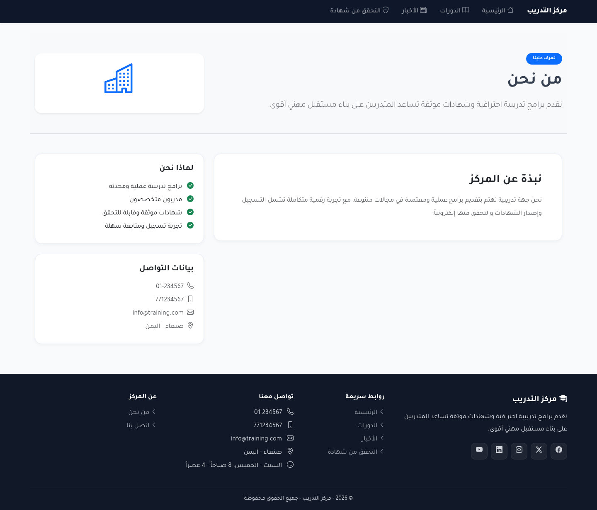

### 2.3 اتصل بنا — `/Home/Contact`

**الغرض:** عرض بيانات التواصل (هاتف، جوال، بريد، عنوان، ساعات عمل) وروابط التواصل الاجتماعي، كلٌّ حسب
إعدادات الظهور في `/HomepageManage`.

> **صفحة «اتصل بنا» — `/Home/Contact`**
>
> 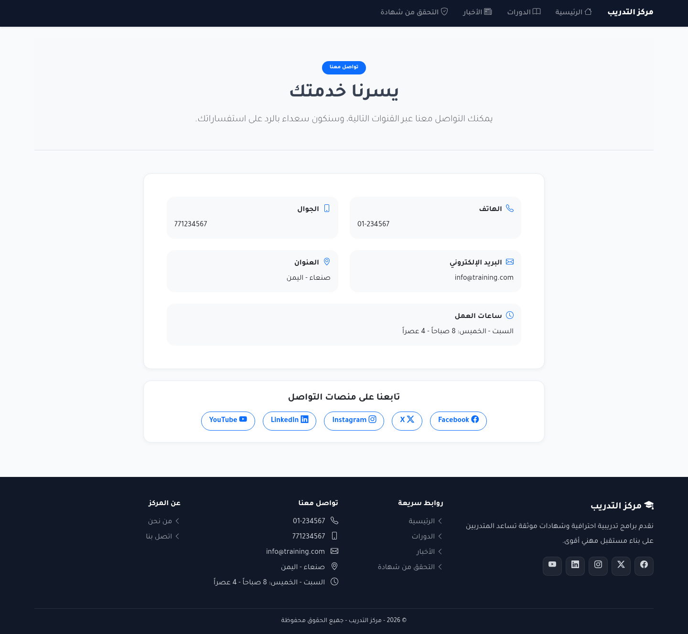

### 2.4 سياسة الخصوصية — `/Home/Privacy`

**الغرض:** صفحة نصية ثابتة.

### 2.5 الدورات العامة — `/PublicCourses/Index` و `/PublicCourses/Details/{id}`

**الغرض:** عرض الدورات المنشورة للزوار.

| العنصر | الوصف |
|--------|-------|
| حقل **بحث** | بحث نصّي في الدورات |
| روابط **الفئات** | تصفية حسب الفئة |
| زر **التفاصيل** | يفتح صفحة تفاصيل الدورة |
| زر **سجّل الآن** | يفتح نموذج التسجيل العام (إن كانت الدورة مفتوحة للتسجيل) |

> **صفحة الدورات العامة — `/PublicCourses`**
>
> 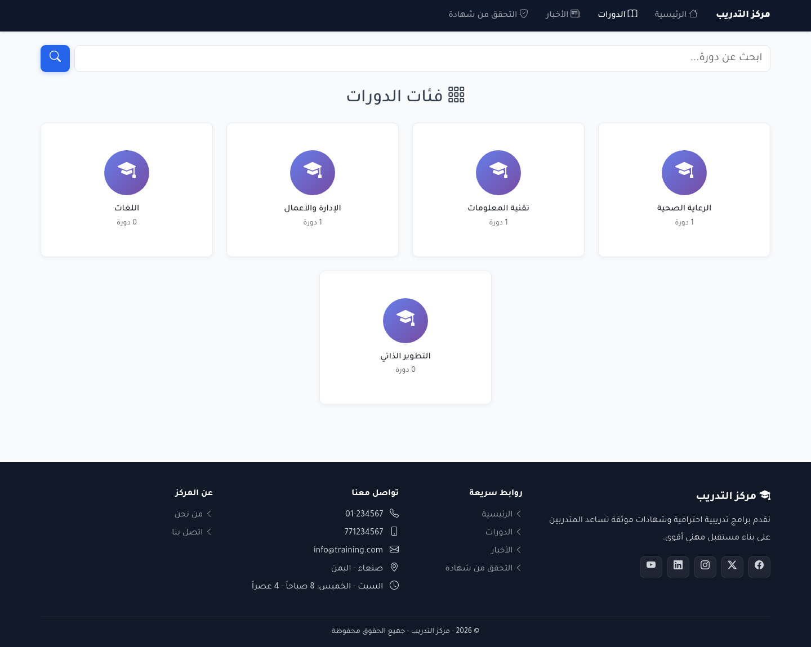

### 2.6 الأخبار — `/Posts/Index` و `/Posts/Details/{id}`

**الغرض:** عرض الأخبار والمنشورات المنشورة.

### 2.7 التسجيل العام — `/Registration/Register?courseId={id}`

**الغرض:** نموذج تقديم طلب تسجيل من الزائر. محمي بتحديد معدل `public-registration` (3 طلبات/دقيقة)
وبـ Cloudflare Turnstile (إن مُهيّأ).

#### الحقول

| الحقل | النوع | مطلوب | ملاحظات |
|-------|------|-------|---------|
| **الاسم بالعربية** | text | نعم | |
| **الاسم بالإنجليزية** | text | نعم | |
| **الجنس** | radio (ذكر/أنثى) | نعم | |
| **الهاتف** | text | نعم | يُتحقق وفق مفاتيح الدول من `/PhoneCountries` |
| **إضافة بياناتي الجامعية** | checkbox | لا | يظهر فقط إن كانت الدورة تتطلب بيانات أكاديمية |
| **الجامعة / الكلية / التخصص / المستوى الدراسي** | text/select | لا | تظهر عند تفعيل البيانات الجامعية |
| **موقع الويب** (WebsiteUrl) | text | لا | **حقل فخ للبوتات (Honeypot):** إن امتلأ يُرفض الطلب صامتاً |
| **إرسال طلب التسجيل** | زر | — | يرسل إلى `POST /Registration/Register` |

**بعد الإرسال:** صفحة نجاح `Success` تعرض **رقم الطلب** (`RequestNumber`).

> **البيانات الجامعية — `/AcademicCatalog`**
>
> 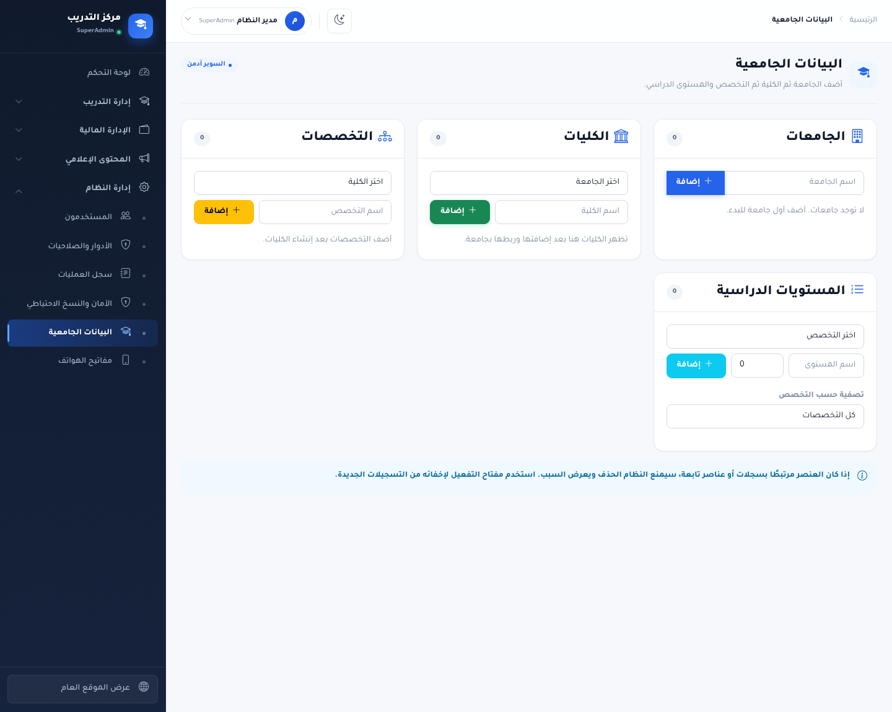

### 2.8 التحقق من شهادة (عام) — `/Certificates/Verify`

**الغرض:** بوابة رسمية للتحقق من صحة الشهادة. محمية بتحديد معدل `public-verification` (20/دقيقة).

| العنصر | الوصف |
|--------|-------|
| حقل **رقم الشهادة أو رمز التحقق** | نص (يُقبل رقم الشهادة أو رمز التحقق) |
| Turnstile (إن مُهيّأ) | تحقق من الإنسان |
| زر **تحقّق من الشهادة** | يرسل إلى `POST /Certificates/Verify` |

**صفحة النتيجة** `VerifyResult` تعرض بيانات الشهادة العامة، حالة الشهادة (سارية/موقوفة/غير موجودة)،
بarcode/QR، وزر طباعة.

**التحقق عبر الرابط المباشر:** `/v/{publicId}?sig=...` — تحقق بتوقيع HMAC دون إدخال يدوي (يُستخدم من QR).
كما يوجد `/Certificates/QrImage?publicId=...&sig=...` لتوليد صورة QR.

> **صفحة التحقق من شهادة — `/Certificates/Verify`**
>
> 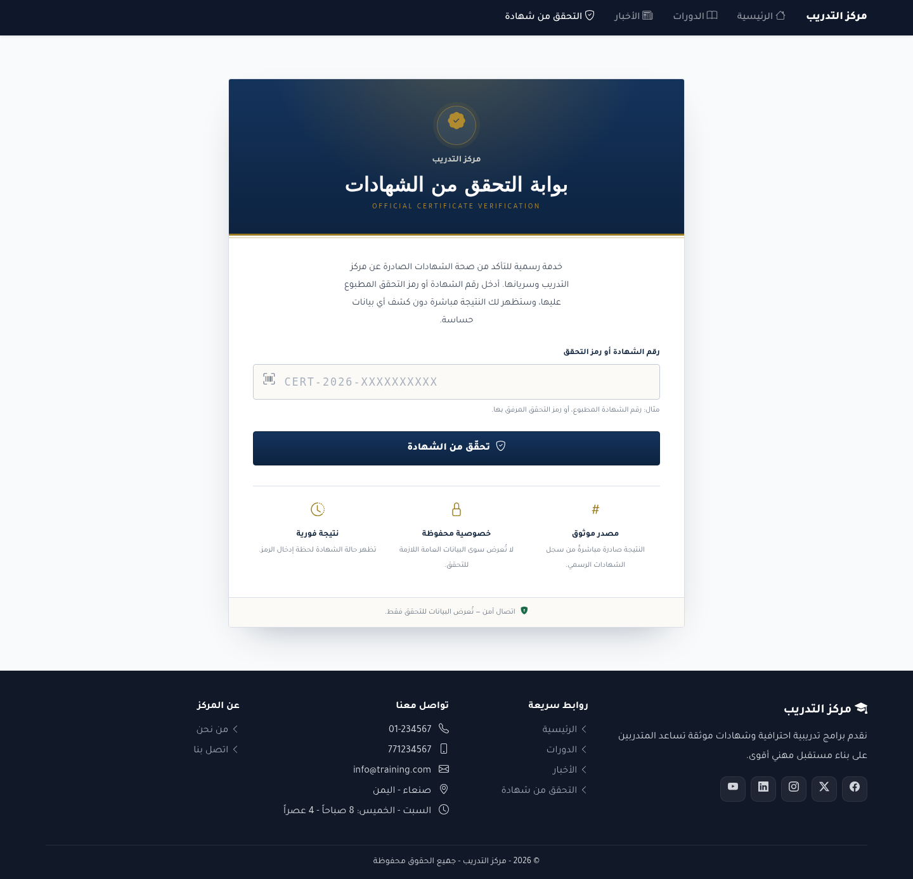

### 2.9 التحقق من سند (عام) — `/r/{publicId}?sig=...`

**الغرض:** تحقق مجهول من صحة سند قبض أو سند استرداد عبر الرابط/QR. يُظهر فقط ما يكفي للتحقق
(النوع، الرقم، المبلغ، المتدرب، الدورة، التاريخ، الموظف) ولا يكشف أي بيانات أخرى.

> **التحقق من سند قبض — `/r/{publicId}?sig=...`**
>
> 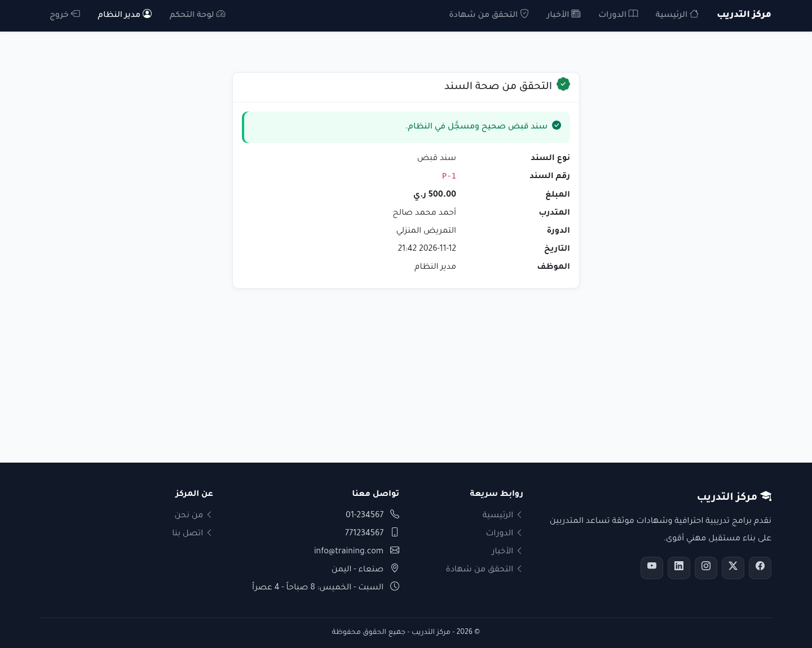

---

## الفصل 3 — لوحة التحكم

### 3.1 لوحة التحكم الموحّدة — `/Dashboard/Index`

**الغرض:** لوحة واحدة تخدم **كل** الأدوار؛ تظهر فقط المؤشرات والإجراءات التي يملك المستخدم صلاحيتها.

**الصلاحيات:** أي مستخدم يملك صلاحية إدارية واحدة على الأقل (`HasAnyAdminPermission`).

#### 3.1.1 بطاقات المؤشرات (KPIs) — تُفلتر حسب الصلاحية

| البطاقة | القيمة | الصلاحية المطلوبة | الرابط |
|---------|--------|-------------------|--------|
| تسجيلات معلقة | عدد التسجيلات بحالة Pending | manage-registrations | قائمة التسجيلات (مفلترة) |
| فواتير غير مدفوعة | عدد الفواتير غير المدفوعة/غير الملغاة | view-invoices/manage-finance | قائمة الفواتير |
| إجمالي الإيرادات | مجموع الدفعات النشطة | view-reports | تقرير إيرادات الدورات |
| دورات نشطة | دورات مفتوحة للتسجيل/جارية | manage-courses | قائمة الدورات |
| المتدربون | عدد التسجيلات المقبولة | manage-registrations | قائمة التسجيلات (مقبولة) |
| منشورات جديدة | منشورات منشورة آخر 7 أيام | manage-posts | قائمة المنشورات |

> **ملاحظة:** كل الأرقام **مقيّدة بنطاق دورات المستخدم** — المشرف المقيّد يرى أرقام فروعه فقط.

#### 3.1.2 الإجراءات السريعة

روابط مباشرة: التسجيلات، الفواتير، الدفعات، الدورات، الشهادات، التقارير — وتظهر أيضاً مفلترةً بالصلاحية.

#### 3.1.3 أحدث التسجيلات وأحدث الفواتير

جدولان يعرضان آخر 5 تسجيلات وآخر 5 فواتير مع رابط «عرض الكل».

> **لوحة التحكم الموحّدة (حساب مدير النظام) — `/Dashboard`**
>
> 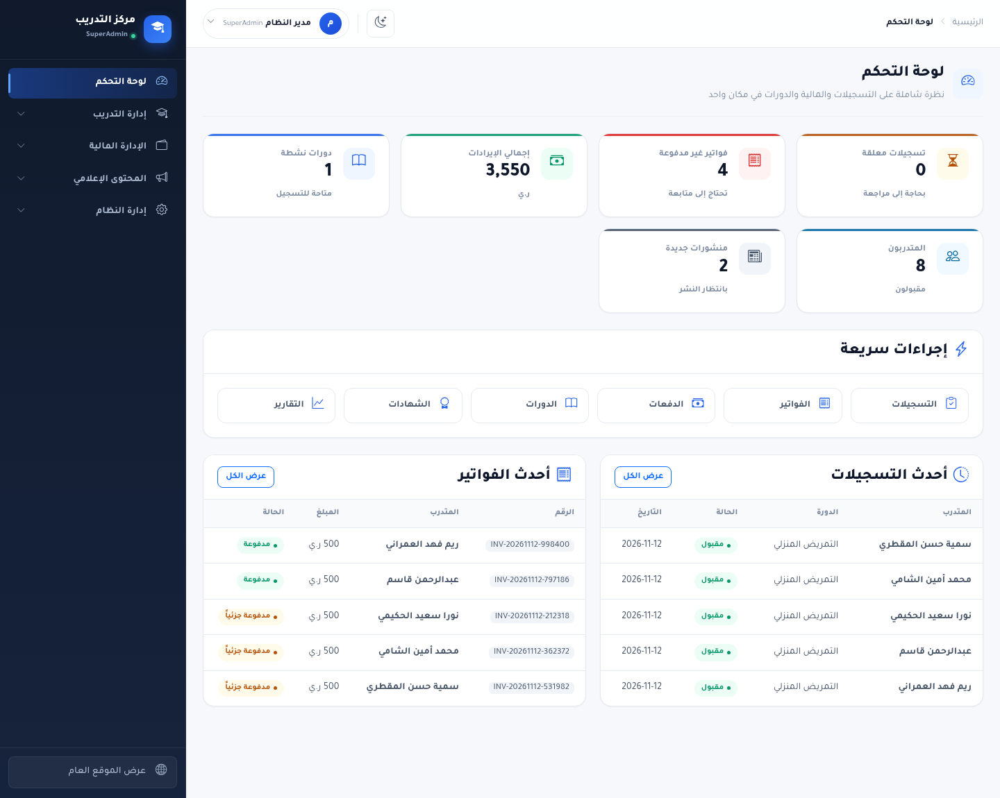

### 3.2 العناصر المشتركة في كل صفحات لوحة الإدارة

| العنصر | الوظيفة |
|--------|---------|
| شريط التنقل الجانبي | المجموعات الأربع + عناصرها (مفلترة بالصلاحية) |
| زر **تخطي إلى المحتوى** | إتاحة الوصول |
| زر تبديل المظهر (قمر) | يبدّل بين المظهر الفاتح/الداكن (يُحفظ محلياً) |
| قائمة المستخدم (أعلى يمين) | لوحة التحكم، تغيير كلمة المرور، الموقع العام، تسجيل الخروج |
| مسار التنقل (Breadcrumbs) | الرئيسية ← عنوان الصفحة |
| تنبيهات النجاح/الخطأ | تظهر أعلى المحتوى بعد الإجراءات |

> **لوحة التحكم الموحّدة (حساب مدير النظام) — `/Dashboard`**
>
> 

---

## الفصل 4 — إدارة التدريب

### 4.1 التسجيلات — `/Registrations/Index`

**الغرض:** إدارة طلبات التسجيل: القبول، الرفض، إعادة الفتح، الإعفاء المالي، الأرشفة، والاستعادة.

**الصلاحيات:** `manage-registrations`. مقيّد بنطاق الدورات.

#### 4.1.1 الفلاتر

| العنصر | النوع | الخيارات |
|--------|------|----------|
| **البحث في التسجيلات** | search | الاسم/الهاتف/رقم الطلب |
| **حالة الطلب** | select | الكل، معلق، مقبول، مرفوض، مؤرشف |
| **الدورة** | select | دورات نطاق المستخدم |
| **من تاريخ / إلى تاريخ** | date | نطاق تاريخ التسجيل |
| زر **تصفية** / رابط **مسح** | — | تطبيق/إعادة تعيين |

#### 4.1.2 الأزرار الرئيسية

| الزر | الإجراء | القاعدة |
|------|---------|---------|
| **قبول المحدد** / **رفض المحدد** | إجراء جماعي على المحددين (BulkAction) | — |
| **تحديد المعلقة الظاهرة** | يحدّد كل الصفوف المعلقة المعروضة | — |
| **تأكيد** (في نافذة الرفض) | يؤكّد رفض المحدد بسبب | — |
| قبول (لكل صف) | `Accept` | فقط للطلبات المعلقة |
| رفض (لكل صف) | يفتح صفحة `Reject` | فقط للطلبات المعلقة |
| إعادة فتح (لكل صف) | `Reopen` | فقط للمرفوضة |
| أرشفة (لكل صف) | `Archive` | للمقبولة/المرفوضة |
| استعادة (لكل صف) | `Restore` | للمؤرشفة فقط |
| حذف (لكل صف) | `Delete` | — |

#### 4.1.3 الأعمدة

رقم الطلب، المتدرب، الهاتف، الدورة، تاريخ الطلب، الدفع (مؤشر وجود فاتورة)، الحالة، الإجراءات.

> **قاعدة موثّقة:** عند القبول تُنشأ الفاتورة تلقائياً (إن لم تكن موجودة) عبر
> `RegistrationInvoiceService.EnsureForAcceptedAsync`، ويُرسَل إشعار SMS للمتدرب.

> **قائمة التسجيلات — `/Registrations`**
>
> 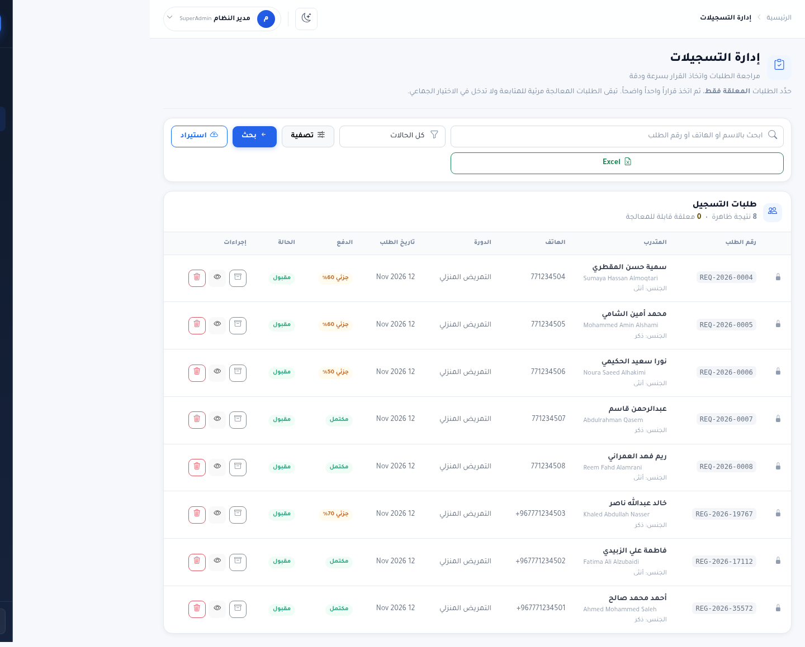

### 4.2 تفاصيل التسجيل — `/Registrations/Details/{id}`

**الصلاحيات:** `manage-registrations` + داخل النطاق.

#### المحتوى والأزرار

| العنصر | الوصف |
|--------|-------|
| بطاقة **بيانات المتدرب** | رقم الطلب، الاسم عربي/إنجليزي، الجنس، الهاتف، البريد، كيف سمع عنا، الدورة، التواريخ، الموظف، سبب الرفض (إن وُجد) |
| بطاقة **الفاتورة** | رقمها، المبلغ، المدفوع، المتبقي، وزر «عرض الفاتورة» أو «تأكيد/استكمال الفاتورة» |
| قسم **الإعفاء المالي** | حقل «مبلغ الإعفاء»، حقل «سبب الإعفاء»، زر «حفظ الإعفاء» |
| زر **قبول التسجيل** | يقبل الطلب وينشئ الفاتورة |
| زر **رفض التسجيل** | يفتح صفحة الرفض |

> **قاعدة الإعفاء:** يمكن تطبيق الإعفاء على التسجيلات المعلقة أو المقبولة فقط؛ ويُسجَّل الإعفاء في سجل
> التدقيق المالي (نوع العملية: Exemption) لأنه يقلّل الإيراد المتوقع. الإعفاء = 0 يلغي الإعفاء ويعيد الرسوم.

> **تفاصيل تسجيل — `/Registrations/Details/1`**
>
> 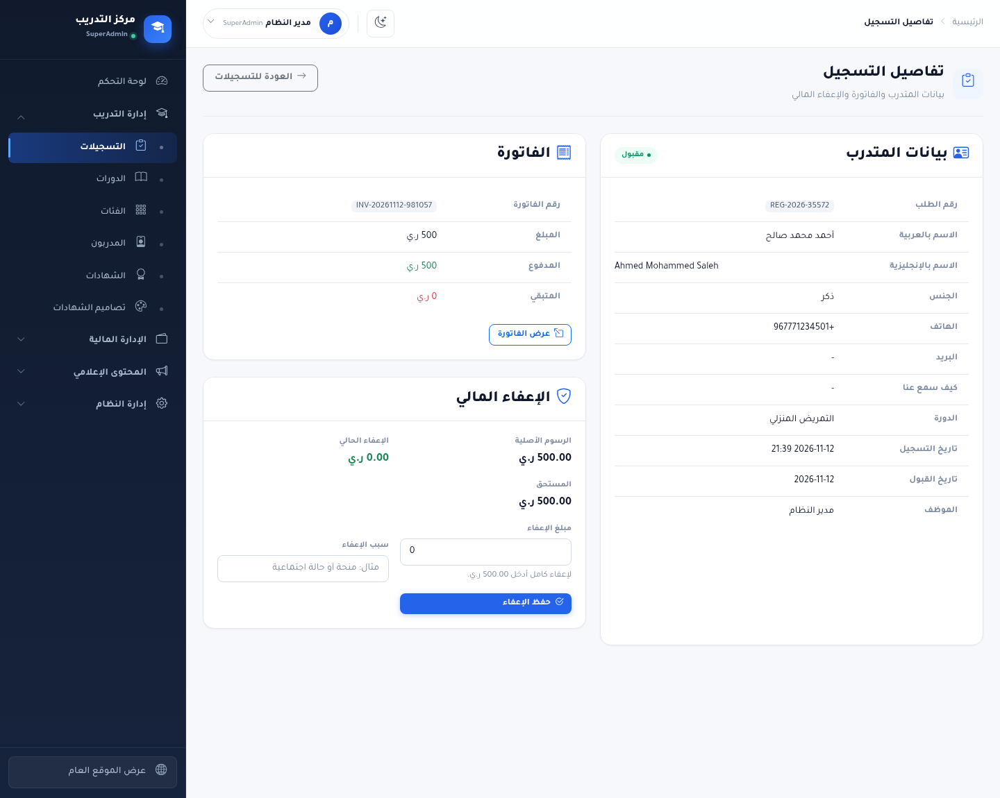

### 4.3 رفض التسجيل — `/Registrations/Reject/{id}`

**الحقول:** «سبب الرفض (اختياري)» (textarea). الأزرار: **تأكيد الرفض**، **العودة**، **إلغاء**.

### 4.4 استيراد المتدربين — `/Registrations/Import`

**الصلاحيات:** `manage-registrations`.

| العنصر | الوصف |
|--------|-------|
| **الدورة المستهدفة** | select (مطلوب) |
| **الحالة بعد الاستيراد** | select |
| **الدورة الجامعية** | checkbox |
| **ملف XLSX** | رفع (مطلوب، حد 10MB) |
| زر **تنزيل القالب** | يُنزّل قالب Excel |
| زر **فحص ومعاينة الملف** | يحلّل الملف ويعرض معاينة |
| زر **اعتماد استيراد N متدرب** | يؤكّد الاستيراد |
| زر **رفع ملف آخر** | إعادة البدء |

جدول المعاينة: الصف، الاسم بالعربية، الاسم بالإنجليزية، الجوال، البيانات الجامعية، التحقق.

> **استيراد المتدربين من Excel — `/Registrations/Import`**
>
> 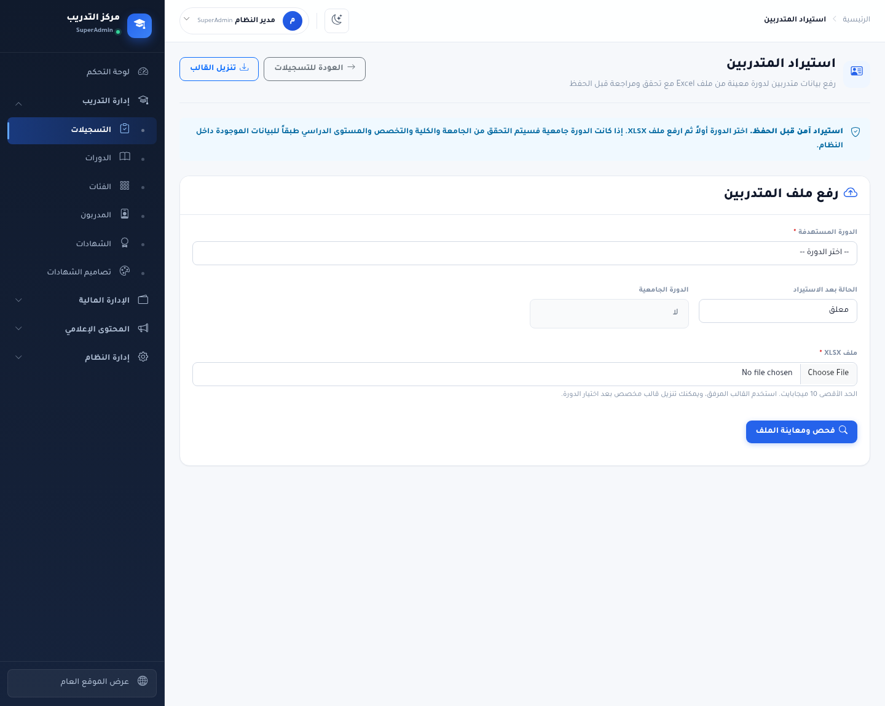

### 4.5 تصدير التسجيلات — `/Registrations/ExportXlsx`

يُنتج ملف Excel بالتسجيلات وفق الفلاتر الحالية (الاسم عربي/إنجليزي، الهاتف، الدورة، الحالة…).

### 4.6 الدورات — `/CoursesManage/Index`

**الصلاحيات:** `manage-courses`.

#### الفلاتر والأزرار

| العنصر | الوصف |
|--------|-------|
| حقل **بحث** + زر **بحث** | بحث بالاسم العربي/الإنجليزي |
| **استيراد من Excel** | → `/CoursesManage/Import` |
| **تصدير إلى Excel** | → `/CoursesManage/Export` |
| **إضافة دورة** | → `/CoursesManage/Create` |
| أزرار تغيير الحالة (لكل دورة): **مسودة، نشر، فتح التسجيل، جارية، مكتملة، أرشفة** | تُرسل `ChangeStatus` |

#### الأعمدة
الدورة، الفئة، المدربون، السعر، الحالة، التاريخ، إجراءات (تعديل/حذف).

**حالات الدورة (6):** Draft (مسودة)، Published (منشورة)، OpenForRegistration (مفتوحة للتسجيل)،
InProgress (جارية)، Completed (مكتملة)، Archived (مؤرشفة).

> **قاعدة موثّقة:** لا يمكن إصدار الشهادة إلا لدورة حالتها **Completed** وتسجيل **Accepted** ولم تُصدَر
> له شهادة سابقاً.

> **قائمة الدورات — `/CoursesManage`**
>
> 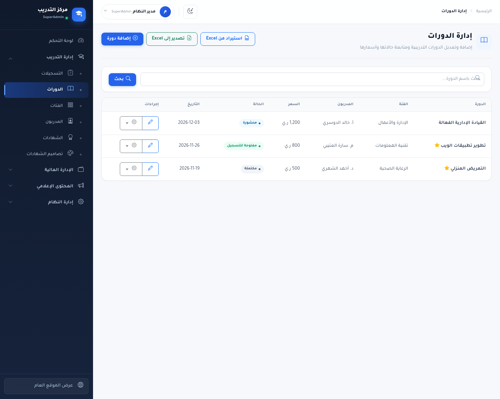

### 4.7 إضافة/تعديل دورة — `/CoursesManage/Create` و `/CoursesManage/Edit/{id}`

#### قسم البيانات الأساسية
| الحقل | الوصف |
|-------|-------|
| **اسم الدورة (إنجليزي)** | text |
| **اسم الدورة (عربي)** | text |
| **الوصف المختصر** | text |
| **الوصف الكامل / الأهداف / المحتوى** | textarea |
| **الفئة** | select |
| **قالب شهادة هذه الدورة** | select (من تصاميم الشهادات) |
| **المدربون** | اختيار متعدد |
| **الجهات الداعمة** | مكرّر (Name/Logo/Signature/SortOrder) — يُدار بـ `course-partners.js` |

#### قسم الرسوم والخصم
| الحقل | الوصف |
|-------|-------|
| **السعر** | number |
| **نوع الخصم** | select (نسبة/مبلغ) |
| **قيمة الخصم** | number |

#### قسم الجدول والحالة
**تاريخ البداية، تاريخ النهاية، المكان، الحالة** (select)، **دورة مميزة** (checkbox)،
**دورة جامعية** (checkbox — تُفعّل طلب البيانات الجامعية في التسجيل العام).

#### قسم الصورة
**الصورة** (رفع؛ يُتحقق منها بفحص التوقيع الثنائي (magic bytes)).

الأزرار: **حفظ الدورة**/**حفظ التعديلات**، **العودة للدورات**، **إلغاء**.

> **تعديل دورة (قسم الجهات الداعمة) — `/CoursesManage/Edit/1`**
>
> 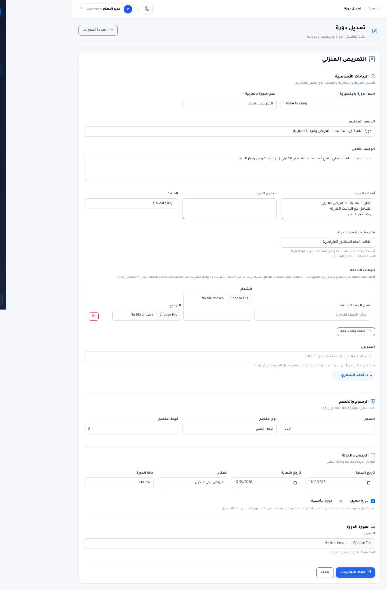

### 4.8 استيراد الدورات — `/CoursesManage/Import`

حقل «ملف XLSX» + زر «تنزيل القالب» + «فحص ومعاينة الملف» + «اعتماد استيراد N دورة» + «رفع ملف آخر».
جدول المعاينة: الصف، الدورة، الفئة، المدربون، السعر، الحالة، التحقق.

### 4.9 الفئات — `/CategoriesManage/Index`

**الصلاحيات:** `manage-categories`.

| العنصر | الوصف |
|--------|-------|
| حقل **بحث** + زر **بحث** | بحث بالفئة |
| **إضافة فئة** | → `/CategoriesManage/Create` |
| الأعمدة | الأيقونة، اسم الفئة، الوصف، عدد الدورات، الحالة، إجراءات (تعديل/حذف) |

#### إضافة/تعديل فئة
الحقول: **اسم الفئة** (مطلوب)، **الوصف** (textarea)، **أو ارفع صورة أو أيقونة مخصصة** (رفع)،
**نشطة** (checkbox)، مع منتقي **أيقونة جاهزة** (`_PresetIconPicker`).
الأزرار: **حفظ الفئة**/**حفظ التعديلات**، **العودة للفئات**، **إلغاء**.

> **الفئات — `/CategoriesManage`**
>
> 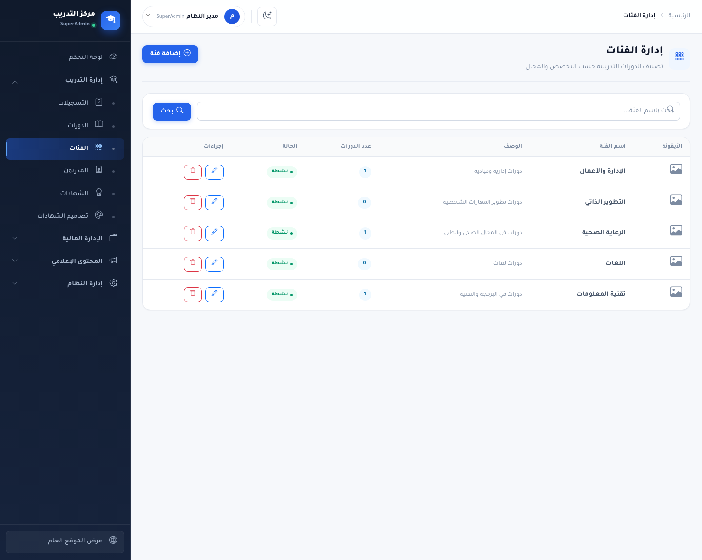

### 4.10 المدربون — `/Instructors/Index`

**الصلاحيات:** `manage-instructors`.

| العنصر | الوصف |
|--------|-------|
| حقل **بحث** + زر **بحث** | بحث بالاسم |
| **إضافة مدرب** | → `/Instructors/Create` |
| عمود إجراءات | **تعديل** |

#### إضافة/تعديل مدرب
الحقول: **الاسم الكامل**، **التخصص**، **نبذة** (textarea)، **الهاتف**، **البريد**، **صورة المدرب** (رفع)،
**نشط** (checkbox). إضافةً إلى **لوحة التوقيع المباشر** (`_SignaturePad`): رسم التوقيع بالماوس/اللمس أو
رفع صورة توقيع، مع **تراجع/مسح** وخيار **إزالة التوقيع المحفوظ**.

> **المدربون — `/Instructors`**
>
> 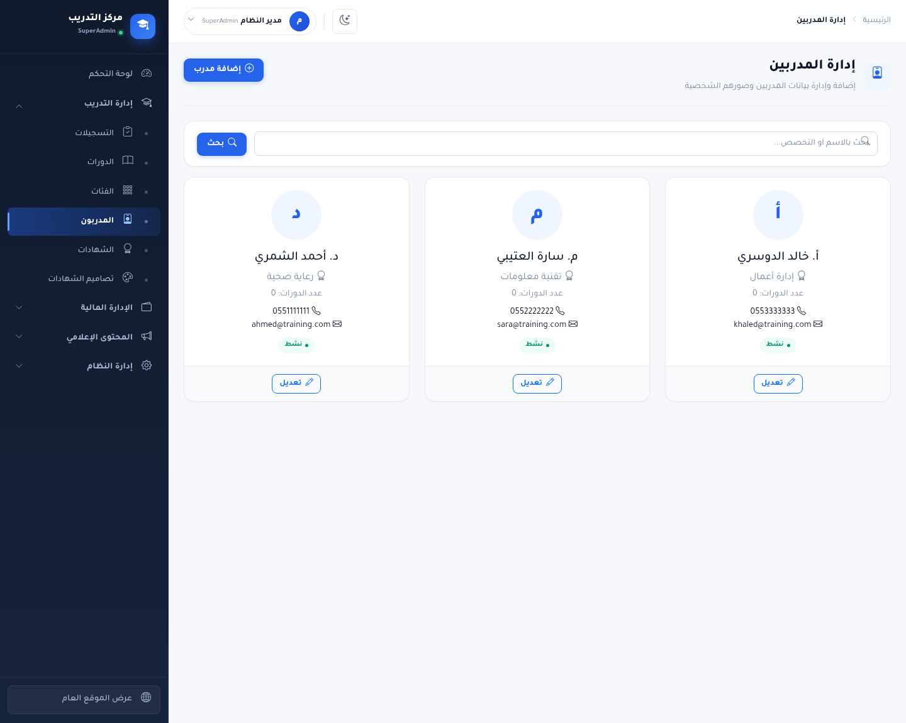

### 4.11 الشهادات — `/Certificates/Index`

**الصلاحيات:** `issue-certificates`.

#### الفلاتر والأزرار

| العنصر | الوصف |
|--------|-------|
| **بحث** | بحث في الشهادات |
| **الدورة** | select |
| **تاريخ الإصدار من / إلى** | date |
| زر **تصفية** | تطبيق |
| زر **تصدير المحدد** | تصدير الشهادات المحددة (checkboxes) |
| **إصدار شهادات** | → `/Certificates/Issue` |
| **استيراد شهادات قديمة** | → `/CertificatesImport/Import` |
| **تصدير النتائج الحالية** | تصدير مفلتر |
| **مسح الفلاتر** | إعادة تعيين |
| **تحديد الكل** / **إلغاء التحديد** | تحديد جماعي |
| **نسخ الرابط** / **فتح الرابط** (لكل شهادة) | رابط التحقق العام |

#### الأعمدة
رقم الشهادة، اسم المتدرب، الدورة، تاريخ الإصدار، المصدر، الحالة، رابط QR.

> **قائمة الشهادات — `/Certificates`**
>
> 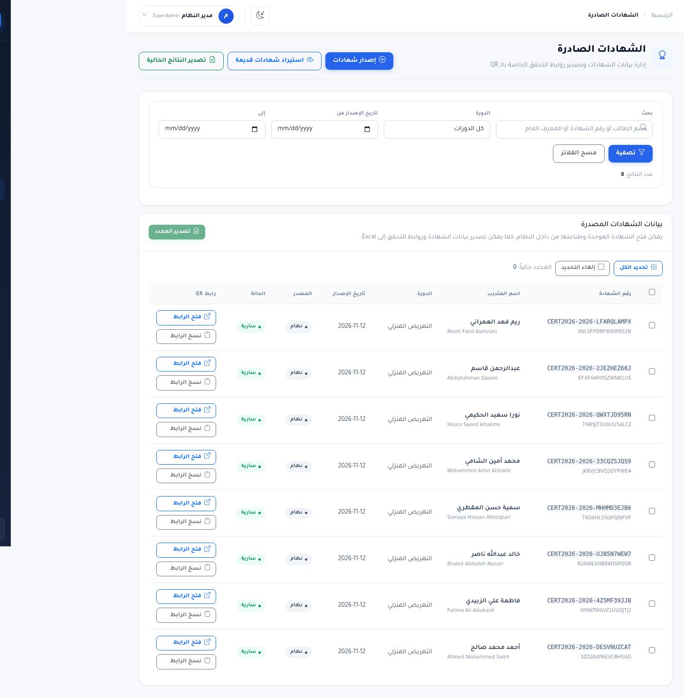

### 4.12 إصدار الشهادات — `/Certificates/Issue`

**الفلاتر:** **الدورة**، **تاريخ التسجيل من/إلى**، ثم جدول المتدربين المؤهلين
(رقم الطلب، الاسم، الدورة، تاريخ التسجيل، تاريخ القبول) مع checkboxes.
**حقل البادئة** `certificatePrefix` (مطلوب) — يُبنى منه رقم الشهادة.
الأزرار: **تطبيق**، **إصدار الشهادات للمحدد**، **تحديد الكل**، **إلغاء التحديد**، **إصدار الشهادات**.

**القواعد:** يُصدر فقط لمن: تسجيله Accepted، لم تصدر له شهادة، ودورته Completed. كل شهادة تحصل على رقم
فريد + PublicId + رمز تحقق فريدين، وتُرسَل إشعارات للمتدربين.

> **إصدار الشهادات (إصدار جماعي) — `/Certificates/Issue`**
>
> 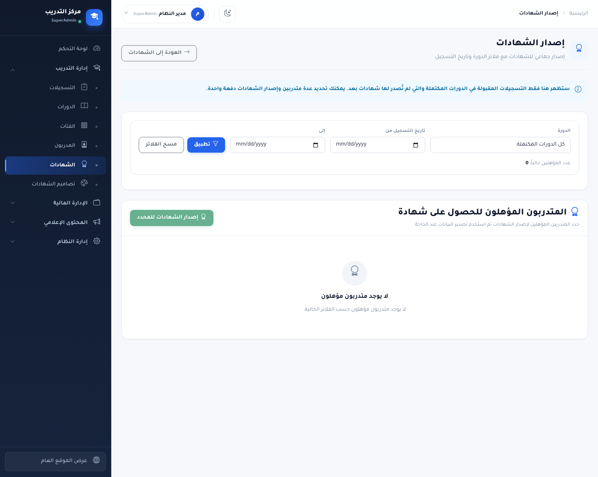

### 4.13 تصاميم الشهادات — `/CertificateDesigns/Index`

**الصلاحيات:** `manage-certificate-designs`.

محرر مرئي (WYSIWYG) للشهادة. عناصر اللوحة: **نص ثابت**، **حقل ديناميكي**، **رمز QR**، **باركود**،
**شعار الشريك**، **توقيع الشريك**، **توقيع المدرب**، **فاصل**.

#### الخصائص لكل عنصر
الخط (Tajawal)، الحجم، الوزن، لون النص، المحاذاة، التدوير، الموضع (س، ص)، العرض، الارتفاع، إظهار العنصر.

#### إعدادات اللوحة
**مقاس اللوحة** (أفقي A4/عمودي)، العرض px، الارتفاع px، لون الخلفية، صورة القالب (خلفية مرفوعة)،
لون الإطار، سماكة الإطار، انحناء الزوايا، **الشبكة**، **الالتقاط**.

#### الأزرار
**معاينة**، **حفظ كمسودة**، **حفظ ونشر**.

> **محرر تصاميم الشهادات — `/CertificateDesigns`**
>
> 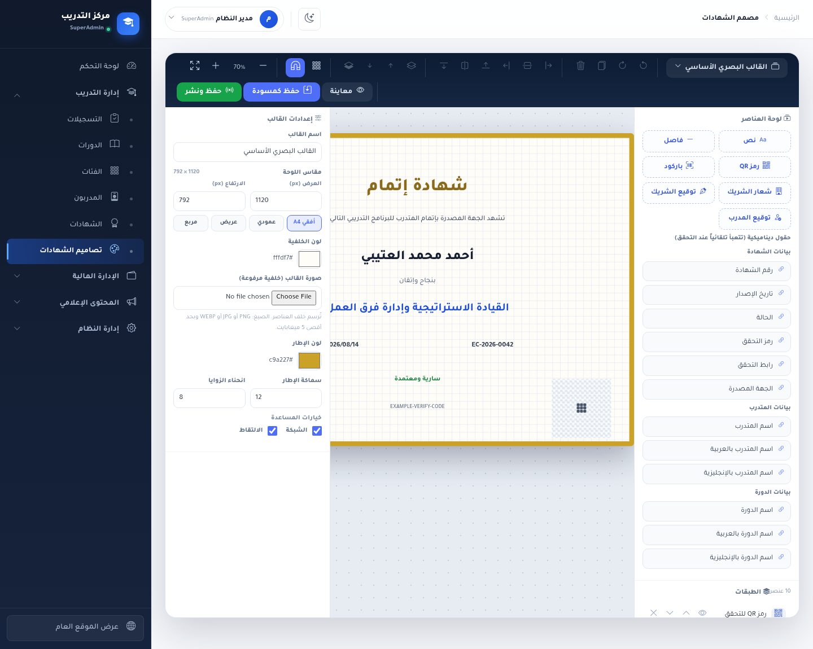

### 4.14 استيراد الشهادات القديمة — `/CertificatesImport/Import`

**الصلاحيات:** `issue-certificates`.

| العنصر | الوصف |
|--------|-------|
| **ملف XLSX** | رفع (مطلوب) |
| **تصنيف افتراضي** / **مدرب افتراضي** | select (اختياري) |
| إجراء لكل دورة | radio: **إنشاء جديدة** أو **ربط بموجودة** |
| **تصنيف يُطبَّق على كل الدورات** | select |
| **مدربون يُطبَّقون على كل الدورات** | اختيار متعدد |
| زر **فحص ومعاينة الملف** | معاينة |
| زر **تطبيق على الكل** | تطبيق الإعدادات على كل الصفوف |
| زر **اعتماد الاستيراد** | تنفيذ |

**صفحة النتيجة** `Result`: رقم الشهادة، الاسم، الدورة، الباركود (QR)، رمز التحقق، رابط التحقق، الحالة.

> **استيراد الشهادات القديمة — `/CertificatesImport/Import`**
>
> 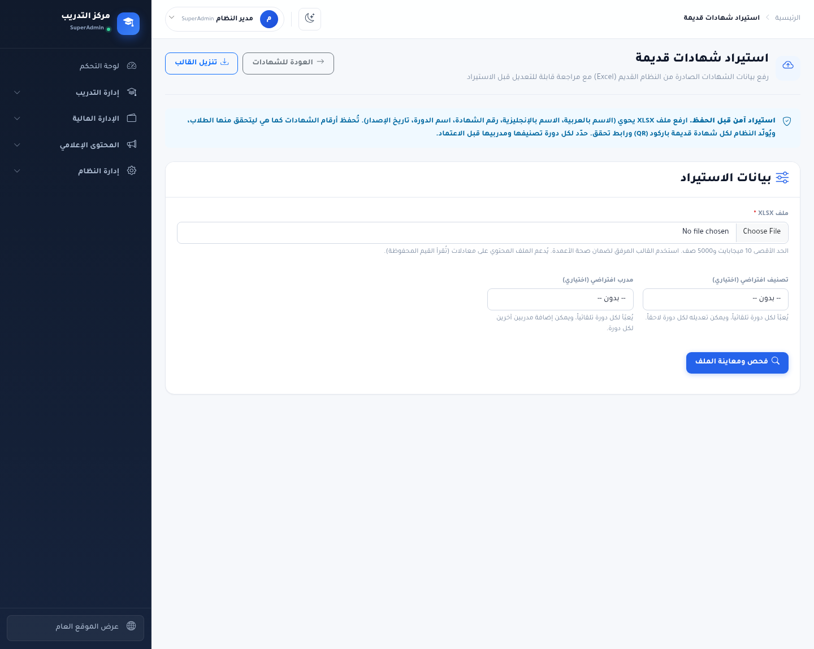

---

## الفصل 5 — الإدارة المالية

> هذا هو قلب النظام. يشرح هذا الفصل كل واجهة مالية، وكل زر، وكل قاعدة عمل، إضافةً إلى القواعد
> المعمارية الحاكمة: **عزل الصندوق**، **إقفال الفترة المالية**، **حد اعتماد الاسترداد**، و**سلاسل التوقيعات**.

### 5.0 القواعد المالية الحاكمة (اقرأها أولاً)

| القاعدة | التفصيل |
|---------|---------|
| **كل رصيد مُشتقّ من دفتر** | لا يوجد حقل رصيد مخزّن؛ الأرصدة تُحسب من مجموع الحركات وقت الاستعلام. |
| **المسار الوحيد لتمويل الصندوق** | لا تدخل الأموال الصندوق الرئيسي إلا عبر **توريد عهدة** يعتمده مدير النظام. لا يوجد «ترحيل رصيد دورة» (مسار قديم مُلغى). |
| **الأموال المحصّلة تهبط في عهدة المحصّل** | كل دفعة +مبلغ تدخل في عهدة الموظف الذي سجّلها؛ الاسترداد يخصم من عهدته. |
| **لا عهدة سالبة أبداً** | لا يمكن أن يصبح رصيد عهدة الموظف سالباً. |
| **الاسترداد حركة جديدة لا حذف** | الاسترداد لا يحذف دفعة قديمة؛ بل يُنشئ حركة مؤرّخة تقلّل رصيد الفاتورة وتخصم العهدة. |
| **إقفال الفترة يمنع الكتابة** | أي حركة (دفعة، استرداد، سحب، توريد) داخل فترة مقفلة تُرفض. |
| **كل حركة مُدقّقة** | كل حركة تُضاف إلى سجل التدقيق المالي المُذيَّل بـ Hash Chain. |

### 5.1 لوحة المؤشرات المالية — `/Finance/Index`

**الغرض:** نظرة شاملة على المالية المؤسسية.

**الصلاحيات:** `view-finance-dashboard`. مقيّد بنطاق الدورات.

#### المؤشرات (KPIs)
- **المحصّل اليوم** — مجموع الدفعات النشطة اليوم.
- **المحصّل هذا الشهر** — مجموع الدفعات النشطة هذا الشهر.
- **المسترد هذا الشهر** — مجموع الاستردادات المعتمدة هذا الشهر.
- **المصروفات هذا الشهر** — مجموع المصروفات المعتمدة هذا الشهر.
- **إجمالي المتأخرات** — مجموع ما تبقّى على الفواتير غير الملغاة.
- **إجمالي العهد** — (مدير النظام: كل العهد؛ المقيّد: عهدته فقط).
- **رصيد الصندوق** — المورَّد − المسحوب.
- **صافي هذا الشهر** — المحصّل − المسترد − المصروفات.

#### الأقسام
- **التدفق النقدي (آخر 14 يوم):** جدول يومي (التاريخ، التحصيل، الاسترداد، السحب، المصروفات، الصافي).
- **أعمار المتأخرات:** توزيع المتأخرات على الفئات العمرية.
- **أحدث الدفعات** (آخر 8) و**أحدث الاستردادات** (آخر 8).

الأزرار: **قائمة الدخل**، **التدفق النقدي**، **عرض التفاصيل**.

> **لوحة المؤشرات المالية — `/Finance`**
>
> 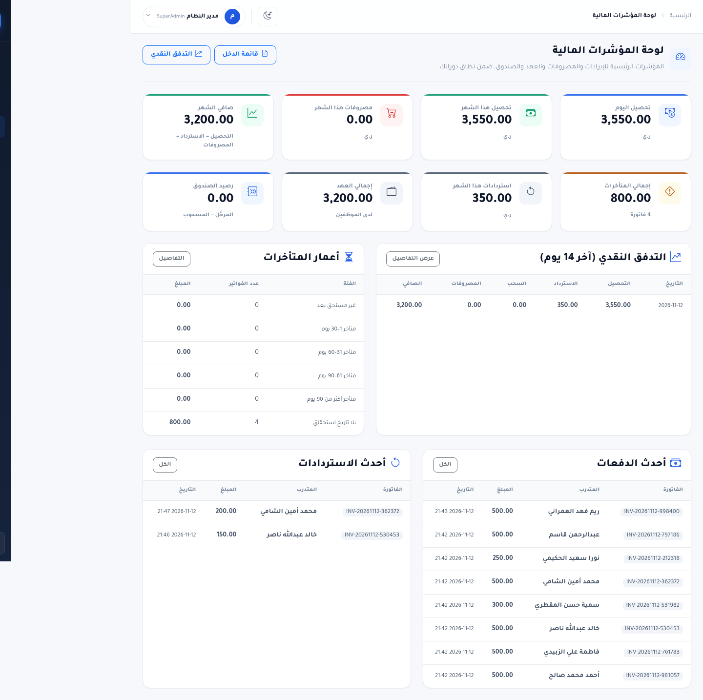

### 5.2 الفواتير — `/Invoices/Index`

**الغرض:** إدارة فواتير المتدربين.

**الصلاحيات:** `view-invoices` **أو** `manage-finance`. مقيّد بنطاق الدورات.

#### الفلاتر
| العنصر | الوصف |
|--------|-------|
| حقل **بحث** | رقم الفاتورة، اسم المتدرب (عربي/إنجليزي)، الهاتف، اسم الدورة |
| فلتر **الحالة** | Unpaid / PartiallyPaid / Paid / Cancelled |
| زر **بحث** / رابط **مسح** | تطبيق/إعادة تعيين |

#### الأعمدة
الرقم، المتدرب، الدورة، الإجمالي، المدفوع، المتبقي، الحالة، إجراءات.

#### أزرار الصف
- **دفعة** → `Payments/Add` (تسجيل دفعة).
- **إلغاء** → `Cancel` (لا يمكن إلغاء فاتورة بها دفعات نشطة).
- **استعادة** → `Restore` (للفواتير الملغاة؛ تعيد الحالة وفق المدفوع).

> **قاعدة الإلغاء:** يُرفض إلغاء فاتورة تحتوي دفعات نشطة، لتجنّب ترك الأموال معلّقة؛ يجب حذف الدفعات
> أولاً. الاستعادة تعيد الحالة تلقائياً (Paid / PartiallyPaid / Unpaid).

> **قائمة الفواتير — `/Invoices`**
>
> 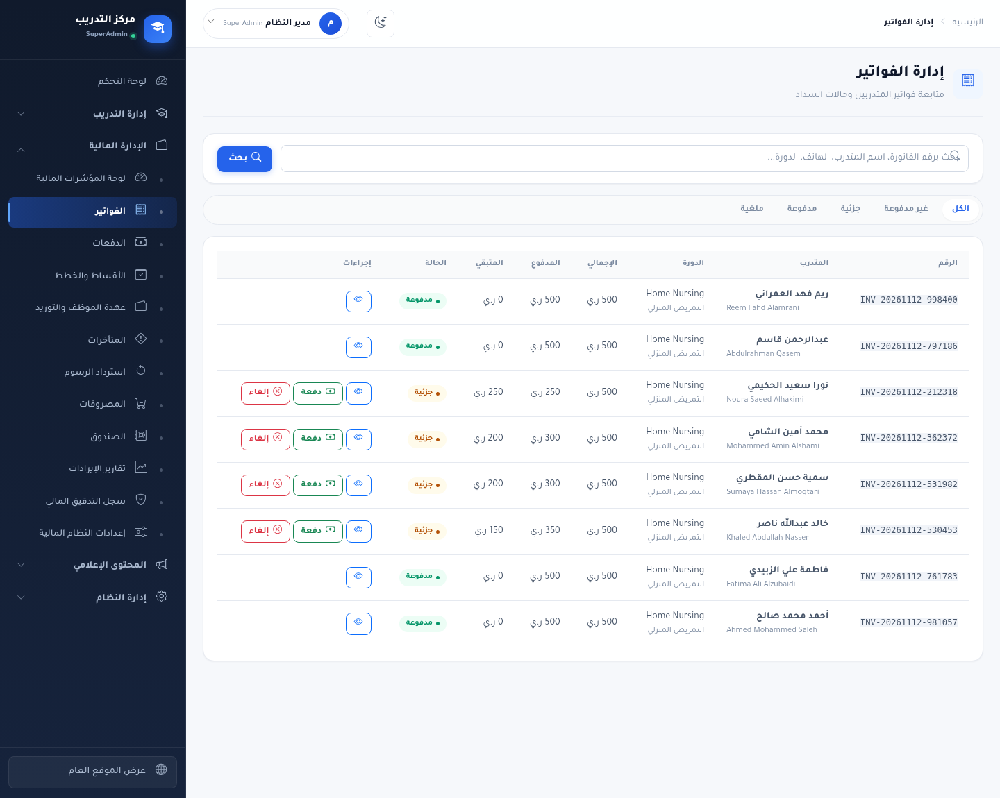

> 

> *الشكل: قائمة الفواتير — لقطة فعلية من النظام عند المسار `/Invoices`.*

### 5.3 إنشاء فاتورة — `/Invoices/Create/{registrationId}`

**الصلاحيات:** `manage-finance` + التسجيل مقبول وداخل النطاق.

| العنصر | الوصف |
|--------|-------|
| حقل **تاريخ الاستحقاق (اختياري)** | date |
| زر **إنشاء الفاتورة** | يُنشئ/يؤكّد الفاتورة |
| رابط **العودة للفواتير** | — |

**القواعد:** لا تُنشأ فاتورة إلا لتسجيل **مقبول**؛ وإن وُجدت فاتورة مسبقاً تُرفض العملية برسالة تُظهر
رقمها. عند القبول من صفحة التسجيلات تُنشأ الفاتورة تلقائياً، فهذه الصفحة للاستكمال اليدوي.

> **إنشاء فاتورة يدوياً — `/Invoices/Create?registrationId={id}`**
>
> 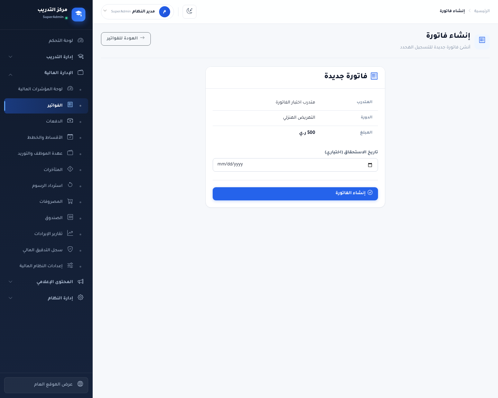

> 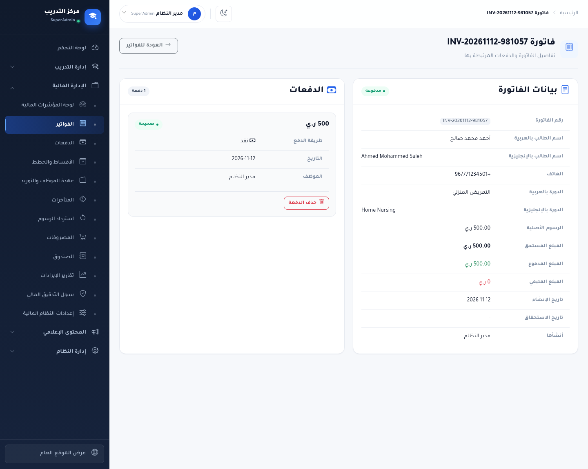

> *الشكل: تفاصيل فاتورة — لقطة فعلية من النظام عند المسار `/Invoices/Details/1`.*

### 5.4 تفاصيل الفاتورة — `/Invoices/Details/{id}`

**الصلاحيات:** `view-invoices` أو `manage-finance` + داخل النطاق.

#### بطاقة «بيانات الفاتورة»
رقم الفاتورة، الاسم عربي/إنجليزي، الهاتف، الدورة عربي/إنجليزي، **الرسوم الأصلية**، **الإعفاء** (إن وُجد
مع سببه)، **المبلغ المستحق**، **المبلغ المدفوع**، **المبلغ المتبقي**، تاريخ الإنشاء، تاريخ الاستحقاق،
من أنشأها. مع شارة الحالة الملوّنة.

#### أزرار البطاقة (تظهر إن لم تكن مدفوعة/ملغاة)
- **تسجيل دفعة** → `Payments/Add`.
- **خطة أقساط** (إن ملك المستخدم `manage-installments`) → `Installments/Create`.
- **إلغاء الفاتورة** (بتأكيد) → `Cancel`.

#### بطاقة «الدفعات»
قائمة الدفعات، ولكل دفعة: المبلغ، شارة (صحيحة/ملغاة)، طريقة الدفع، رقم السند، التاريخ، الموظف، ملاحظة،
وزر **حذف الدفعة** (بتأكيد).

> **تفاصيل فاتورة — `/Invoices/Details/1`**
>
> 

### 5.5 الدفعات — `/Payments/Index`

**الصلاحيات:** `manage-payments`. مقيّد بنطاق الدورات.

#### الفلاتر
| العنصر | الوصف |
|--------|-------|
| **اسم الطالب** | بحث بالاسم |
| **اسم الدورة** | بحث بالدورة |
| **رقم الفاتورة** | بحث برقم الفاتورة |
| **طريقة الدفع** | Cash / BankTransfer / EWallet / Card |
| **حالة الدفعة** | Active (نشطة) / Cancelled (ملغاة) |
| **من تاريخ / إلى تاريخ** | نطاق التاريخ |
| زر **بحث** / **مسح** / **تصدير** | — |

#### الأعمدة
الفاتورة، اسم الطالب، المبلغ، طريقة الدفع، التاريخ، الموظف، ملاحظات، الحالة.

#### أزرار الصف
- **حذف** (بتأكيد) → `Delete` (يعكس أثر الدفعة على العهدة ويُدقّق).

> **قائمة الدفعات — `/Payments`**
>
> 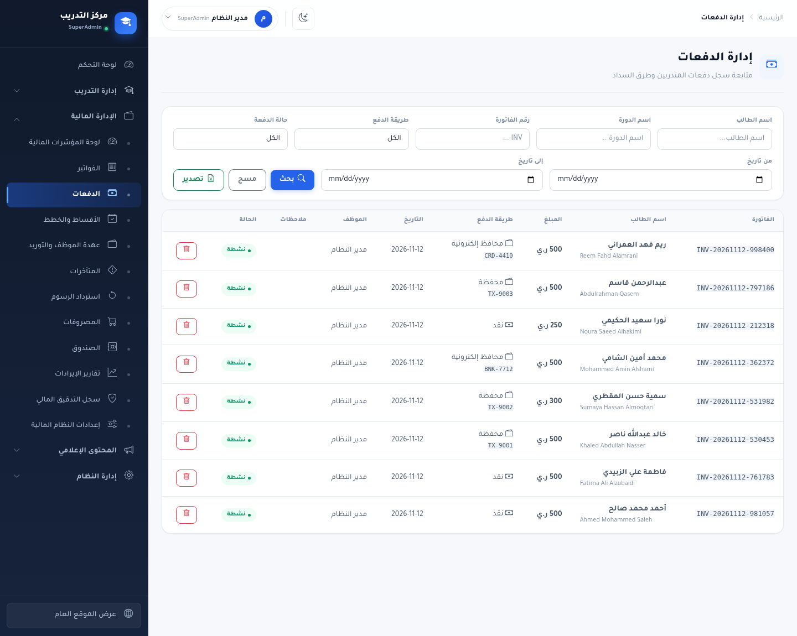

> 

> *الشكل: قائمة الدفعات — لقطة فعلية من النظام عند المسار `/Payments`.*

### 5.6 تسجيل دفعة — `/Payments/Add/{invoiceId}`

**الصلاحيات:** `manage-payments` + داخل النطاق + الفاتورة غير ملغاة.

| الحقل | النوع | مطلوب | ملاحظات |
|-------|------|-------|---------|
| **المبلغ** | number | نعم | لا يتجاوز المتبقي (max) |
| **طريقة الدفع** | select | نعم | نقد / تحويل بنكي / محفظة إلكترونية / بطاقة |
| **رقم السند** (ReferenceNumber) | text | **شرطي** | **إجباري للطرق الإلكترونية** (يظهر/يختفي ديناميكياً) |
| **ملاحظات** | textarea | لا | |
| زر **تسجيل الدفعة** | — | — | يرسل إلى `POST /Payments/Add` |

#### المنطق والقواعد
1. **إقفال الفترة:** إن كان تاريخ الدفع داخل فترة مقفلة ⇒ رفض.
2. **المبلغ > 0** إلزامي.
3. **رقم السند** إلزامي للطرق غير النقدية (يُفرض في JS والخادم معاً).
4. **المبلغ ≤ المتبقي** — مع **قفل صف الفاتورة** (`SELECT … FOR UPDATE`) وإعادة الفحص داخل المعاملة لمنع
   الدفع المزدوج عند تزامن عمليتين.
5. **عند النجاح:** تُسجَّل الدفعة، تُضاف إلى **عهدة المحصّل**، وتُعاد الفاتورة إلى حساب الرصيد، ويُولَّد
   PublicId للتحقق، ثم يُعاد التوجيه إلى **سند القبض**.

> **نموذج الدفع الإلكتروني — رقم السند إجباري — `/Payments/Add?invoiceId=4`**
>
> 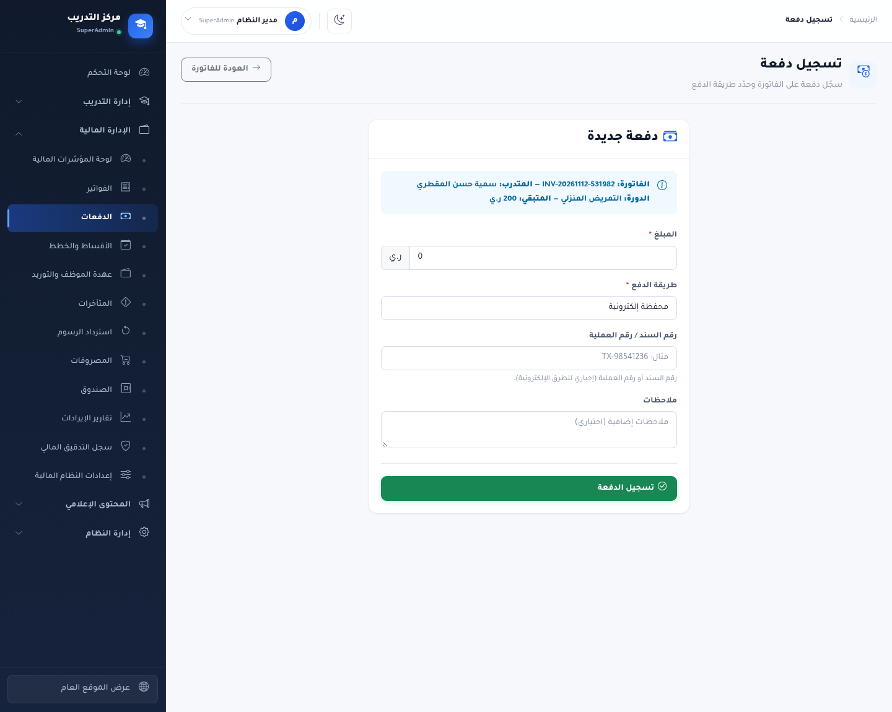

### 5.7 سند القبض — `/Payments/Receipt/{id}`

**الصلاحيات:** `manage-payments` + داخل النطاق. تخطيط طباعة مستقل.

#### المحتوى
بيانات الدفعة والفاتورة: **المبلغ المستحق**، **المبلغ المدفوع**، **إجمالي المدفوع**، **المتبقي**، مع
**رمز QR** لرابط التحقق العام، وزر **طباعة**، وزر **إرسال عبر واتساب** (رابط مباشر برسالة جاهزة).

> **سند القبض مع رمز QR — `/Payments/Receipt/1`**
>
> 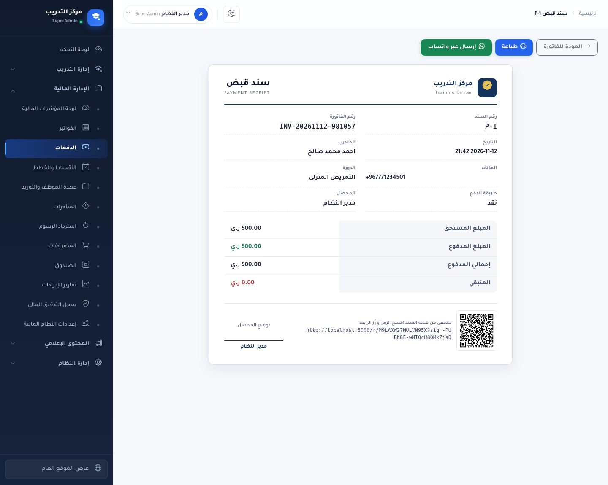

### 5.8 الأقساط والخطط — `/Installments/Index`

**الصلاحيات:** `manage-installments`. مقيّد بنطاق الدورات.

#### الأعمدة
الفاتورة، المتدرب، الدورة، الأقساط (عدد مدفوع/إجمالي)، المسدد، المتأخر، المتبقي.

#### الأزرار
- **الأقساط المتأخرة** → `/Installments/Late`.
- **الفواتير غير المسددة** → قائمة الفواتير.
- **تعديل الخطة** → `/Installments/Create/{invoiceId}`.
- **طباعة** → `/Installments/Print/{invoiceId}`.

> **الأقساط والخطط — `/Installments`**
>
> 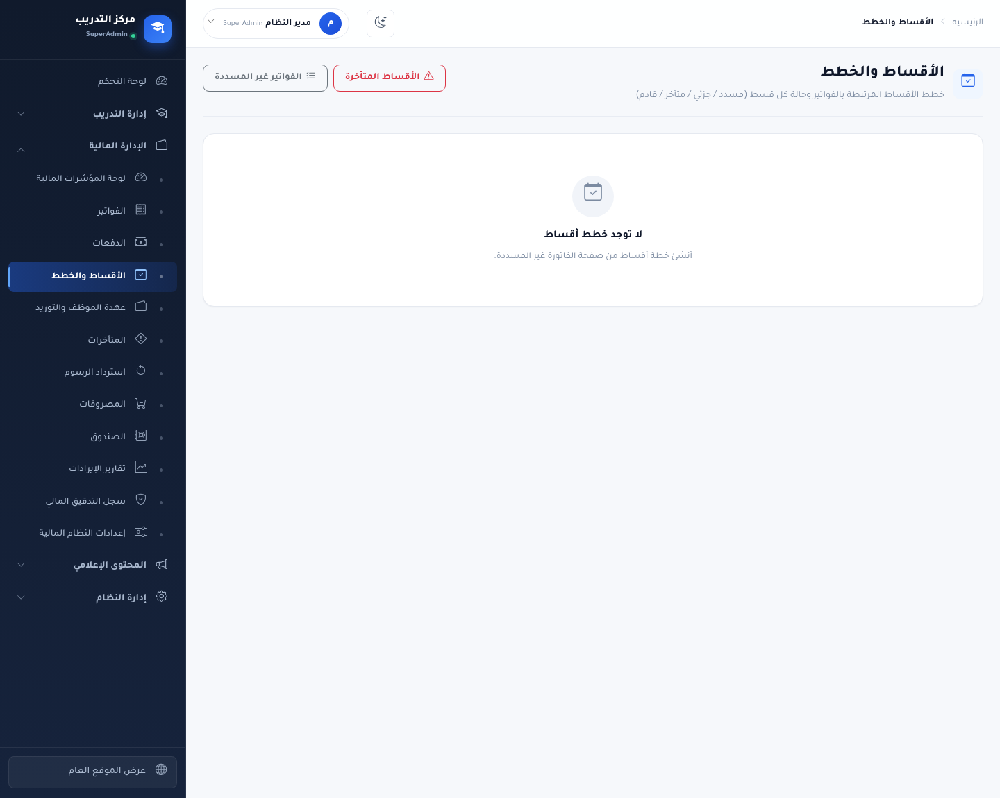

> 

> *الشكل: الأقساط والخطط — لقطة فعلية من النظام عند المسار `/Installments`.*

### 5.9 إنشاء خطة أقساط — `/Installments/Create/{invoiceId}`

صفوف ديناميكية، كل صف: **المبلغ** (number) + **تاريخ الاستحقاق** (date)، مع زر **إضافة قسط**، وحقل
**ملاحظة**، وزر **حفظ الخطة**. الأعمدة: #، المبلغ، تاريخ الاستحقاق.

> **قاعدة:** الخطة لا تحمل رصيداً؛ حالة كل قسط (مدفوع/جزئي/متأخر/قادم) تُشتق دائماً من الدفعات الحقيقية
> (مع توزيع الدفعات على الأقساط زمنياً).

> **إنشاء خطة أقساط — `/Installments/Create?invoiceId=1`**
>
> 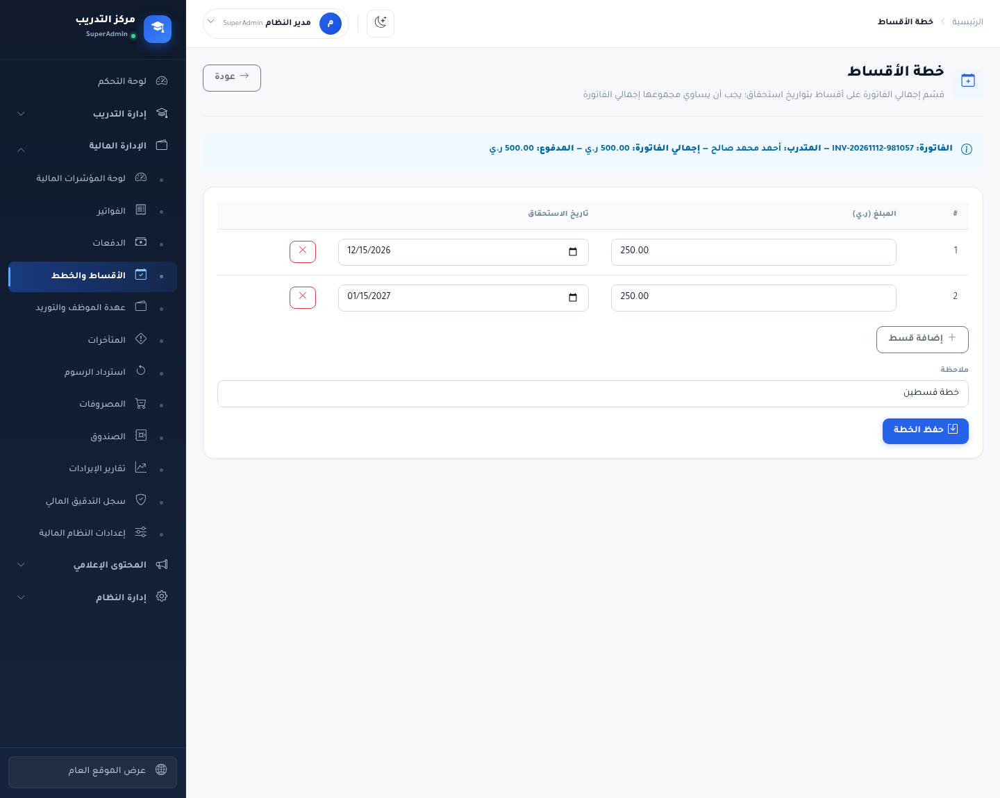

### 5.10 الأقساط المتأخرة — `/Installments/Late`

جدول الأقساط المتأخرة فقط: الفاتورة، المتدرب، الدورة، القسط، الاستحقاق، المتبقي، التأخير (بالأيام)، مع
زر **قبض** (يقود لتسجيل دفعة) وزر **كل الخطط**.

> **الأقساط المتأخرة — `/Installments/Late`**
>
> 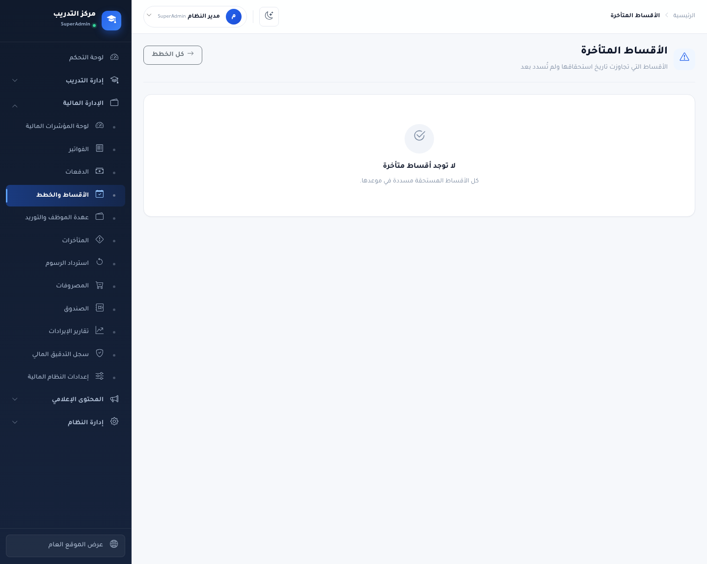

> 

> *الشكل: الأقساط — لقطة فعلية من النظام عند المسار `/Installments`.*

### 5.11 طباعة جدول الأقساط — `/Installments/Print/{invoiceId}`

جدول نظيف للطباعة: #، تاريخ الاستحقاق، المبلغ المستحق، المدفوع، المتبقي، الحالة. أزرار: **طباعة / حفظ
PDF**، **إغلاق**.

### 5.12 عهدة الموظف والتوريد — `/Custody/Index`

**الغرض:** إدارة عهدة الموظف النقدية وتقديم طلب توريد للصندوق الرئيسي، ومراجعة الطلبات (مدير النظام).

**الصلاحيات:** `view-custody`.
- **الموظف:** يرى **عهدته فقط** وسجل حركاتها.
- **مدير النظام:** يرى **عهد كل الموظفين** وطابور الطلبات المعلّقة، ويمكنه عرض عهدة أي موظف.

#### بطاقات KPI
- **رصيد العهدة الحالي** (للموظف المستهدف).
- **طلبات قيد المراجعة** (طلبات الموظف المستهدف).
- (مدير النظام فقط): **إجمالي العهد لدى الموظفين**، **طلبات توريد معلّقة (الكل)**.

#### قسم «أرصدة العهد لدى الموظفين» (مدير النظام فقط)
جدول: الموظف، اسم المستخدم، رصيد العهدة، زر **عرض** (لفتح عهدة موظف بعينه عبر `?userId=`).

#### قسم «طلبات التوريد بانتظار القرار» (مدير النظام فقط)
جدول: الموظف، المبلغ، ملاحظة الموظف، تاريخ التقديم، القرار — مع:
- حقل **ملاحظة (اختياري)** + زر **اعتماد** (بتأكيد) → `Approve`.
- زر **رفض** (بتأكيد) → `Reject`.

#### قسم «توريد / ترحيل للصندوق الرئيسي» (لكل موظف)
| الحقل | الوصف |
|-------|-------|
| **المبلغ (رمز العملة)** | number، بحد أقصى = رصيد العهدة |
| **ملاحظة للمراجعة (اختياري)** | text |
| زر **تقديم طلب توريد** | → `RequestHandover` |

**القواعد:**
- المبلغ > 0 ولا يتجاوز رصيد العهدة.
- **طلب واحد معلّق فقط في الوقت نفسه** — لا يمكن تقديم طلب آخر حتى يُعتمد أو يُرفض.
- عند الاعتماد (مدير النظام): يُخصم المبلغ من العهدة ويُضاف إلى الصندوق **في معاملة واحدة** (لا يُحسب
  المال مرتين ولا يضيع). الرفض لا يغيّر شيئاً.

#### قسم «سجل طلبات التوريد»
جدول: #، المبلغ، الحالة (قيد المراجعة/معتمد/مرفوض)، راجعها، التاريخ.

#### قسم «حركات العهدة»
فلاتر: **النوع** (الكل/قبض/استرداد/توريد للصندوق/تسوية)، **من/إلى** (تاريخ)، **بحث (ملاحظة/مرجع)**.
الأعمدة: #، النوع، المبلغ (مع إشارة +/− ملوّنة)، المرجع، ملاحظة، التاريخ. مع **ترقيم صفحات (20/صفحة)**.

> **عهدة الموظف والتوريد (مدير النظام) — `/Custody`**
>
> 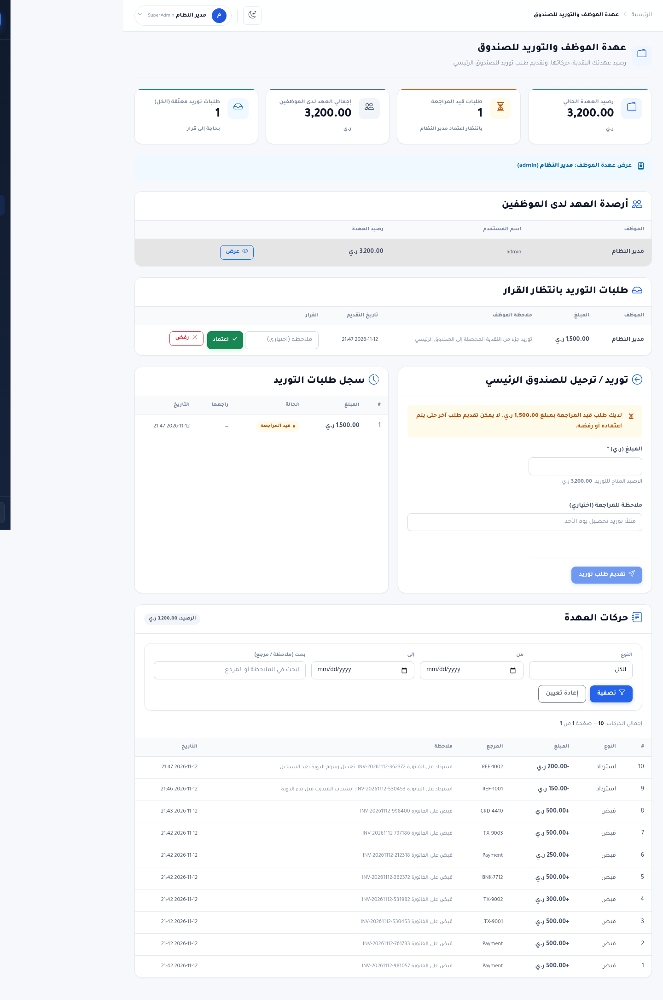

> **عهدة الموظف والتوريد (مدير النظام) — `/Custody`**
>
> 

### 5.13 المتأخرات — `/Receivables/Index`

**الصلاحيات:** `view-receivables`. مقيّد بنطاق الدورات.

#### الفلاتر
**الدورة** (select)، **بحث**، **الفئة العمرية (bucket)** (select).
الفئات العمرية: غير مستحق بعد، متأخر 1–30 يوم، 31–60، 61–90، أكثر من 90، بلا تاريخ استحقاق.

#### الأعمدة
رقم الفاتورة، المتدرب، الدورة، المستحق، المدفوع، المتبقي، الاستحقاق، الفئة.

#### الأزرار
**تصدير XLSX**، **مسح**، **كشف** (→ كشف حساب)، **قبض** (→ تسجيل دفعة).

> **قاعدة:** تُحتسب المتأخرات من الفواتير غير الملغاة وغير المدفوعة، والمتبقي = الإجمالي − (الدفعات
> النشطة − الاستردادات المعتمدة).

> **المتأخرات — `/Receivables`**
>
> 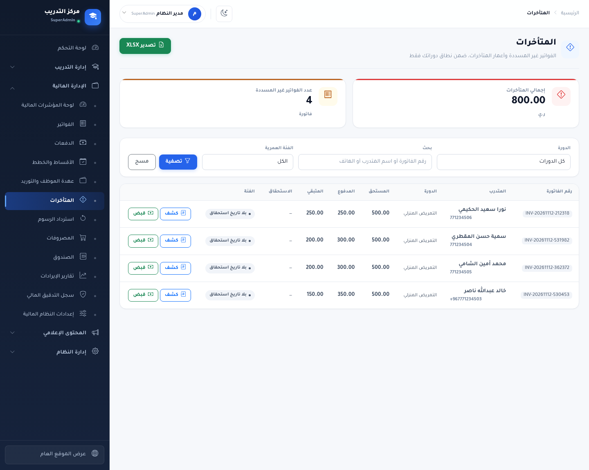

### 5.14 كشف حساب — `/Receivables/Statement/{invoiceId}`

**الصلاحيات:** `view-receivables` + داخل النطاق.

يعرض: **بيانات الحساب** (الفاتورة، المتدرب، الدورة، الإجمالي، المدفوع، المسترد، المتبقي)، و**حركات
الحساب** (جدول: التاريخ، النوع، المرجع، المبلغ، الموظف) يجمع الدفعات والاستردادات زمنياً. الأزرار:
**المتأخرات**، **الفاتورة**، **تسجيل دفعة**، **استرداد**.

> **كشف حساب متدرب — `/Receivables/Statement?invoiceId=1`**
>
> 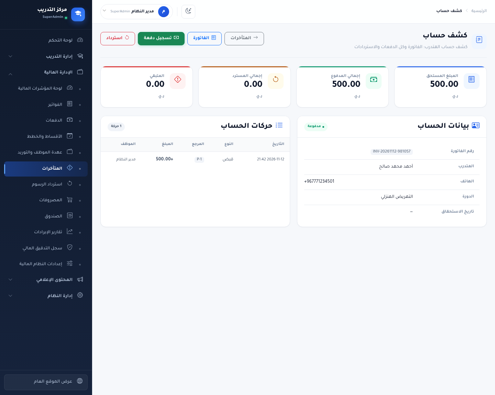

> 

> *الشكل: كشف حساب — لقطة فعلية من النظام عند المسار `/Receivables/Statement`.*

### 5.15 استرداد الرسوم — `/Refunds/Index`

**الصلاحيات:** `manage-refunds`. مقيّد بنطاق الدورات.

#### الفلاتر
حقل **بحث** (رقم الفاتورة/اسم المتدرب/رقم السند).

#### الأقسام
- **بانتظار الاعتماد:** جدول الاستردادات بحالة PendingApproval، مع زر **اعتماد** (مدير النظام فقط).
- **الاستردادات:** جدول كامل: رقم السند، الفاتورة، المتدرب، المبلغ، السبب، نفّذه، الحالة، التاريخ، مع
  رابط **سند**.

> **استرداد الرسوم — `/Refunds`**
>
> 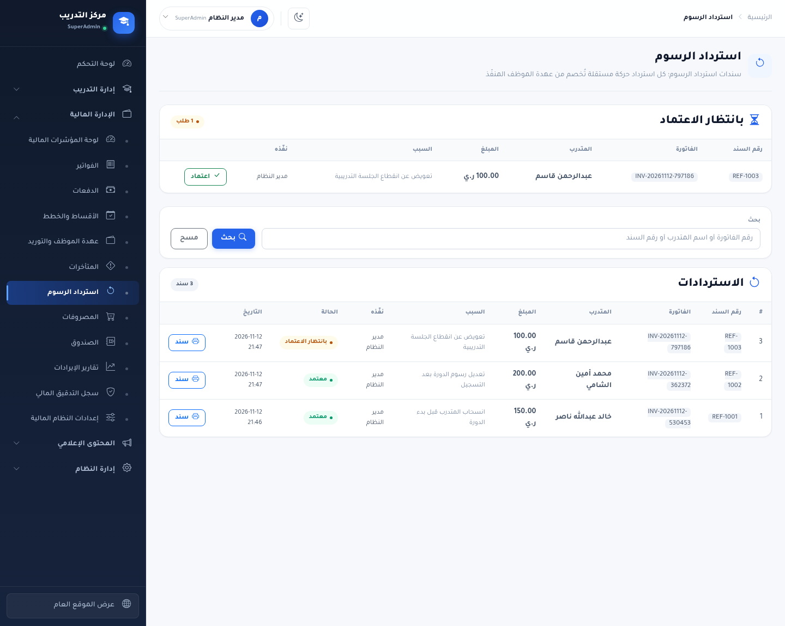

> 

> *الشكل: استرداد الرسوم — لقطة فعلية من النظام عند المسار `/Refunds`.*

### 5.16 إنشاء استرداد — `/Refunds/Create/{invoiceId}`

**الصلاحيات:** `manage-refunds` + داخل النطاق + الفاتورة غير ملغاة.

| الحقل | النوع | مطلوب | ملاحظات |
|-------|------|-------|---------|
| **المبلغ** | number | نعم | بحد أقصى = min(المتاح للاسترداد، مصدر الصرف) |
| **سبب الاسترداد** | text | نعم | |
| **طريقة الاسترداد** | select | نعم | نقد / تحويل بنكي / محفظة إلكترونية |
| **رقم سند الصرف (اختياري)** | text | لا | |
| زر **تسجيل الاسترداد** | — | — | بتأكيد، يوضّح المصدر |

**قواعد المصدر والحدّ (موثّقة من `FinancialService`):**
- **المتاح للاسترداد** = صافي مدفوع الفاتورة (الدفعات − الاستردادات المعتمدة) **ناقص** أي استردادات
  معلّقة، كي لا يتجاوز استردادان معلّقان الحدّ معاً.
- **مصدر الصرف:** من **عهدة الموظف**؛ ويُرفض إن لم تكفِ العهدة (لا تصبح سالبة أبداً).
- **استثناء مدير النظام:** إن لم تكفِ عهدته، يصرف من **الصندوق الرئيسي** (بشرط كفاية الصندوق)، فلا يُحجب
  مدير النظام ولا تُدفع أي عهدة تحت الصفر.
- **حد اعتماد الاسترداد:** إن كان المبلغ **أكبر** من الحدّ المُعدّ في إعدادات النظام المالية ⇒ يُسجَّل
  الطلب بحالة **بانتظار الاعتماد** ولا يحرّك أي مال حتى يعتمده مدير النظام.

> **سند الاسترداد — `/Refunds/Receipt/1`**
>
> 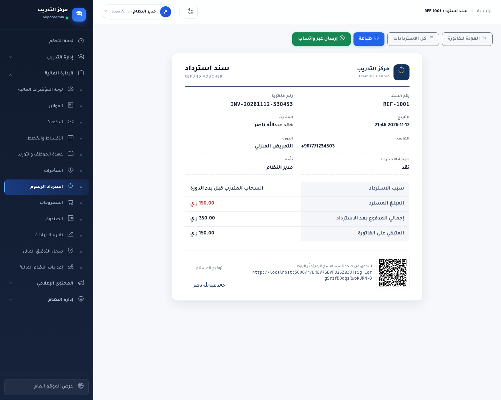

### 5.17 سند الاسترداد — `/Refunds/Receipt/{id}`

**الصلاحيات:** `manage-refunds` + داخل النطاق. تخطيط طباعة مستقل.

يعرض: **سبب الاسترداد**، **المبلغ المسترد**، **إجمالي المدفوع بعد الاسترداد**، **المتبقي على الفاتورة**،
مع **QR** للتحقق العام، وزر **طباعة**، وزر **إرسال عبر واتساب**، ورابط **كل الاستردادات**.

### 5.18 المصروفات — `/Expenses/Index`

**الصلاحيات:** `manage-expenses`. **غير مقيّد بنطاق الدورات** (المصروف للمؤسسة ككل).

#### الفلاتر
**البند** (select)، **الحالة** (select)، **من/إلى** (date). الأزرار: **تصفية**، **مسح**.

#### الأعمدة
التاريخ، البند، البيان، المبلغ، المستند، قدّمه، الحالة.

#### الأزرار
- **بنود المصروفات** → `/Expenses/Categories`.
- **تصدير XLSX**، **مصروف جديد** → `/Expenses/Create`.
- لكل صف (مدير النظام فقط): **اعتماد** / **رفض** (بحقل ملاحظة)، مع قفل صف المصروف لمنع الاعتماد المزدوج.

> **المصروفات — `/Expenses`**
>
> 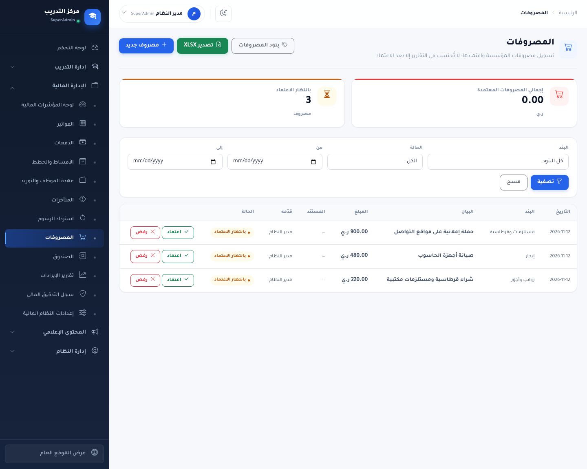

> 

> *الشكل: قائمة المصروفات — لقطة فعلية من النظام عند المسار `/Expenses`.*

### 5.19 مصروف جديد — `/Expenses/Create`

| الحقل | النوع | مطلوب |
|-------|------|-------|
| **بند المصروف** | select | نعم |
| **المبلغ (رمز العملة)** | number | نعم |
| **البيان** | text | نعم |
| **تاريخ المصروف** | date | لا |
| **رقم المستند** | text | لا |
| **المرفق (صورة الفاتورة)** | file | لا (يُتحقق منها) |
| زر **حفظ المصروف** | — | — |

### 5.20 بنود المصروفات — `/Expenses/Categories`

جدول: البند، الترتيب، الحالة، عدد المصروفات. نموذج **إضافة بند**: **اسم البند** (مطلوب)، **الترتيب**
(number)، **نشط** (checkbox)، زر **حفظ البند**.

### 5.21 الصندوق الرئيسي — `/Cashbox/Index`

**الغرض:** الصندوق العام — التوريدات المعتمدة من العهد والسحوبات.

**الصلاحيات:** **مدير النظام فقط** (لا تفتحه أي صلاحية ممنوحة). أي مستخدم آخر يُرفض بـ 403.

#### بطاقات KPI
- **إجمالي المحصَّل من الدورات**
- **إجمالي المورَّد للصندوق**
- **إجمالي العهد لدى الموظفين** (لم تُورَّد بعد)
- **الصندوق المتاح** = المورَّد − المسحوب

#### قسم «سحب من الصندوق — لمدير النظام فقط»
| الحقل | الوصف |
|-------|-------|
| **المبلغ (رمز العملة)** | number، بحد أقصى = الصندوق المتاح |
| **السبب / البيان** | text (مطلوب) |
| زر **سحب** | بتأكيد → `Withdraw` |

**القواعد:** المبلغ > 0، السبب إلزامي، لا يتجاوز الصندوق المتاح، ويحترم **إقفال الفترة**.

#### قسم «التوريدات المعتمدة من العهد»
جدول: #، الدورة (أو «توريد عهدة»)، المبلغ، الملاحظة، أنشأها، التاريخ.

#### قسم «عمليات السحب من الصندوق»
جدول: #، المبلغ، السبب/البيان، سحبها، التاريخ.

> **الصندوق الرئيسي (مدير النظام فقط) — `/Cashbox`**
>
> 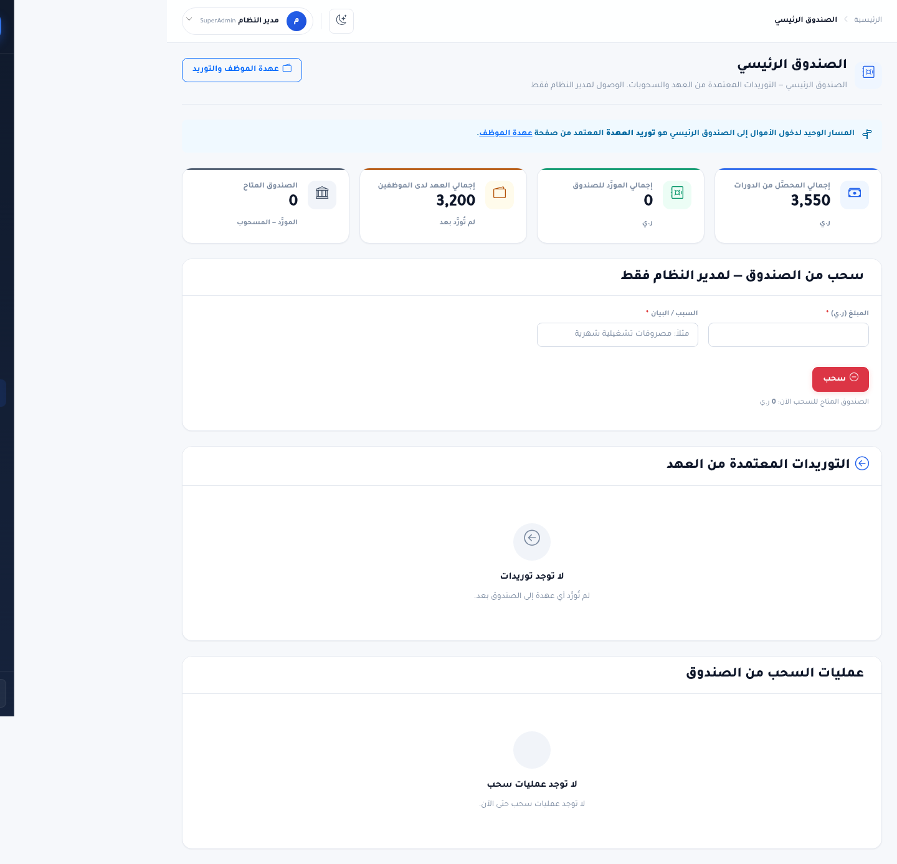

> **الصندوق الرئيسي (مدير النظام فقط) — `/Cashbox`**
>
> 

### 5.22 تقارير الإيرادات — `/Reports/CourseRevenue`

**الصلاحيات:** `view-reports`. مقيّد بنطاق الدورات.

#### الفلاتر
**الفئة**، **الدورة**، **حالة الدورة**، **من/إلى** (تاريخ). الأزرار: **تصفية**، **مسح**، **تصدير XLSX**.

#### الأعمدة
الدورة، الفئة، المسجلين، المتوقع، المدفوع، المسترد، صافي الإيراد الفعلي، المتبقي، نسبة التحصيل %.

#### التقرير الفرعي — تفاصيل تحصيلات الدورة `/Reports/CourseRevenueDetail/{courseId}`
- **تحصيلات المتدربين:** الفاتورة، المتدرب، الهاتف، المتوقع، المدفوع، المسترد، صافي المدفوع، المتبقي، الحالة.
- **التوزيع حسب الموظف:** الموظف، عدد الدفعات، المبلغ، النسبة.
- **التوزيع حسب طريقة الدفع:** طريقة الدفع، عدد الدفعات، المبلغ، النسبة.
- أزرار: **طباعة (PDF)** → `PrintCourseRevenueDetail`، **عودة**.

> **تفاصيل تحصيلات دورة — `/Reports/CourseRevenueDetail?courseId=1`**
>
> 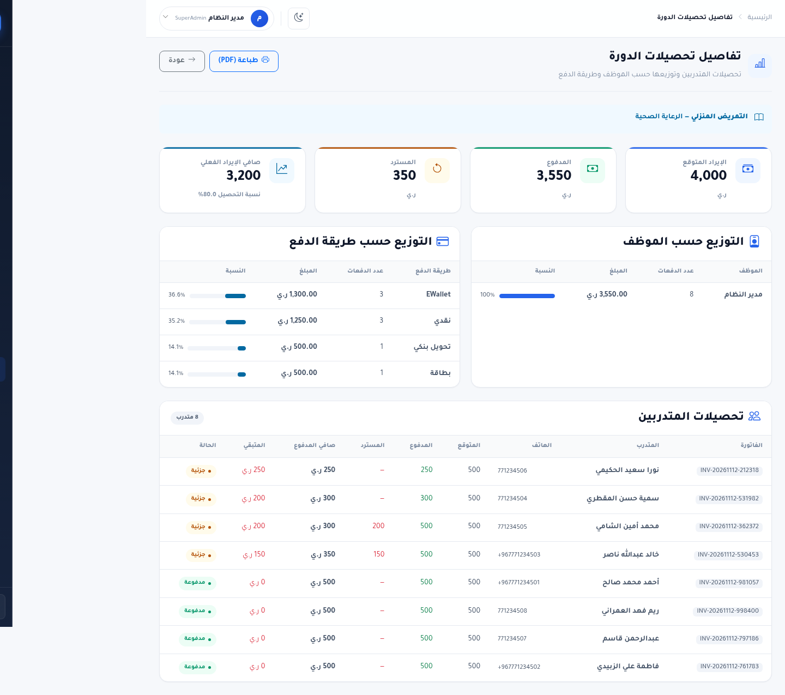

### 5.23 التدفق النقدي — `/Reports/CashFlow`

**الصلاحيات:** `view-reports`. الفلاتر: **من/إلى** (افتراضياً آخر 30 يوماً). زر **عرض**، **تصدير XLSX**،
**إعادة تعيين**. الأعمدة: التاريخ، التحصيل، الاسترداد، السحب، المصروفات، الصافي. مع صف الإجمالي.

### 5.24 قائمة الدخل — `/Reports/IncomeStatement`

**الصلاحيات:** `view-reports`. الفلاتر: **من/إلى** (افتراضياً من بداية السنة). يعرض **الإيرادات**
(التحصيلات − الاستردادات = صافي الإيراد) و**المصروفات حسب البند**، ثم **صافي الدخل**.
زر **تصدير XLSX**، **إعادة تعيين**.

> **قائمة الدخل — `/Reports/IncomeStatement`**
>
> 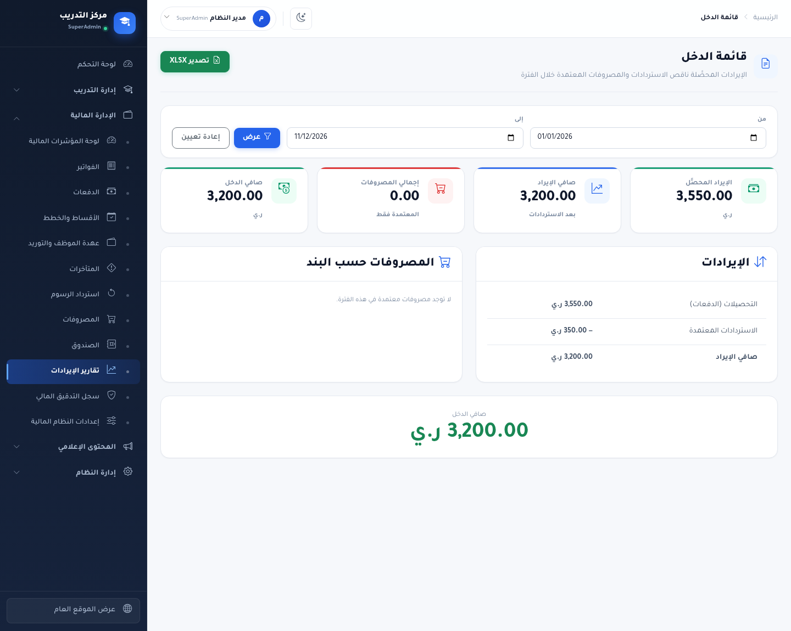

### 5.25 أعمار المتأخرات — `/Reports/Aging`

**الصلاحيات:** `view-receivables`. جدول: الفئة العمرية، عدد الفواتير، المبلغ، النسبة.

### 5.26 المطابقة النقدية — `/Reports/Reconciliation`

**الصلاحيات:** `view-financial-audit`. الفلاتر: **من/إلى**، زر **مطابقة**، زر **اليوم**.

#### قسم «حركات الفترة»
إجمالي التحصيل، الاستردادات المعتمدة (ومنها استرداد من الصندوق)، التوريدات للصندوق، المسحوب من الصندوق.

#### قسم «الأرصدة»
رصيد الصندوق، إجمالي العهد، **رصيد النظام**، **رصيد الحركات**، **الفرق** — مع شارة خضراء «النقد مطابق»
أو تحذير بالفرق.

**المعادلة الموثّقة:**
- **رصيد النظام** = رصيد الصندوق + إجمالي العهد.
- **رصيد الحركات** = التحصيل − الاستردادات المعتمدة − المسحوب.
- يتطابقان عندما تكون كل تحصيلة إما في عهدة موظف أو مورَّدة للصندوق، والاستردادات خرجت من العهد، ولا
  سحب يتجاوز الصندوق.

> **الصندوق الرئيسي (مدير النظام فقط) — `/Cashbox`**
>
> 

### 5.27 سجل التدقيق المالي — `/FinancialAudit/Index`

**الصلاحيات:** `view-financial-audit`. (قراءة فقط — لا يعدّل شيئاً.)

#### الفلاتر
**نوع العملية** (select من الأنواع الموجودة)، **المستخدم** (select)، **من/إلى** (تاريخ)، **بحث**
(في التفاصيل/رقم المرجع). الأزرار: **تصفية**، **مسح**، **تصدير XLSX**.

#### الأعمدة
#، التاريخ، المستخدم، العملية، المبلغ، المرجع، التفاصيل. مع مؤشرات: إجمالي المبلغ وعدد السجلات.

**أنواع العمليات:** قبض، استرداد، اعتماد استرداد، إلغاء، إعفاء، توريد عهدة، ترحيل، سحب، مصروف، إقفال
فترة، إعادة فتح فترة.

> **سجل التدقيق المالي — `/FinancialAudit`**
>
> 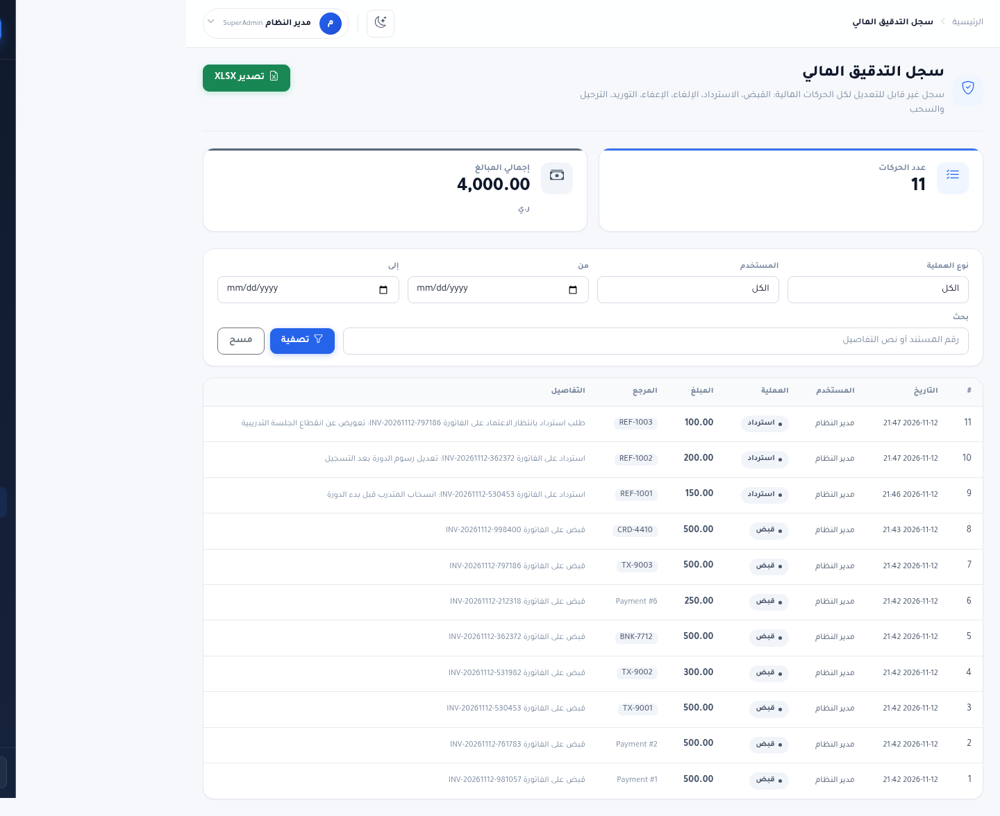

### 5.28 إعدادات النظام المالية — `/FinanceSettings/Index`

**الصلاحيات:** `manage-finance-settings` — **حصرية لمدير النظام**.

#### قسم «العملة»
| الحقل | الوصف |
|-------|-------|
| **اسم العملة** | text (مطلوب) — الافتراضي «ريال يمني» |
| **رمز العرض** | text (مطلوب) — الافتراضي «ر.ي» |
| زر **حفظ العملة** | — |

> **ملاحظة:** الرمز للعرض فقط؛ الصفحة تعرض عدد السجلات التي ستظهر بالرمز (الفواتير + الدفعات + الاستردادات).

#### قسم «حد اعتماد الاسترداد»
| الحقل | الوصف |
|-------|-------|
| **أقصى مبلغ يُسترد مباشرةً (رمز العملة)** | number — أي استرداد أكبر ينتقل لبانتظار اعتماد مدير النظام |
| زر **حفظ الحد** | — |

#### قسم «إقفال الفترة المالية»
| الحقل | الوصف |
|-------|-------|
| **إقفال حتى تاريخ** | date (مطلوب) |
| **ملاحظة** | text (اختياري) |
| زر **إقفال الفترة** | يقفل كل الحركات حتى التاريخ |
| **سبب إعادة الفتح** | text |
| زر **إعادة الفتح** | يفتح الفترة المقفلة (يُسجَّل ويُرسَل تنبيه) |

#### قسم «سجل الإقفال»
جدول: مقفلة حتى، بواسطة، التاريخ، الحالة (نشط/سابق)، ملاحظة.

> **قواعد الإقفال:** الإقفال الجديد يُلغي الإقفال السابق (إقفال واحد نشط). الإقفال يمنع الكتابة في أي
> حركة (دفعة، استرداد، سحب، توريد) تاريخها ≤ تاريخ الإقفال. كل إقفال/إعادة فتح يُدقّق ويُنبَّه عليه.

> **إعدادات النظام المالية — `/FinanceSettings`**
>
> 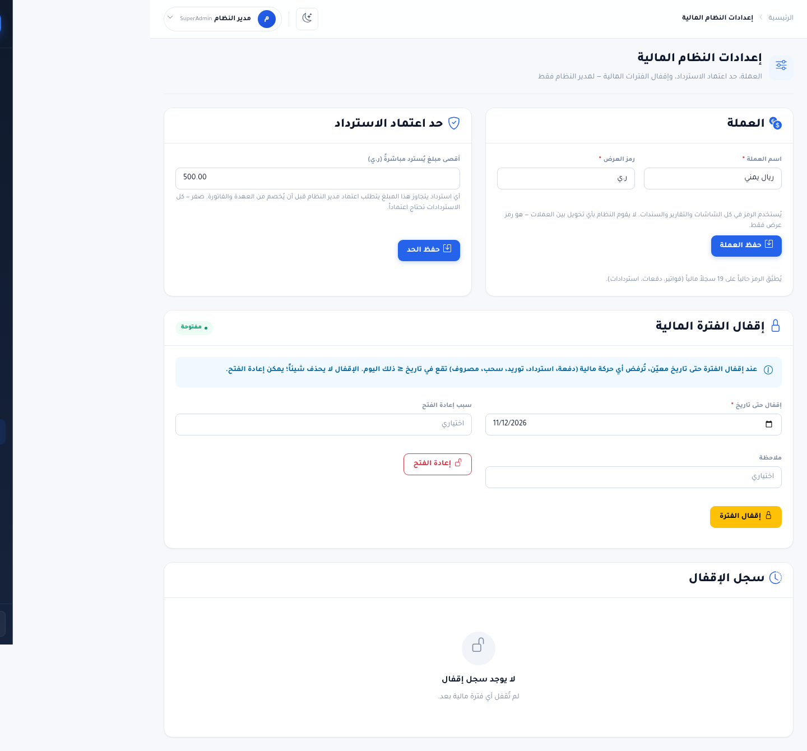

---

## الفصل 6 — المحتوى الإعلامي

### 6.1 المنشورات — `/PostsManage/Index`

**الصلاحيات:** `manage-posts`.

| العنصر | الوصف |
|--------|-------|
| حقل **بحث** + **بحث** | بحث بالعنوان |
| **إضافة منشور** | → `/PostsManage/Create` |
| الأعمدة | العنوان، الكاتب، الحالة، تاريخ النشر، إجراءات |
| أزرار الصف | **نشر / إلغاء النشر / حذف** |

#### إضافة/تعديل منشور
الحقول: **العنوان** (مطلوب)، **المحتوى** (textarea، مطلوب)، **صورة المنشور** (رفع)، **الحالة** (select).
الأزرار: **حفظ المنشور**، **العودة للمنشورات**، **إلغاء**.

> **المنشورات — `/PostsManage`**
>
> 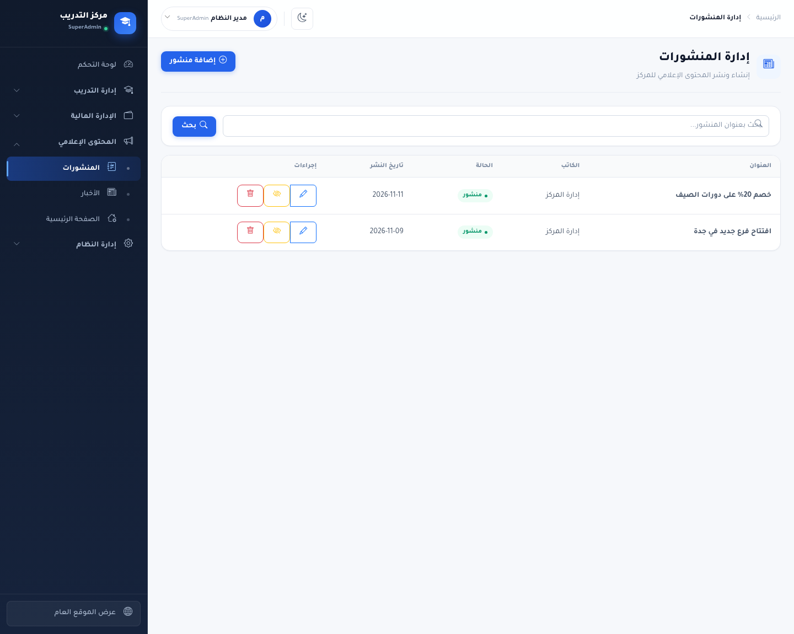

> 

> *الشكل: إدارة المنشورات — لقطة فعلية من النظام عند المسار `/PostsManage`.*

### 6.2 الأخبار — `/NewsManage/Index`

**الصلاحيات:** `manage-news`. بنية مطابقة للمنشورات (بحث، إضافة، تعديل، نشر/إلغاء نشر/حذف).
الأعمدة: الصورة، العنوان، الكاتب، الحالة، تاريخ النشر، إجراءات.

### 6.3 إدارة الصفحة الرئيسية — `/HomepageManage/Index`

**الصلاحيات:** `manage-homepage`. الصفحة هي **مركز تحكم** بروابط لأقسام فرعية:

| القسم | المسار | الوصف |
|-------|--------|-------|
| **الشرائح (Slider)** | `/HomepageManage/Slides` | إدارة شرائح القسم الرئيسي |
| **النصوص المتحركة** | `/HomepageManage/AnimatedTexts` | نصوص متغيرة |
| **إدارة الأقسام** | `/HomepageManage/Sections` | إظهار/إخفاء وترتيب الأقسام |
| **الإحصائيات** | `/HomepageManage/Stats` | بطاقات الأرقام |
| **معلومات التواصل** | `/HomepageManage/Contact` | الهاتف، البريد، العنوان |
| **التواصل الاجتماعي** | `/HomepageManage/Social` | روابط المنصات |
| **من نحن والفوتر** | `/HomepageManage/AboutFooter` | نبذة المركز وظهور الفوتر |
| **الألوان والهوية البصرية** | `/HomepageManage/Theme` | ألوان الموقع |
| **إعدادات الموقع** | `/HomepageManage/SiteSettings` | الاسم، الشعار، SEO |

#### 6.3.1 الشرائح — `/HomepageManage/Slides`
الحقول: **العنوان** (مطلوب)، **الوصف**، **نص/رابط الزر الأول**، **نص/رابط الزر الثاني**، **صورة الشريحة**،
**الحالة**. الأزرار: **إضافة شريحة**، **حفظ**، **إلغاء**، ولكل شريحة **تعديل/حذف/تحريك (ترتيب)**.
الأعمدة: الصورة، العنوان، الأزرار، الحالة، الترتيب، إجراءات.

#### 6.3.2 النصوص المتحركة — `/HomepageManage/AnimatedTexts`
حقل **النص** + زر **إضافة**، وجدول (النص، الحالة، إجراءات: تبديل/حذف).

#### 6.3.3 إدارة الأقسام — `/HomepageManage/Sections`
جدول: القسم، المعرف، الحالة، الترتيب. أزرار: تبديل الظهور (**ظاهر/مخفي**) و**تحريك**.

#### 6.3.4 الإحصائيات — `/HomepageManage/Stats`
لكل بطاقة: **التسمية**، **اللون**، **الأيقونة**، **المصدر التلقائي** (select)، **تلقائي من قاعدة
البيانات** (checkbox)، **ظاهر** (checkbox)، **قيمة ثابتة**. زر **حفظ الإحصائيات**.

#### 6.3.5 معلومات التواصل — `/HomepageManage/Contact`
حقول لكل نوع (الهاتف الأرضي، الجوال، البريد، العنوان، ساعات العمل) + checkbox **إظهار في الموقع** لكلٍّ.
زر **حفظ معلومات التواصل**.

#### 6.3.6 التواصل الاجتماعي — `/HomepageManage/Social`
جدول الروابط (المنصة، الأيقونة، الرابط، الحالة) + نموذج إضافة (**اسم المنصة**، **الأيقونة (Bootstrap
Icon)**، **الرابط**). أزرار **حفظ الروابط**، **إضافة**.

#### 6.3.7 من نحن والفوتر — `/HomepageManage/AboutFooter`
الحقول: **AboutTitle**، **AboutSummary**، **AboutContent**، ومفاتيح ظهور الفوتر (**FooterEnabled**،
**FooterShowQuickLinks**، **FooterShowContact**، **FooterShowAboutLinks**، **FooterShowSocial**).
زر **حفظ التعديلات**، **معاينة صفحة من نحن**، **إدارة بيانات التواصل**، **معاينة عامة**.

#### 6.3.8 الألوان والهوية — `/HomepageManage/Theme`
منتقيات ألوان: **اللون الأساسي، الثانوي، لون الأزرار، لون شريط التنقل، لون الفوتر**. زر **حفظ الألوان**.

#### 6.3.9 إعدادات الموقع — `/HomepageManage/SiteSettings`
الحقول: **اسم المركز**، **الشعار (Logo)**، **أيقونة الموقع (Favicon)**، **نص حقوق النشر**، **وصف الموقع
(Meta Description)**، **الكلمات المفتاحية (SEO Keywords)**. زر **حفظ الإعدادات**.

> **إدارة الصفحة الرئيسية — `/HomepageManage`**
>
> 

---

## الفصل 7 — إدارة النظام

### 7.1 المستخدمون — `/Users/Index`

**الصلاحيات:** `manage-users`.

#### الفلاتر
**بحث** (الاسم/البريد/اسم المستخدم)، **الدور** (select)، **الحالة** (الكل/نشط/معطل)،
**النطاق** (الكل/محدد بدورات أو فئات/كل الدورات). الأزرار: **تصفية**، **مسح**.

#### الأعمدة
اسم المستخدم، الاسم الكامل، البريد، الأدوار، الدورات المسموح بها، الحالة، آخر دخول، إجراءات.

#### أزرار الصف
- **تعديل** → `/Users/Edit/{id}`.
- **تعطيل/تفعيل** → `ToggleActive` (بتأكيد عند التعطيل).
- **إعادة تعيين كلمة المرور** (يفتح نافذة منبثقة) → `ResetPassword` بحقل **كلمة المرور الجديدة**.

#### رأس الصفحة
**إضافة مستخدم** → `/Users/Create`، و**الأدوار والصلاحيات** (يظهر لمدير النظام فقط).

> **المستخدمون — `/Users`**
>
> 

### 7.2 إضافة مستخدم — `/Users/Create`

**الصلاحيات:** `manage-users`.

| الحقل | النوع | مطلوب |
|-------|------|-------|
| **اسم المستخدم** | text | نعم (فريد) |
| **الاسم الكامل** | text | نعم |
| **البريد الإلكتروني** | email | — |
| **الهاتف** | text | — |
| **كلمة المرور** | password | نعم (وفق السياسة) |
| **الدور** | select | نعم (أدوار متاحة) |
| **نطاق الدورات** | منتقي | (مدير النظام فقط) |

**القواعد:**
- **الأدوار المتاحة:** مدير النظام يرى كل الأدوار؛ غيره يرى الأدوار غير النظامية فقط.
- **النطاق:** مدير النظام يحدّد الفئات/الدورات؛ غيره يرث نطاقه تلقائياً (نص توضيحي يظهر في المنتقي).

> **إضافة مستخدم (منتقي النطاق) — `/Users/Create`**
>
> 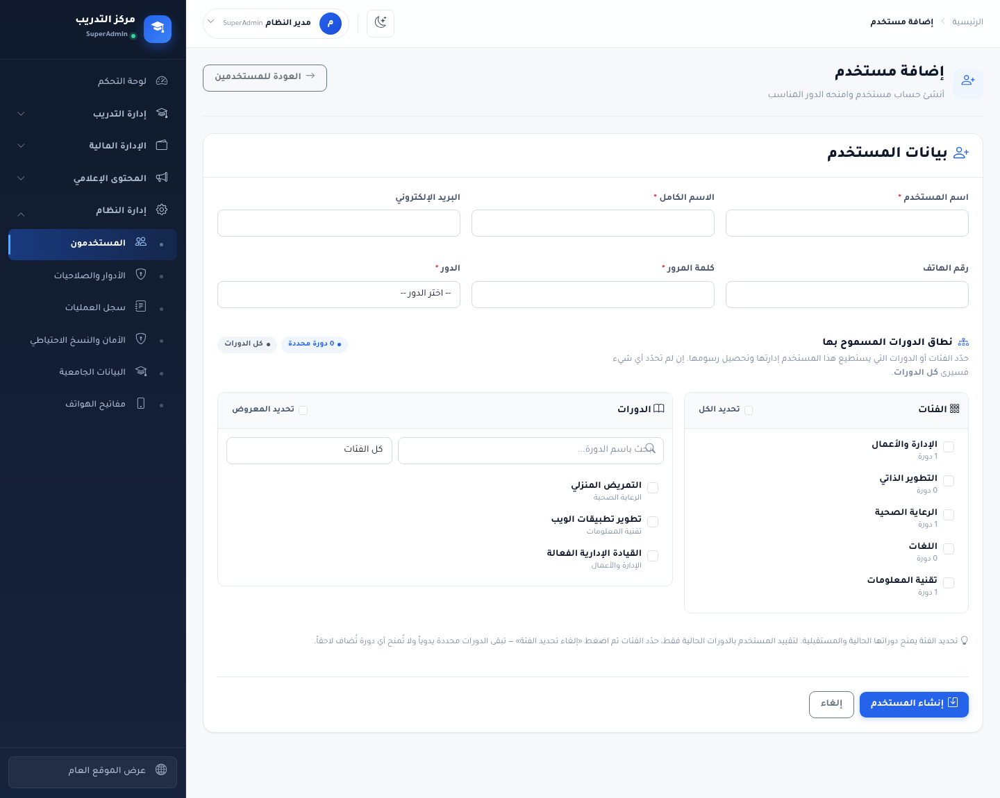

### 7.3 تعديل مستخدم — `/Users/Edit/{id}`

| العنصر | الوصف |
|--------|-------|
| الحقول | **الاسم الكامل**، **البريد**، **الهاتف**، **الدور**، **نشط** (checkbox) |
| **اسم المستخدم** | للعرض فقط |
| قسم **ربط تليجرام (التحقق بخطوتين)** | يعرض حالة الربط (ChatId، الرمز، تاريخ الربط)، مع زر **إنشاء رمز ربط** وزر **إلغاء الربط** |
| زر **حفظ التعديلات** | — |

**القواعد:** لا يمكن تغيير نطاق حساب مدير النظام؛ وتغيير الدور يستبدل الربط الواحد بالدور الجديد.

> **تعديل مستخدم (ربط تليجرام) — `/Users/Edit/2`**
>
> 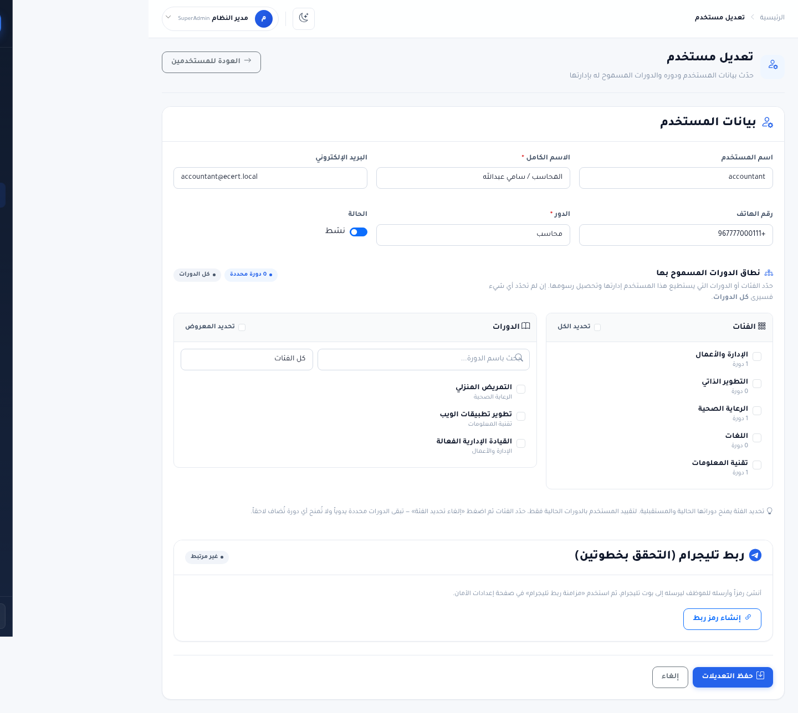

> 

> *الشكل: تعديل مستخدم — لقطة فعلية من النظام عند المسار `/Users/Edit/1`.*

### 7.4 الأدوار والصلاحيات — `/Roles/Index`

**الصلاحيات:** `manage-roles` — **حصرية لمدير النظام**.

#### المحتوى
بطاقة لكل دور تعرض اسمه، وصفه، وشاراته (محمي/مخصص)، وعدد المستخدمين، وعدد الصلاحيات.

#### الأزرار
- **إنشاء دور مخصص** → `/Roles/Create`.
- **إدارة المستخدمين** → `/Users/Index`.
- **تعديل الصلاحيات** (للأدوار المخصصة فقط) → `/Roles/Edit/{id}`.
- **حذف** (للأدوار المخصصة غير المرتبطة بمستخدمين).

#### نموذج الدور (`_RoleForm`)
- **اسم الدور** (max 50)، **الوصف** (max 250).
- **قالب جاهز** (select) — يملأ الصلاحيات.
- شبكة الصلاحيات **مجمّعة حسب القسم**، كلٌّ مع **تحديد الكل** وعدّاد.
- الأزرار: **إنشاء الدور** / **حفظ التعديلات**، **العودة للأدوار**، **إلغاء**.

**القواعد:** لا يمكن تعديل/حذف أدوار النظام المحمية (`IsSystem`). لا يمكن حذف دور مرتبط بمستخدمين. تغيير
الصلاحيات يسري عند **تسجيل دخول المستخدمين المرتبطين مرة أخرى** (لأن الصلاحيات مُحمّلة في الكوكيز).

> **الأدوار والصلاحيات — `/Roles`**
>
> 

### 7.5 سجل العمليات — `/AuditLog/Index`

**الصلاحيات:** `view-audit-log` أو `view-security-audit`.

#### الفلاتر
**نوع العنصر** (select)، **العملية** (select). زر **تصفية**، رابط **إعادة تعيين**.

#### الأعمدة
التاريخ والوقت، المستخدم، العملية، نوع العنصر، رقم العنصر، التفاصيل.

> **سجل العمليات — `/AuditLog`**
>
> 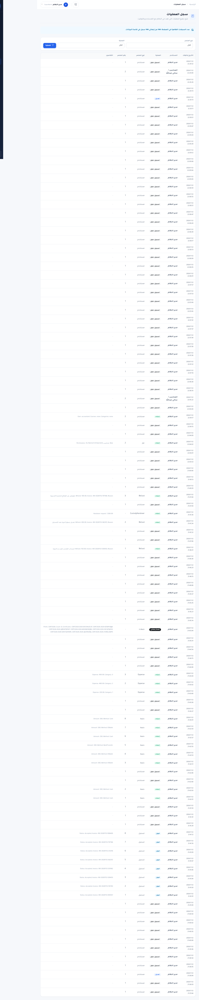

> 

> *الشكل: سجل العمليات — لقطة فعلية من النظام عند المسار `/AuditLog`.*

### 7.6 الأمان والنسخ الاحتياطي — `/SecuritySettings/Index`

**الصلاحيات:** `manage-security-settings` — **حصرية لمدير النظام**.

#### بطاقة «تكامل تليجرام»
| الحقل | الوصف |
|-------|-------|
| **TelegramBotToken** | توكن البوت (لرموز الدخول والتنبيهات والأرشيف) |
| **SecurityAlertChannelId** | قناة التنبيهات الفورية |
| **BackupChannelId** | قناة الأرشيف المعزولة للنسخ المشفّرة |

#### بطاقة «تشفير النسخ الاحتياطي»
| الحقل | الوصف |
|-------|-------|
| **BackupEncryptionKey** | مفتاح التشفير (اكتب-فقط: فراغ = الإبقاء على الحالي)؛ شارة «مفتاح مضبوط/لا يوجد مفتاح» |
| **BackupHourUtc** | ساعة النسخ اليومي (UTC، 0–23) |
| **BackupEnabled** | مفتاح تفعيل النسخ الآلي اليومي |

#### بطاقة «المصادقة وسياسة الحظر»
| الحقل | الوصف |
|-------|-------|
| **TwoFactorEnabled** | تفعيل المصادقة الثنائية |
| **MaxFailedLoginAttempts** | عدد المحاولات الفاشلة قبل الحظر |
| **LockoutMinutes** | مدة الحظر (دقائق) |
| **IdleTimeoutMinutes** | مدة الخمول قبل إنهاء الجلسة |

#### بطاقة «عمليات النسخ الاحتياطي»
- زر **تشغيل نسخة الآن** → `RunBackupNow` (بتأكيد).
- زر **مزامنة ربط تليجرام** → `PollTelegramLinks`.

#### الأزرار العامة
**فحص سلامة السجلات** → `/SecuritySettings/VerifyIntegrity`، و**حفظ الإعدادات الأمنية** → `Save`.

**القواعد:** كل القيم تُقرأ ديناميكياً من قاعدة البيانات وتسري فوراً دون إعادة نشر. مفتاح التشفير لا
يُعرض أبداً.

> **الأمان والنسخ الاحتياطي — `/SecuritySettings`**
>
> 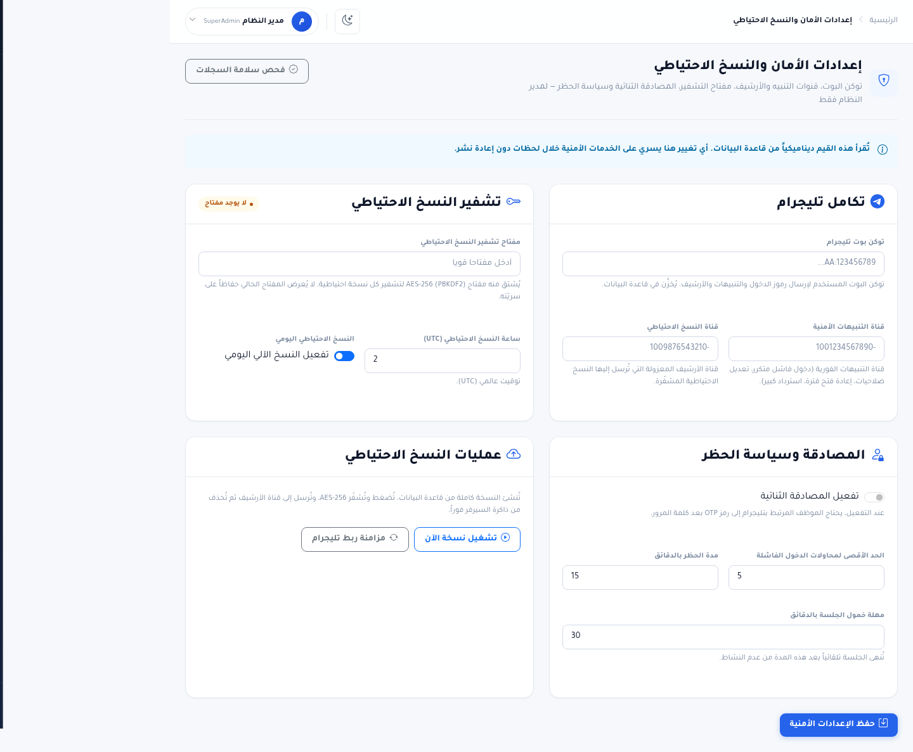

### 7.7 فحص سلامة السجلات — `/SecuritySettings/VerifyIntegrity`

**الصلاحيات:** `manage-security-settings`.

يعرض بطاقتين: **سجل العمليات** و**سجل التدقيق المالي**، لكلٍّ شارة **سليم** (خضراء) أو **مخترق** (حمراء).
عند السليم: «تم التحقق من N سجلاً؛ سلسلة التوقيعات سليمة بالكامل». عند الاختراق: «أول سجل غير سليم: #X»
مع التفصيل (توقيع لا يطابق المحتوى، أو سلسلة مقطوعة).

> **فحص سلامة سجلات التدقيق — `/SecuritySettings/VerifyIntegrity`**
>
> 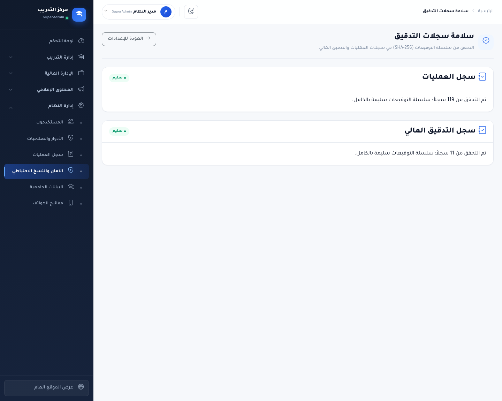

> 

> *الشكل: فحص سلامة السجلات — لقطة فعلية من النظام عند المسار `/SecuritySettings`.*

> **الأمان والنسخ الاحتياطي — `/SecuritySettings`**
>
> 

### 7.8 البيانات الجامعية — `/AcademicCatalog/Index`

**الصلاحيات:** `manage-academic-catalog`.

أربعة أقسام هرمية: **الجامعات** ← **الكليات** ← **التخصصات** ← **المستويات الدراسية**.

| القسم | الحقول | الأزرار |
|-------|--------|---------|
| الجامعات | **universityName** (مطلوب)، **isActive** | **إضافة**، **حذف** |
| الكليات | **universityId** (select، مطلوب)، **collegeName**، **isActive** | **إضافة**، **حذف** |
| التخصصات | **collegeId** (select)، **specializationName**، **isActive** | **إضافة**، **حذف** |
| المستويات | **academicSpecializationId** (select)، **levelName**، **sortOrder**، **isActive** | **إضافة**، **حذف** |

مع فلتر **تصفية حسب التخصص**. كما توجد نقاط نهاية عامة (AJAX) لتعبئة القوائم المترابطة في نموذج التسجيل:
`/AcademicCatalog/Universities`، `/Colleges`، `/Specializations`، `/Levels`.

> **البيانات الجامعية — `/AcademicCatalog`**
>
> 

### 7.9 مفاتيح الهواتف — `/PhoneCountries/Index`

**الصلاحيات:** `manage-phone-countries`.

جدول: الدولة، المفتاح، طول الرقم، البدايات، الحالة، إجراءات. زر **إضافة دولة** → `/PhoneCountries/Create`.

#### إضافة/تعديل دولة
الحقول: **اسم الدولة** (مطلوب)، **مفتاح الدولة** (مطلوب، مثال +967)، **الحد الأدنى لطول الرقم**،
**الحد الأقصى لطول الرقم**، **البدايات المسموحة** (مفصولة بفواصل: 70,71,73)، **نشط**.

> **مفاتيح الهواتف — `/PhoneCountries`**
>
> 

> 

> *الشكل: مفاتيح الهواتف — لقطة فعلية من النظام عند المسار `/PhoneCountries`.*

---

## الفصل 8 — واجهات برمجية (API)

يوفر النظام مجموعة نقاط نهاية REST تعيد JSON، كلها تتطلب مصادقة (`[Authorize]`) عدا تسجيل الدخول.

| المجموعة | المسار | العمليات |
|----------|--------|----------|
| المصادقة | `/api/auth` | `POST /login` (بلا مصادقة، محمي بتحديد المعدل)، `GET /me`، `POST /logout` |
| الدورات | `/api/courses` | `GET`, `POST`, `PUT /{id}`, `PUT /{id}/status` |
| المدربون | `/api/instructors` | `GET` |
| الفواتير | `/api/invoices` | `GET` (فلتر status)، `GET /{id}`, `POST` |
| الدفعات | `/api/payments` | `GET`, `POST`, `POST /{id}/cancel` |
| التسجيلات | `/api/registrations` | `GET`, `GET /{id}`, `POST /accept/{id}`, `/reject/{id}`, `/reopen/{id}`, `/archive/{id}` |
| الطلاب | `/api/students` | `GET`, `POST`, `PUT /{id}` |
| المنشورات | `/api/posts` | `GET`, `POST`, `PUT /{id}`, `PUT /{id}/publish`, `DELETE /{id}` |
| الأخبار | `/api/news` | `GET`, `POST` (multipart)، `PUT /{id}` (multipart)، `PUT /{id}/publish`, `DELETE /{id}` |

**سلوك الأخطاء:** عند انتهاء الجلسة تُعاد استجابة JSON `{ "success": false, "message": "يجب تسجيل
الدخول أولاً" }` بحالة 401 بدلاً من إعادة توجيه (مخصص للـ API). وعند نقص الصلاحية: 403 برسالة «ليس لديك
صلاحية الوصول».

> **المستخدمون — `/Users`**
>
> 

---

## الفصل 9 — السيناريوهات التشغيلية التفاعلية

> هذا الفصل مسارات عمل كاملة خطوة بخطوة، تغطي حالات متعددة المستخدمين والأدوار. كل خطوة تتطلب تفاعلاً
> بشرياً مصحوبة بعنصر لقطة الشاشة الإلزامي.

### السيناريو 1 — إدارة الأدوار والمستخدمين والعزل بين الصلاحيات (RBAC)

**الهدف:** إظهار كيف ينشئ مدير النظام دور «محاسب»، يُسنِده لمستخدم جديد، ثم كيف يُمنع المحاسب من الوصول
لصفحة «الصندوق» أو «الأمان» بينما يُسمح له بتسجيل دفعة.

**الأدوار:** مدير النظام (SuperAdmin)، المحاسب الجديد.

#### الجزء أ — دخول مدير النظام

**الخطوة 1.** افتح `https://<النطاق>/Auth/Login`.
> **صفحة تسجيل الدخول — `/Auth/Login`**
>
> 

**الخطوة 2.** أدخل `admin` وكلمة المرور، ثم اضغط **دخول**.
> **المستخدمون — `/Users`**
>
> 

**الخطوة 3.** إن كانت هذه أول مرة، ستُوجَّه إجبارياً إلى **تغيير كلمة المرور**. غيّرها وأعد الدخول.
> **تغيير كلمة المرور — `/Auth/ChangePassword`**
>
> 

**الخطوة 4.** ستصل إلى **لوحة التحكم** بكل بطاقات KPI ظاهرة (مدير النظام يرى كل شيء).
> **المستخدمون — `/Users`**
>
> 

#### الجزء ب — إنشاء دور «محاسب»

**الخطوة 5.** من القائمة الجانبية: **إدارة النظام ← الأدوار والصلاحيات**.
> **الأدوار والصلاحيات — `/Roles`**
>
> 

**الخطوة 6.** اضغط **إنشاء دور مخصص**.

**الخطوة 7.** أدخل **اسم الدور:** `محاسب`.

**الخطوة 8.** من **قالب جاهز** اختر «محاسب» — ستُملأ الصلاحيات المالية تلقائياً (11 صلاحية).
> **نموذج الدور بعد تطبيق القالب الجاهز — `/Roles/Create`**
>
> 

**الخطوة 9.** لاحظ أن صلاحيات `manage-roles` و`manage-finance-settings` و`manage-security-settings`
**لا تظهر** ضمن الصلاحيات القابلة للمنح لأدوار مخصصة (حصرية لمدير النظام).

**الخطوة 10.** اضغط **إنشاء الدور**.
> **الأدوار والصلاحيات — `/Roles`**
>
> 

#### الجزء ج — إنشاء مستخدم «محاسب» وإسناد الدور

**الخطوة 11.** من القائمة: **إدارة النظام ← المستخدمون**، ثم **إضافة مستخدم**.
> **المستخدمون — `/Users`**
>
> 

**الخطوة 12.** املأ: اسم المستخدم `accountant`، الاسم الكامل «محاسب المركز»، كلمة مرور قوية، والدور
`محاسب`.

**الخطوة 13.** في قسم **نطاق الدورات**: لاحظ الخيارين. لسِّناريو اختبار العزل، **لا تحدّد أي شيء** (سيرى
كل الدورات) أو حدّد فئةً محددة (لاختبار العزل). لنبدأ بعدم التحديد.
> **قائمة الدورات — `/CoursesManage`**
>
> 

**الخطوة 14.** اضغط **إنشاء المستخدم**.
> **المستخدمون — `/Users`**
>
> 

#### الجزء د — تسجيل خروج مدير النظام ودخول المحاسب

**الخطوة 15.** من قائمة المستخدم أعلى اليمين: **تسجيل الخروج**.
> **المستخدمون — `/Users`**
>
> 

**الخطوة 16.** سجّل الدخول بـ `accountant`.
> **صفحة الدخول استعداداً لحساب المحاسب — `/Auth/Login`**
>
> 

**الخطوة 17.** لاحظ القائمة الجانبية الآن: مجموعة **الإدارة المالية** ظاهرة، لكن **الصندوق** غائب،
و**إعدادات النظام المالية** غائبة، ومجموعة **إدارة النظام** كاملة غائبة (لا الأمان ولا المستخدمون ولا
الأدوار).
> **الصندوق الرئيسي — `/Cashbox`**
>
> 

#### الجزء هـ — محاولة الوصول الممنوع

**الخطوة 18.** حاول فتح **الصندوق** مباشرةً بكتابة الرابط `/Cashbox` في شريط العنوان.
> **صفحة «غير مصرح بالوصول» — `/Home/AccessDenied`**
>
> 

**الخطوة 19.** حاول فتح **إعدادات الأمان** عبر `/SecuritySettings`.
> **لوحة التحكم — `/Dashboard`**
>
> 

**الخطوة 20.** حاول فتح **إعدادات النظام المالية** عبر `/FinanceSettings`.
> **صفحة «غير مصرح بالوصول» — `/Home/AccessDenied`**
>
> 

> **الشرح التقني:** الرفض يأتي من فحص الخادم (`User.HasPermission(...) → Forbid()`)، وليس مجرد إخفاء
> الرابط. حتى الكتابة اليدوية للرابط تُرفض بـ 403.

#### الجزء و — الإجراء المسموح: تسجيل دفعة

**الخطوة 21.** من القائمة: **الإدارة المالية ← الفواتير**.
> **قائمة الفواتير — `/Invoices`**
>
> 

**الخطوة 22.** على فاتورة غير مدفوعة، اضغط **دفعة**.
> **نموذج تسجيل دفعة بحساب المحاسب — `/Payments/Add?invoiceId=4`**
>
> 

**الخطوة 23.** أدخل مبلغاً، اختر طريقة الدفع، واضغط **تسجيل الدفعة**.
> **سند القبض بعد تسجيل الدفعة — `/Payments/Receipt/1`**
>
> 

**النتيجة:** المحاسب استطاع تسجيل دفعة (صلاحية `manage-payments`)، لكنه مُنع من الصندوق والأمان
(صلاحيات حصرية أو غير ممنوحة).

---

### السيناريو 2 — إنشاء دورة جديدة وتعيين متدربين وإنشاء فواتيرهم

**الأدوار:** مشرف تدريب (manage-courses + manage-registrations + manage-instructors).

**الخطوة 1.** ادخل بحساب يملك صلاحية إدارة الدورات، ثم **إدارة التدريب ← الدورات ← إضافة دورة**.
> **نموذج إضافة دورة فارغ — `/CoursesManage/Create`**
>
> 

**الخطوة 2.** املأ **البيانات الأساسية**: الاسم عربي/إنجليزي، الوصف، الفئة، قالب الشهادة، المدربون،
والجهات الداعمة (اضغط **إضافة جهة داعمة** وأدخل الاسم/الشعار/التوقيع).
> **قسم الجهات الداعمة بعد إضافة جهتين — `/CoursesManage/Edit/1`**
>
> 

**الخطوة 3.** في **الرسوم والخصم**: أدخل **السعر** و**نوع الخصم** و**قيمته**.

**الخطوة 4.** في **الجدول والحالة**: حدّد التواريخ والمكان، واضبط **الحالة = OpenForRegistration** (أو
احفظ كمسودة ثم انشر لاحقاً).

**الخطوة 5.** ارفع **الصورة** إن أردت، ثم اضغط **حفظ الدورة**.
> **قائمة الدورات — `/CoursesManage`**
>
> 

**الخطوة 6.** إن أردت **فتح التسجيل** لاحقاً: من القائمة، اضغط زر **فتح التسجيل** في صف الدورة.
> **قائمة التسجيلات — `/Registrations`**
>
> 

**الخطوة 7.** الآن يُتيح الموقع العام التسجيل: افتح صفحة الدورة العامة واضغط **سجّل الآن**.
> **صفحة الدورة العامة مع زر «سجّل الآن» — `/PublicCourses/Details/2`**
>
> 

**الخطوة 8.** املأ نموذج التسجيل العام (الاسم عربي/إنجليزي، الجنس، الهاتف) وأرسل.
> **قائمة التسجيلات — `/Registrations`**
>
> 

**الخطوة 9.** عد إلى لوحة الإدارة: **إدارة التدريب ← التسجيلات**. سيظهر الطلب بحالة **معلق**.
> **قائمة التسجيلات — `/Registrations`**
>
> 

**الخطوة 10.** اضغط **قبول** في صف الطلب (أو حدّد عدة طلبات واستخدم **قبول المحدد**).
> **رسالة قبول الطلب وإنشاء الفاتورة — `/Registrations`**
>
> 

**الخطوة 11.** تحقق من إنشاء الفاتورة: **الإدارة المالية ← الفواتير**.
> **قائمة الفواتير — `/Invoices`**
>
> 

**النتيجة:** دورة جديدة مفتوحة للتسجيل، متدربون تقدّموا، قُبلوا، وأُنشئت فواتيرهم تلقائياً.

---

### السيناريو 3 — متدرب يدفع قسطاً من الفاتورة (نقدي وإلكتروني)

**الأدوار:** محاسب/محصّل (manage-payments).

#### الجزء أ — دفع نقدي

**الخطوة 1.** **الإدارة المالية ← الفواتير**، ثم اضغط **دفعة** على فاتورة.

**الخطوة 2.** أدخل **المبلغ**، واختر **طريقة الدفع = نقد**. لاحظ أن حقل **رقم السند** **يختفي**.
> **نموذج الدفع النقدي (بلا رقم سند) — `/Payments/Add?invoiceId=4`**
>
> 

**الخطوة 3.** اضغط **تسجيل الدفعة**، وستظهر **رسالة نجاح** تُوجّهك لسند القبض.
> **سند القبض مع رمز QR — `/Payments/Receipt/1`**
>
> 

#### الجزء ب — دفع إلكتروني

**الخطوة 4.** كرّر على الفاتورة نفسها (أو أخرى): أدخل **المبلغ**، واختر **طريقة الدفع = محفظة
إلكترونية**.
> **نموذج الدفع الإلكتروني — رقم السند إجباري — `/Payments/Add?invoiceId=4`**
>
> 

**الخطوة 5.** جرّب الإرسال **دون** رقم سند — سيُمنعك النموذج برسالة تحذير.
> **تنبيه إلزامية رقم السند للدفع الإلكتروني — `/Payments/Add?invoiceId=4`**
>
> 

**الخطوة 6.** أدخل رقم السند (مثل `TX-98541236`) وأرسل.
> **سند القبض بعد الدفع الإلكتروني — `/Payments/Receipt/1`**
>
> 

**النتيجة:** الفاتورة الآن **مدفوعة جزئياً**، والمبلغ دخل في **عهدة المحاسب**، وكل دفعة لها سند قابل
للتحقق عبر QR.

> **تفاصيل الفاتورة بعد الدفعتين — `/Invoices/Details/1`**
>
> 

---

### السيناريو 4 — موظف يراجع عهدته (2300 ريال) ويورّدها للصندوق

**الأدوار:** المحاسب (صاحب العهدة)، مدير النظام (المراجع).

#### الجزء أ — مراجعة العهدة

**الخطوة 1.** ادخل بحساب المحاسب، ثم **الإدارة المالية ← عهدة الموظف والتوريد**.
> **عهدة الموظف والتوريد — `/Custody`**
>
> 

**الخطوة 2.** راجع **حركات العهدة** أسفل الصفحة (قبض/استرداد/توريد/تسوية) مع فلاترها.
> **عهدة الموظف والتوريد — `/Custody`**
>
> 

**الخطوة 3.** تحقّق من أن الرصيد الحالي **2,300.00** ريال (كما في السيناريو).

#### الجزء ب — طلب التوريد

**الخطوة 4.** في قسم **توريد / ترحيل للصندوق الرئيسي**، أدخل **المبلغ = 2300**، واكتب **ملاحظة** مثل
«توريد تحصيل الأسبوع».
> **حقل طلب التوريد مع الرصيد المتاح — `/Custody`**
>
> 

**الخطوة 5.** اضغط **تقديم طلب توريد**.
> **رسالة تقديم طلب التوريد — `/Custody`**
>
> 

**الخطوة 6.** لاحظ أن نموذج الطلب أصبح **معطّلاً** (لا يمكن تقديم طلب ثانٍ) مع ظهور تحذير «لديك طلب
قيد المراجعة».
> **تحذير وجود طلب توريد قيد المراجعة — `/Custody`**
>
> 

#### الجزء ج — اعتماد التوريد (مدير النظام)

**الخطوة 7.** سجّل الخروج وادخل بحساب **مدير النظام**، ثم **عهدة الموظف والتوريد**.
> **عهدة الموظف والتوريد — `/Custody`**
>
> 

**الخطوة 8.** في طابور الطلبات، اكتب **ملاحظة (اختياري)**، ثم اضغط **اعتماد**.
> **الصندوق الرئيسي — `/Cashbox`**
>
> 

**الخطوة 9.** ستظهر رسالة «تم اعتماد توريد 2,300.00 ريال إلى الصندوق الرئيسي».
> **رسالة نجاح العملية — `/Custody`**
>
> 

**الخطوة 10.** تحقّق من الأثر: **الإدارة المالية ← الصندوق**.
> **الصندوق الرئيسي — `/Cashbox`**
>
> 

**الخطوة 11.** عد إلى عهدة المحاسب (من قائمة «أرصدة العهد» اضغط **عرض**) — الرصيد الآن **0.00**.
> **عهدة المحاسب بعد التوريد (الرصيد صفر) — `/Custody`**
>
> 

**النتيجة:** المبلغ انتقل من عهدة الموظف إلى الصندوق الرئيسي في معاملة واحدة، وظهر كحركتين مُدقّقتين
(خصم عهدة + إضافة صندوق).

---

### السيناريو 5 — مدير يراجع الإيرادات ويطابق الصندوق ويعتمد مصروفاً ويرفض استرداداً

**الأدوار:** مدير النظام.

#### الجزء أ — مراجعة الإيرادات

**الخطوة 1.** **الإدارة المالية ← تقارير الإيرادات**.
> **تقارير الإيرادات — `/Reports/CourseRevenue`**
>
> 

**الخطوة 2.** طبّق فلتر **الفئة/الدورة/الحالة/التاريخ**، ثم اضغط **تصدير XLSX**.
> **فلاتر تقرير الإيرادات بعد التطبيق — `/Reports/CourseRevenue`**
>
> 

#### الجزء ب — مطابقة الصندوق

**الخطوة 3.** افتح **المطابقة النقدية** عبر `/Reports/Reconciliation`.
> **المطابقة النقدية — `/Reports/Reconciliation`**
>
> 

**الخطوة 4.** اختر النطاق (زر **اليوم** أو **من/إلى**) واضغط **مطابقة**. تأكّد من ظهور شارة **«النقد
مطابق»** الخضراء.
> **الصندوق الرئيسي — `/Cashbox`**
>
> 

#### الجزء ج — اعتماد مصروف

**الخطوة 5.** **الإدارة المالية ← المصروفات**. ابحث عن مصروف بحالة **بانتظار الاعتماد**.
> **المصروفات — `/Expenses`**
>
> 

**الخطوة 6.** اضغط **اعتماد** (بحقل ملاحظة اختياري).
> **رسالة نجاح العملية — `/Custody`**
>
> 

#### الجزء د — مراجعة استرداد

**الخطوة 7.** **الإدارة المالية ← استرداد الرسوم**. ابحث عن استرداد في قسم **بانتظار الاعتماد**.
> **الاستردادات — قسم بانتظار الاعتماد — `/Refunds`**
>
> 

**الخطوة 8.** راجع قسم **الاستردادات** لمراقبة الحالة (الحقل يُتيح الاعتماد لمدير النظام؛ ورفض الطلب
يتحقق قبل إنشائه أو بإلغاء الدفعة ذات الصلة — راجع الفصل 5.15/5.16).
> **استرداد الرسوم — `/Refunds`**
>
> 

**النتيجة:** إيرادات مراجَعة ومصدَّرة، صندوق مطابَق، مصروف معتمد، واسترداد مراجَع.

---

### السيناريو 6 — ربط حساب الموظف بتليجرام وتفعيل المصادقة الثنائية (2FA)

**الأدوار:** مدير النظام (الإعداد والربط)، الموظف (الربط والدخول).

#### الجزء أ — ضبط توكن البوت (مدير النظام)

**الخطوة 1.** **إدارة النظام ← الأمان والنسخ الاحتياطي**.
> **بطاقة تكامل تليجرام — `/SecuritySettings`**
>
> 

**الخطوة 2.** أدخل **TelegramBotToken** و**SecurityAlertChannelId**، واضغط **حفظ الإعدادات الأمنية**.
> **رسالة نجاح العملية — `/Custody`**
>
> 

#### الجزء ب — توليد رمز الربط للموظف

**الخطوة 3.** **إدارة النظام ← المستخدمون ← تعديل** على حساب الموظف.
> **قسم ربط تليجرام — إنشاء رمز — `/Users/Edit/2`**
>
> 

**الخطوة 4.** اضغط **إنشاء رمز ربط** — ستظهر رسالة تحوي الرمز (مثل `AB7K9XYZ`).
> **رمز الربط المولَّد للموظف — `/Users/Edit/2`**
>
> 

**الخطوة 5.** أرسل الرمز إلى الموظف (خارج النظام).

#### الجزء ج — مزامنة الربط

**الخطوة 6.** يرسل الموظف الرمز إلى **بوت تليجرام** في محادثة مباشرة.

**الخطوة 7.** في **الأمان والنسخ الاحتياطي**، اضغط **مزامنة ربط تليجرام**.
> **رسالة نجاح مزامنة الربط — `/Users/Edit/2`**
>
> 

**الخطوة 8.** عد إلى **تعديل** الموظف — سيظهر ChatId وتاريخ الربط.
> **قسم ربط تليجرام بعد الربط (ChatId) — `/Users/Edit/2`**
>
> 

#### الجزء د — تفعيل 2FA والدخول بها

**الخطوة 9.** في **الأمان والنسخ الاحتياطي**، فعّل **TwoFactorEnabled** ثم **حفظ الإعدادات الأمنية**.
> **مفتاح تفعيل المصادقة الثنائية — `/SecuritySettings`**
>
> 

**الخطوة 10.** سجّل خروجك وادخل بحساب الموظف — بعد كلمة المرور ستُوجَّه لصفحة **التحقق بخطوتين**، ويصله
رمز OTP على تليجرام.
> **صفحة التحقق بخطوتين — حقل الرمز — `/Auth/Login`**
>
> 

**الخطوة 11.** أدخل الرمز واضغط **تأكيد الدخول** — تدخل النظام.
> **رسالة OTP في تليجرام — `/SecuritySettings`**
>
> 

**النتيجة:** الحساب مرتبط بتليجرام، والمصادقة الثنائية مفعّلة، والدخول يتطلب رمز OTP.

---

### السيناريو 7 — وقوع تلاعب وكيف يكتشفه مدير النظام عبر سلسلة التوقيعات (Hash Chain)

**الأدوار:** مدير النظام (المدقق).

#### الجزء أ — آلية الكشف (خلف الكواليس)

كل سجل في **سجل العمليات** و**سجل التدقيق المالي** يحمل:
- `PreviousHash` = توقيع السجل الذي قبله.
- `RowHash` = SHA-256 (توقيع السابق + محتوى السجل).

أي تعديل أو حذف لسجل يكسر كل التوقيعات اللاحقة. كما أن **مشغّلات قاعدة البيانات** (Triggers) تمنع
UPDATE/DELETE مباشرةً على جداول التدقيق (تُرفض بخطأ MySQL 1644).

#### الجزء ب — اكتشاف التلاعب

**الخطوة 1.** **إدارة النظام ← الأمان والنسخ الاحتياطي ← فحص سلامة السجلات**.
> **فحص سلامة السجلات — `/SecuritySettings/VerifyIntegrity`**
>
> 

**الخطوة 2.** في بيئة اختبار، حاول تعديل سجل تدقيق مباشرةً في قاعدة البيانات (يتطلب تعطيل المشغّلات
مؤقتاً — سيناريو نظري للتوضيح).

**الخطوة 3.** أعد **فحص سلامة السجلات** — ستظهر شارة **«مخترق»** الحمراء مع «أول سجل غير سليم: #X» والسبب.
> **فحص سلامة السجلات — `/SecuritySettings/VerifyIntegrity`**
>
> 

**الخطوة 4.** لتحديد الحركة المشبوهة بدقة، افتح **سجل التدقيق المالي** واستخدم الفلاتر (المستخدم،
التاريخ، نوع العملية، البحث) لمقارنة السجلات حول الرقم المُكتشَف.
> **سجل التدقيق المالي — `/FinancialAudit`**
>
> 

**النتيجة:** النظام يجعل أي تلاعب **قابلاً للكشف** حتى لو تجاوز الفاعل المشغّلات، لأن السلسلة نفسها تكشفه.

---

### السيناريو 8 — إعداد وتفعيل النسخ الاحتياطي المشفّر وإرساله لتليجرام

**الأدوار:** مدير النظام.

**الخطوة 1.** **إدارة النظام ← الأمان والنسخ الاحتياطي**، ثم بطاقة **تشفير النسخ الاحتياطي**.
> **بطاقة تشفير النسخ الاحتياطي — `/SecuritySettings`**
>
> 

**الخطوة 2.** أدخل **BackupEncryptionKey** (مفتاح قوي)، واضبط **BackupHourUtc** (مثلاً 2)، وفعّل
**BackupEnabled**، وأدخل **BackupChannelId** في بطاقة تليجرام.
> **حالة «مفتاح مضبوط» — `/SecuritySettings`**
>
> 

**الخطوة 3.** اضغط **حفظ الإعدادات الأمنية**.
> **رسالة نجاح العملية — `/Custody`**
>
> 

**الخطوة 4.** اختبر النسخة فوراً: اضغط **تشغيل نسخة الآن**.
> **نافذة تأكيد إنشاء نسخة احتياطية — `/SecuritySettings`**
>
> 

**الخطوة 5.** ستظهر رسالة النجاح، ويصل الملف المشفّر إلى **قناة الأرشيف** في تليجرام.
> **رسالة نجاح العملية — `/Custody`**
>
> 

**الخطوة 6.** افتح قناة الأرشيف في تليجرام وستجد ملف النسخة (اسمه وزمنه).
> **رسالة نجاح النسخة الاحتياطية — `/SecuritySettings`**
>
> 

**الخطوة 7.** تأكد من تسجيل العملية: **سجل العمليات** يعرض عملية «Backup» بنوع العنصر «Database».
> **سجل العمليات — `/AuditLog`**
>
> 

**النتيجة:** النسخة تُنشأ كاملةً من قاعدة البيانات، تُضغط وتُشفّر AES-256 (PBKDF2, 200,000 تكرار)،
تُرسل للقناة المعزولة، ثم **تُحذف من ذاكرة السيرفر فوراً**. النسخ الآلي اليومي يعمل تلقائياً في الساعة
المحددة (UTC).

---

## الفصل 10 — الملاحق

### الملحق أ — جدول الصلاحيات الكامل (28 صلاحية)

| # | اسم الصلاحية | الوصف بالعربية | المجموعة | يفتح القسم |
|---|--------------|----------------|----------|------------|
| 1 | manage-registrations | إدارة التسجيلات | إدارة التدريب | Registrations |
| 2 | manage-courses | إدارة الدورات | إدارة التدريب | CoursesManage |
| 3 | manage-instructors | إدارة المدربين | إدارة التدريب | Instructors |
| 4 | manage-categories | إدارة الفئات | إدارة التدريب | CategoriesManage |
| 5 | issue-certificates | إصدار الشهادات | الشهادات | Certificates |
| 6 | manage-certificate-designs | إدارة تصميم الشهادات | الشهادات | CertificateDesigns |
| 7 | manage-finance | إدارة المالية | الإدارة المالية | Invoices |
| 8 | view-invoices | مشاهدة الفواتير | الإدارة المالية | Invoices |
| 9 | manage-payments | إدارة الدفعات | الإدارة المالية | Payments |
| 10 | view-reports | مشاهدة تقارير الإيرادات | الإدارة المالية | Reports |
| 11 | view-custody | عهدة الموظف والتوريد للصندوق | الإدارة المالية | Custody |
| 12 | manage-refunds | استرداد الرسوم | الإدارة المالية | Refunds |
| 13 | view-receivables | تقارير المتأخرات وكشف الحساب | الإدارة المالية | Receivables |
| 14 | view-financial-audit | سجل التدقيق المالي | الإدارة المالية | FinancialAudit |
| 15 | manage-expenses | إدارة المصروفات | الإدارة المالية | Expenses |
| 16 | manage-installments | إدارة الأقساط والخطة الدراسية | الإدارة المالية | Installments |
| 17 | view-finance-dashboard | لوحة المؤشرات المالية | الإدارة المالية | Finance |
| 18 | manage-finance-settings | إعدادات النظام المالية (العملة والفترات) | الإدارة المالية | FinanceSettings |
| 19 | manage-posts | إدارة المنشورات | المحتوى | PostsManage |
| 20 | manage-news | إدارة الأخبار | المحتوى | NewsManage |
| 21 | manage-homepage | إدارة الصفحة الرئيسية | المحتوى | HomepageManage |
| 22 | manage-users | إدارة المستخدمين | النظام | Users |
| 23 | manage-roles | إدارة الأدوار والصلاحيات | النظام | Roles |
| 24 | view-audit-log | مشاهدة سجل العمليات | النظام | AuditLog |
| 25 | manage-academic-catalog | إدارة البيانات الجامعية | النظام | AcademicCatalog |
| 26 | manage-phone-countries | إدارة مفاتيح الهواتف | النظام | PhoneCountries |
| 27 | view-security-audit | مراجعة سجلات العمليات والتدقيق (قراءة فقط) | النظام | AuditLog |
| 28 | manage-security-settings | إعدادات الأمان والنسخ الاحتياطي | النظام | SecuritySettings |

> **حصرية لمدير النظام:** الصلاحيات 18، 23، 28. **الصندوق (Cashbox)** لا تفتحه أي صلاحية (SuperAdmin فقط).

### الملحق ب — جدول المسارات الكامل

| المسار (URL) | الوصف | الصلاحية |
|--------------|-------|----------|
| `/` | الصفحة الرئيسية العامة | عام |
| `/Home/About` · `/Home/Contact` · `/Home/Privacy` | صفحات ثابتة | عام |
| `/Auth/Login` · `/Auth/VerifyTwoFactor` · `/Auth/ChangePassword` · `/Auth/Logout` | المصادقة | عام/مصادَق |
| `/Dashboard` | لوحة التحكم | أي صلاحية إدارية |
| `/Registrations` + `/{id}` + `/Reject/{id}` + `/Import` + `/ExportXlsx` | التسجيلات | manage-registrations |
| `/CoursesManage` + `/Create` + `/Edit/{id}` + `/Import` + `/Export` | الدورات | manage-courses |
| `/CategoriesManage` + `/Create` + `/Edit/{id}` | الفئات | manage-categories |
| `/Instructors` + `/Create` + `/Edit/{id}` | المدربون | manage-instructors |
| `/Certificates` + `/Issue` + `/Verify` + `/v/{id}` + `/QrImage` | الشهادات | issue-certificates / عام للتحقق |
| `/CertificateDesigns` + `/New` | تصاميم الشهادات | manage-certificate-designs |
| `/CertificatesImport/Import` + `/Result` | استيراد شهادات قديمة | issue-certificates |
| `/Finance` | لوحة المؤشرات المالية | view-finance-dashboard |
| `/Invoices` + `/Create/{registrationId}` + `/Details/{id}` | الفواتير | view-invoices/manage-finance |
| `/Payments` + `/Add/{invoiceId}` + `/Receipt/{id}` + `/ExportXlsx` | الدفعات | manage-payments |
| `/Installments` + `/Create/{invoiceId}` + `/Late` + `/Print/{invoiceId}` | الأقساط | manage-installments |
| `/Custody` | عهدة الموظف | view-custody |
| `/Receivables` + `/Statement/{invoiceId}` + `/ExportXlsx` | المتأخرات | view-receivables |
| `/Refunds` + `/Create/{invoiceId}` + `/Receipt/{id}` | الاستردادات | manage-refunds |
| `/Expenses` + `/Create` + `/Categories` + `/ExportXlsx` | المصروفات | manage-expenses |
| `/Cashbox` | الصندوق الرئيسي | **SuperAdmin فقط** |
| `/Reports/CourseRevenue` + `/CourseRevenueDetail/{id}` + `/CashFlow` + `/IncomeStatement` + `/Aging` + `/Reconciliation` | التقارير | view-reports/view-receivables/view-financial-audit |
| `/FinancialAudit` + `/ExportXlsx` | سجل التدقيق المالي | view-financial-audit |
| `/FinanceSettings` | إعدادات النظام المالية | manage-finance-settings |
| `/PostsManage` + `/NewsManage` + `/HomepageManage/*` | المحتوى | manage-posts/news/homepage |
| `/Users` + `/Create` + `/Edit/{id}` | المستخدمون | manage-users |
| `/Roles` + `/Create` + `/Edit/{id}` | الأدوار | manage-roles |
| `/AuditLog` | سجل العمليات | view-audit-log/view-security-audit |
| `/SecuritySettings` + `/VerifyIntegrity` | الأمان | manage-security-settings |
| `/AcademicCatalog` (+ نقاط AJAX عامة) | البيانات الجامعية | manage-academic-catalog |
| `/PhoneCountries` + `/Create` + `/Edit/{id}` | مفاتيح الهواتف | manage-phone-countries |
| `/PublicCourses` + `/Registration/Register` | الدورات والتسجيل العام | عام |
| `/r/{publicId}` | التحقق من سند | عام |
| `/health` | فحص الصحة | عام |
| `/api/*` | نقاط REST | مصادَق |

### الملحق ج — حالات النظام (Status Codes)

| الكيان | الحالات |
|--------|---------|
| التسجيل | Pending (معلق)، Accepted (مقبول)، Rejected (مرفوض)، Archived (مؤرشف) |
| الفاتورة | Unpaid (غير مدفوعة)، PartiallyPaid (جزئية)، Paid (مدفوعة)، Cancelled (ملغاة) |
| الدورة | Draft، Published، OpenForRegistration، InProgress، Completed، Archived |
| الدفعة | نشطة (IsCancelled=false)، ملغاة (IsCancelled=true) |
| المصروف | PendingApproval، Approved، Rejected |
| الاسترداد | Approved (معتمد)، PendingApproval (بانتظار الاعتماد) |
| طلب التوريد | Pending، Approved، Rejected |
| حركة العهدة | Collection (قبض)، Refund (استرداد)، Handover (توريد)، FundPayout (صرف من الصندوق)، Adjustment (تسوية) |
| أنواع العمليات المالية | Collection، Refund، RefundApproved، Cancel، Exemption، Handover، Transfer، Withdraw، Expense، PeriodLock، PeriodReopen |

### الملحق د — رسائل الأخطاء الشائعة ومعانيها

| الرسالة | السبب | الحل |
|---------|-------|------|
| «غير مصرح بالوصول» | لا تملك صلاحية القسم | اطلب من مدير النظام منحك الصلاحية |
| «تم حظر المحاولات مؤقتاً…» | تجاوزت حد المحاولات الفاشلة | انتظر انتهاء مدة الحظر |
| «الفترة المالية مقفلة حتى …» | التاريخ داخل فترة مقفلة | راجع مدير النظام لإعادة الفتح |
| «المبلغ أكبر من المتبقي!» | محاولة دفع يتجاوز رصيد الفاتورة | أدخل مبلغاً ≤ المتبقي |
| «رقم السند مطلوب عند اختيار طريقة دفع إلكترونية!» | طريقة إلكترونية بلا رقم سند | أدخل رقم السند |
| «لا يمكن إلغاء فاتورة تحتوي على دفعات نشطة…» | الفاتورة بها دفعات | احذف الدفعات أولاً |
| «رصيد عهدتك لا يكفي لصرف هذا الاسترداد» | العهدة أقل من مبلغ الاسترداد | ورّد عهدتك أو تواصل مع مدير النظام |
| «لديك طلب توريد قيد المراجعة بالفعل» | طلب توريد معلّق موجود | انتظر اعتماد/رفض الطلب |
| «هذا الاسترداد ليس بانتظار الاعتماد» | الطلب مُراجَع مسبقاً | لا إجراء |
| «لا يمكن حذف دور مرتبط بمستخدمين» | الدور مستخدَم | انقل المستخدمين لدور آخر |
| «رمز التحقق غير صحيح أو منتهي الصلاحية» | OTP خاطئ أو منتهٍ | اطلب رمزاً جديداً |
| «تعذّر إرسال رمز التحقق عبر تليجرام» | مشكلة في البوت | راجع توكن البوت |
| «لا يمكن الاعتماد: المبلغ المتاح للاسترداد أقل من قيمة الطلب» | تغيّر رصيد الفاتورة | أعد التحقق من الفاتورة |

### الملحق هـ — مصفوفة: من يستطيع ماذا (أمثلة أدوار شائعة)

| الوظيفة | مدير النظام | محاسب | محصّل رسوم | مشرف تدريب | مسؤول شهادات | محرر محتوى | مدقق أمني |
|---------|:-----------:|:-----:|:----------:|:----------:|:------------:|:----------:|:---------:|
| الصندوق الرئيسي | ✅ | ❌ | ❌ | ❌ | ❌ | ❌ | ❌ |
| إعدادات مالية/أمان/أدوار | ✅ | ❌ | ❌ | ❌ | ❌ | ❌ | ❌ |
| تسجيل دفعة | ✅ | ✅ | ✅ | ❌ | ❌ | ❌ | ❌ |
| عهدة الموظف | ✅ | ✅ | ✅ | ❌ | ❌ | ❌ | ❌ |
| استرداد رسوم | ✅ | ✅ | ❌ | ❌ | ❌ | ❌ | ❌ |
| اعتماد استرداد كبير | ✅ | ❌ | ❌ | ❌ | ❌ | ❌ | ❌ |
| اعتماد مصروف | ✅ | ❌ | ❌ | ❌ | ❌ | ❌ | ❌ |
| الفواتير/المتأخرات | ✅ | ✅ | ✅ (فواتير فقط) | ❌ | ❌ | ❌ | ❌ |
| تقارير الإيرادات | ✅ | ✅ | ❌ | ❌ | ❌ | ❌ | ✅ |
| سجل التدقيق المالي | ✅ | ✅ | ❌ | ❌ | ❌ | ❌ | ✅ |
| التسجيلات/الدورات/المدربون | ✅ | ❌ | ❌ | ✅ | ❌ | ❌ | ❌ |
| إصدار الشهادات | ✅ | ❌ | ❌ | ❌ | ✅ | ❌ | ❌ |
| المحتوى الإعلامي | ✅ | ❌ | ❌ | ❌ | ❌ | ✅ | ❌ |
| المستخدمون | ✅ | ❌ | ❌ | ❌ | ❌ | ❌ | ❌ |

### الملحق و — ملاحظات تقنية للتشغيل

- **صحة النظام:** نقطة `/health` تعيد JSON بحالة الفحوصات (قاعدة البيانات).
- **إقفال الفترة:** إقفال واحد نشط؛ الجديد يلغي السابق. يُطبّق على كل مسارات المال.
- **قفل الصفوف:** العمليات المالية الحساسة (دفع، إلغاء دفعة، اعتماد مصروف) تستخدم `SELECT … FOR UPDATE`
  لمنع التزاحم (race conditions).
- **المصادقة الثنائية:** الرمز صالح 5 دقائق، 5 محاولات، يُستهلك عند أول استخدام.
- **تحديد المعدل:** التسجيل العام 3/دقيقة، التحقق العام 20/دقيقة، دخول الإدارة 10/دقيقة (لكل عنوان).
- **الخمول:** تُنهى الجلسة بعد `IdleTimeoutMinutes` من عدم النشاط (يُفحص في كوكيز المصادقة).
- **رؤوس الأمان:** CSP، HSTS، X-Frame-Options: DENY، X-Content-Type-Options: nosniff.
- **رفع الصور:** يُتحقق منها بفحص التوقيع الثنائي (magic bytes) — يُرفض SVG/HTML الخبيث.
- **مفاتيح العهدة والاسترداد:** كل دفعة/استرداد يحصل على PublicId عشوائي + توقيع HMAC للتحقق العام.

---

> **نهاية الدليل المرجعي الشامل لنظام ECert.**
> كُتب هذا الدليل بالاعتماد المباشر على الكود المصدري، ويغطي كل واجهات النظام وأزرارها وحقولها
> وفلاترها وصلاحياتها، مع ثمانية سيناريوهات تشغيلية تفاعلية وعناصر لقطات الشاشة الإلزامية.

---

---

# الفصل 11 — دليل اللقطات الفعلية للنظام

جميع اللقطات في هذا الفصل مُلتقطة من النظام الحقيقي أثناء تشغيله فعلياً (خادم ASP.NET Core + قاعدة بيانات MariaDB)، بعد إدخال بيانات تشغيلية واقعية: ٨ تسجيلات، ٨ فواتير، ٨ دفعات، ٣ مصروفات، ٣ استردادات، حركات عهدة وتوريد، و٨ شهادات صادرة. الملفات محفوظة في المستودع تحت المجلد `docs/screenshots/`، وكل صورة معروضة هنا عبر رابطها المطلق.

## 11.1 أ) المصادقة والدخول

### 1. صفحة تسجيل الدخول إلى لوحة الإدارة — `/Auth/Login`

الملف: `docs/screenshots/01-auth-login.png` — المسار: `/Auth/Login`

### 2. صفحة تغيير كلمة المرور — `/Auth/ChangePassword`

الملف: `docs/screenshots/02-auth-change-password.png` — المسار: `/Auth/ChangePassword`

## 11.2 ب) الموقع العام (بدون تسجيل دخول)

### 3. الصفحة الرئيسية للموقع العام — `/`

الملف: `docs/screenshots/95-public-home.png` — المسار: `/`

### 4. صفحة «من نحن» — `/Home/About`

الملف: `docs/screenshots/96-public-about.png` — المسار: `/Home/About`

### 5. صفحة «اتصل بنا» — `/Home/Contact`

الملف: `docs/screenshots/97-public-contact.png` — المسار: `/Home/Contact`

### 6. صفحة الدورات العامة — `/PublicCourses`

الملف: `docs/screenshots/99-public-courses.png` — المسار: `/PublicCourses`

### 7. تفاصيل دورة عامة — `/PublicCourses/Details/2`

الملف: `docs/screenshots/100-public-course-details.png` — المسار: `/PublicCourses/Details/2`

### 8. نموذج التسجيل العام — `/Registration/Register?courseId=2`

الملف: `docs/screenshots/101-public-register.png` — المسار: `/Registration/Register?courseId=2`

### 9. رسالة نجاح التسجيل العام — `/Registration/Register`

الملف: `docs/screenshots/98-public-register-success.png` — المسار: `/Registration/Register`

### 10. صفحة الأخبار/المنشورات العامة — `/Posts`

الملف: `docs/screenshots/102-public-posts.png` — المسار: `/Posts`

### 11. صفحة التحقق من شهادة — `/Certificates/Verify`

الملف: `docs/screenshots/104-public-verify.png` — المسار: `/Certificates/Verify`

### 12. نتيجة التحقق من شهادة سارية — `/Certificates/Verify`

الملف: `docs/screenshots/105-public-verify-result.png` — المسار: `/Certificates/Verify`

### 13. التحقق العام من سند قبض — `/r/{publicId}?sig=...`

الملف: `docs/screenshots/106-public-receipt-verify.png` — المسار: `/r/{publicId}?sig=...`

## 11.3 ج) لوحة التحكم

### 14. لوحة التحكم الموحّدة (حساب مدير النظام) — `/Dashboard`

الملف: `docs/screenshots/03-dashboard.png` — المسار: `/Dashboard`

### 15. لوحة التحكم بحساب المحاسب (بطاقات مفلترة) — `/Dashboard`

الملف: `docs/screenshots/110-acc-dashboard.png` — المسار: `/Dashboard`

## 11.4 د) إدارة التدريب

### 16. قائمة التسجيلات — `/Registrations`

الملف: `docs/screenshots/10-registrations.png` — المسار: `/Registrations`

### 17. تفاصيل تسجيل — `/Registrations/Details/1`

الملف: `docs/screenshots/11-registration-details.png` — المسار: `/Registrations/Details/1`

### 18. استيراد المتدربين من Excel — `/Registrations/Import`

الملف: `docs/screenshots/12-registrations-import.png` — المسار: `/Registrations/Import`

### 19. قائمة الدورات — `/CoursesManage`

الملف: `docs/screenshots/13-courses.png` — المسار: `/CoursesManage`

### 20. إضافة دورة جديدة — `/CoursesManage/Create`

الملف: `docs/screenshots/14-course-create.png` — المسار: `/CoursesManage/Create`

### 21. تعديل دورة (قسم الجهات الداعمة) — `/CoursesManage/Edit/1`

الملف: `docs/screenshots/15-course-edit.png` — المسار: `/CoursesManage/Edit/1`

### 22. استيراد الدورات من Excel — `/CoursesManage/Import`

الملف: `docs/screenshots/16-courses-import.png` — المسار: `/CoursesManage/Import`

### 23. الفئات — `/CategoriesManage`

الملف: `docs/screenshots/17-categories.png` — المسار: `/CategoriesManage`

### 24. إضافة فئة — `/CategoriesManage/Create`

الملف: `docs/screenshots/18-category-create.png` — المسار: `/CategoriesManage/Create`

### 25. المدربون — `/Instructors`

الملف: `docs/screenshots/19-instructors.png` — المسار: `/Instructors`

### 26. إضافة مدرب (لوحة التوقيع) — `/Instructors/Create`

الملف: `docs/screenshots/20-instructor-create.png` — المسار: `/Instructors/Create`

### 27. قائمة الشهادات — `/Certificates`

الملف: `docs/screenshots/21-certificates.png` — المسار: `/Certificates`

### 28. إصدار الشهادات (إصدار جماعي) — `/Certificates/Issue`

الملف: `docs/screenshots/22-certificates-issue.png` — المسار: `/Certificates/Issue`

### 29. محرر تصاميم الشهادات — `/CertificateDesigns`

الملف: `docs/screenshots/23-certificate-designs.png` — المسار: `/CertificateDesigns`

### 30. استيراد الشهادات القديمة — `/CertificatesImport/Import`

الملف: `docs/screenshots/24-certificates-import.png` — المسار: `/CertificatesImport/Import`

## 11.5 هـ) الإدارة المالية

### 31. لوحة المؤشرات المالية — `/Finance`

الملف: `docs/screenshots/30-finance.png` — المسار: `/Finance`

### 32. لوحة المؤشرات المالية بحساب المحاسب — `/Finance`

الملف: `docs/screenshots/124-acc-finance-dashboard.png` — المسار: `/Finance`

### 33. قائمة الفواتير — `/Invoices`

الملف: `docs/screenshots/31-invoices.png` — المسار: `/Invoices`

### 34. تفاصيل فاتورة — `/Invoices/Details/1`

الملف: `docs/screenshots/32-invoice-details.png` — المسار: `/Invoices/Details/1`

### 35. إنشاء فاتورة يدوياً — `/Invoices/Create?registrationId={id}`

الملف: `docs/screenshots/33-invoice-create.png` — المسار: `/Invoices/Create?registrationId={id}`

### 36. قائمة الدفعات — `/Payments`

الملف: `docs/screenshots/34-payments.png` — المسار: `/Payments`

### 37. تسجيل دفعة — `/Payments/Add?invoiceId=4`

الملف: `docs/screenshots/35-payment-add.png` — المسار: `/Payments/Add?invoiceId=4`

### 38. تسجيل دفعة بطريقة «محفظة إلكترونية» (رقم السند إجباري) — `/Payments/Add?invoiceId=4`

الملف: `docs/screenshots/94-payment-ewallet.png` — المسار: `/Payments/Add?invoiceId=4`

### 39. سند قبض (مع رمز QR) — `/Payments/Receipt/1`

الملف: `docs/screenshots/36-payment-receipt.png` — المسار: `/Payments/Receipt/1`

### 40. الأقساط والخطط — `/Installments`

الملف: `docs/screenshots/37-installments.png` — المسار: `/Installments`

### 41. إنشاء خطة أقساط — `/Installments/Create?invoiceId=1`

الملف: `docs/screenshots/38-installment-create.png` — المسار: `/Installments/Create?invoiceId=1`

### 42. الأقساط المتأخرة — `/Installments/Late`

الملف: `docs/screenshots/39-installments-late.png` — المسار: `/Installments/Late`

### 43. طباعة جدول الأقساط — `/Installments/Print?invoiceId=1`

الملف: `docs/screenshots/40-installment-print.png` — المسار: `/Installments/Print?invoiceId=1`

### 44. عهدة الموظف والتوريد (مدير النظام) — `/Custody`

الملف: `docs/screenshots/41-custody.png` — المسار: `/Custody`

### 45. عهدة الموظف بحساب المحاسب — `/Custody`

الملف: `docs/screenshots/115-acc-custody.png` — المسار: `/Custody`

### 46. المتأخرات — `/Receivables`

الملف: `docs/screenshots/42-receivables.png` — المسار: `/Receivables`

### 47. كشف حساب متدرب — `/Receivables/Statement?invoiceId=1`

الملف: `docs/screenshots/43-receivables-statement.png` — المسار: `/Receivables/Statement?invoiceId=1`

### 48. استرداد الرسوم — `/Refunds`

الملف: `docs/screenshots/44-refunds.png` — المسار: `/Refunds`

### 49. إنشاء استرداد — `/Refunds/Create?invoiceId=4`

الملف: `docs/screenshots/45-refund-create.png` — المسار: `/Refunds/Create?invoiceId=4`

### 50. سند الاسترداد — `/Refunds/Receipt/1`

الملف: `docs/screenshots/46-refund-receipt.png` — المسار: `/Refunds/Receipt/1`

### 51. المصروفات — `/Expenses`

الملف: `docs/screenshots/47-expenses.png` — المسار: `/Expenses`

### 52. تسجيل مصروف — `/Expenses/Create`

الملف: `docs/screenshots/48-expense-create.png` — المسار: `/Expenses/Create`

### 53. بنود المصروفات — `/Expenses/Categories`

الملف: `docs/screenshots/49-expense-categories.png` — المسار: `/Expenses/Categories`

### 54. الصندوق الرئيسي (مدير النظام فقط) — `/Cashbox`

الملف: `docs/screenshots/50-cashbox.png` — المسار: `/Cashbox`

### 55. محاولة المحاسب فتح الصندوق ← غير مصرح (403) — `/Cashbox`

الملف: `docs/screenshots/130-acc-cashbox-403.png` — المسار: `/Cashbox`

### 56. تقارير الإيرادات — `/Reports/CourseRevenue`

الملف: `docs/screenshots/51-reports.png` — المسار: `/Reports/CourseRevenue`

### 57. تفاصيل تحصيلات دورة — `/Reports/CourseRevenueDetail?courseId=1`

الملف: `docs/screenshots/53-reports-course-revenue-detail.png` — المسار: `/Reports/CourseRevenueDetail?courseId=1`

### 58. قائمة الدخل — `/Reports/IncomeStatement`

الملف: `docs/screenshots/54-reports-income-statement.png` — المسار: `/Reports/IncomeStatement`

### 59. التدفق النقدي — `/Reports/CashFlow`

الملف: `docs/screenshots/55-reports-cash-flow.png` — المسار: `/Reports/CashFlow`

### 60. أعمار المتأخرات — `/Reports/Aging`

الملف: `docs/screenshots/56-reports-aging.png` — المسار: `/Reports/Aging`

### 61. المطابقة النقدية — `/Reports/Reconciliation`

الملف: `docs/screenshots/57-reports-reconciliation.png` — المسار: `/Reports/Reconciliation`

### 62. سجل التدقيق المالي — `/FinancialAudit`

الملف: `docs/screenshots/58-financial-audit.png` — المسار: `/FinancialAudit`

### 63. إعدادات النظام المالية — `/FinanceSettings`

الملف: `docs/screenshots/59-finance-settings.png` — المسار: `/FinanceSettings`

## 11.6 و) المحتوى الإعلامي

### 64. المنشورات — `/PostsManage`

الملف: `docs/screenshots/60-posts.png` — المسار: `/PostsManage`

### 65. إضافة منشور — `/PostsManage/Create`

الملف: `docs/screenshots/61-post-create.png` — المسار: `/PostsManage/Create`

### 66. الأخبار — `/NewsManage`

الملف: `docs/screenshots/62-news.png` — المسار: `/NewsManage`

### 67. إضافة خبر — `/NewsManage/Create`

الملف: `docs/screenshots/63-news-create.png` — المسار: `/NewsManage/Create`

### 68. إدارة الصفحة الرئيسية — `/HomepageManage`

الملف: `docs/screenshots/64-homepage.png` — المسار: `/HomepageManage`

### 69. شرائح العرض (Slides) — `/HomepageManage/Slides`

الملف: `docs/screenshots/65-homepage-slides.png` — المسار: `/HomepageManage/Slides`

### 70. الإحصاءات — `/HomepageManage/Stats`

الملف: `docs/screenshots/66-homepage-stats.png` — المسار: `/HomepageManage/Stats`

### 71. روابط التواصل — `/HomepageManage/Social`

الملف: `docs/screenshots/67-homepage-social.png` — المسار: `/HomepageManage/Social`

### 72. المظهر والألوان — `/HomepageManage/Theme`

الملف: `docs/screenshots/68-homepage-theme.png` — المسار: `/HomepageManage/Theme`

### 73. بيانات التواصل — `/HomepageManage/Contact`

الملف: `docs/screenshots/69-homepage-contact.png` — المسار: `/HomepageManage/Contact`

### 74. من نحن والتذييل — `/HomepageManage/AboutFooter`

الملف: `docs/screenshots/70-homepage-about-footer.png` — المسار: `/HomepageManage/AboutFooter`

### 75. النصوص المتحركة — `/HomepageManage/AnimatedTexts`

الملف: `docs/screenshots/71-homepage-animated-texts.png` — المسار: `/HomepageManage/AnimatedTexts`

### 76. إعدادات الموقع — `/HomepageManage/SiteSettings`

الملف: `docs/screenshots/72-homepage-site-settings.png` — المسار: `/HomepageManage/SiteSettings`

### 77. إدارة الأقسام — `/HomepageManage/Sections`

الملف: `docs/screenshots/73-homepage-sections.png` — المسار: `/HomepageManage/Sections`

## 11.7 ز) إدارة النظام

### 78. المستخدمون — `/Users`

الملف: `docs/screenshots/80-users.png` — المسار: `/Users`

### 79. إضافة مستخدم (منتقي النطاق) — `/Users/Create`

الملف: `docs/screenshots/81-user-create.png` — المسار: `/Users/Create`

### 80. تعديل مستخدم (ربط تليجرام) — `/Users/Edit/2`

الملف: `docs/screenshots/82-user-edit.png` — المسار: `/Users/Edit/2`

### 81. الأدوار والصلاحيات — `/Roles`

الملف: `docs/screenshots/83-roles.png` — المسار: `/Roles`

### 82. إنشاء دور (شبكة الصلاحيات + القوالب) — `/Roles/Create`

الملف: `docs/screenshots/84-role-create.png` — المسار: `/Roles/Create`

### 83. تعديل دور — `/Roles/Edit/2`

الملف: `docs/screenshots/85-role-edit.png` — المسار: `/Roles/Edit/2`

### 84. سجل العمليات — `/AuditLog`

الملف: `docs/screenshots/86-audit-log.png` — المسار: `/AuditLog`

### 85. الأمان والنسخ الاحتياطي — `/SecuritySettings`

الملف: `docs/screenshots/87-security-settings.png` — المسار: `/SecuritySettings`

### 86. فحص سلامة سجلات التدقيق — `/SecuritySettings/VerifyIntegrity`

الملف: `docs/screenshots/92-integrity-check.png` — المسار: `/SecuritySettings/VerifyIntegrity`

### 87. البيانات الجامعية — `/AcademicCatalog`

الملف: `docs/screenshots/88-academic-catalog.png` — المسار: `/AcademicCatalog`

### 88. مفاتيح الهواتف — `/PhoneCountries`

الملف: `docs/screenshots/89-phone-countries.png` — المسار: `/PhoneCountries`

### 89. إضافة دولة — `/PhoneCountries/Create`

الملف: `docs/screenshots/90-phone-country-create.png` — المسار: `/PhoneCountries/Create`

### 90. صفحة «غير مصرح بالوصول» (403) — `/Home/AccessDenied`

الملف: `docs/screenshots/91-access-denied.png` — المسار: `/Home/AccessDenied`

## 11.8 ح) لقطات بحساب المحاسب (الصلاحيات المحدودة)

### 91. الفواتير بحساب المحاسب — `/Invoices`

الملف: `docs/screenshots/111-acc-invoices.png` — المسار: `/Invoices`

### 92. تفاصيل فاتورة بحساب المحاسب — `/Invoices/Details/1`

الملف: `docs/screenshots/112-acc-invoice-details.png` — المسار: `/Invoices/Details/1`

### 93. الدفعات بحساب المحاسب — `/Payments`

الملف: `docs/screenshots/113-acc-payments.png` — المسار: `/Payments`

### 94. تسجيل دفعة بحساب المحاسب — `/Payments/Add?invoiceId=4`

الملف: `docs/screenshots/114-acc-payment-add.png` — المسار: `/Payments/Add?invoiceId=4`

### 95. المتأخرات بحساب المحاسب — `/Receivables`

الملف: `docs/screenshots/116-acc-receivables.png` — المسار: `/Receivables`

### 96. الاستردادات بحساب المحاسب — `/Refunds`

الملف: `docs/screenshots/117-acc-refunds.png` — المسار: `/Refunds`

### 97. المصروفات بحساب المحاسب — `/Expenses`

الملف: `docs/screenshots/118-acc-expenses.png` — المسار: `/Expenses`

### 98. التقارير بحساب المحاسب — `/Reports/CourseRevenue`

الملف: `docs/screenshots/119-acc-reports.png` — المسار: `/Reports/CourseRevenue`

### 99. سجل التدقيق المالي بحساب المحاسب — `/FinancialAudit`

الملف: `docs/screenshots/120-acc-financial-audit.png` — المسار: `/FinancialAudit`

### 100. الأقساط بحساب المحاسب — `/Installments`

الملف: `docs/screenshots/123-acc-installments.png` — المسار: `/Installments`

> **إجمالي اللقطات الفعلية: 100 لقطة.**
